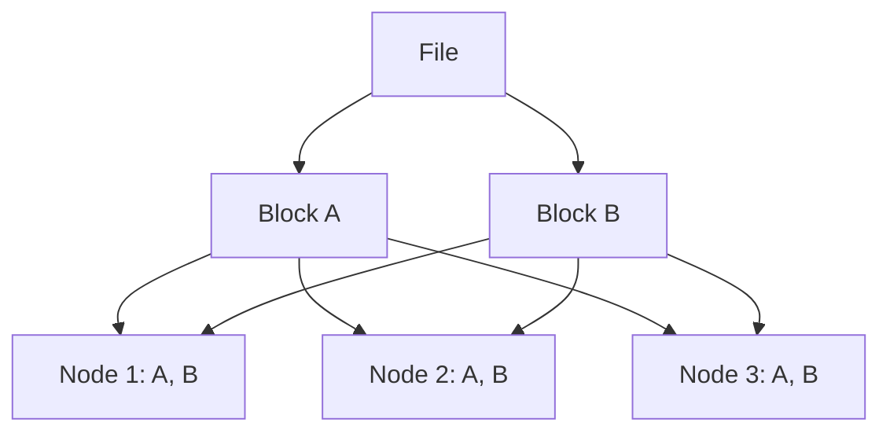
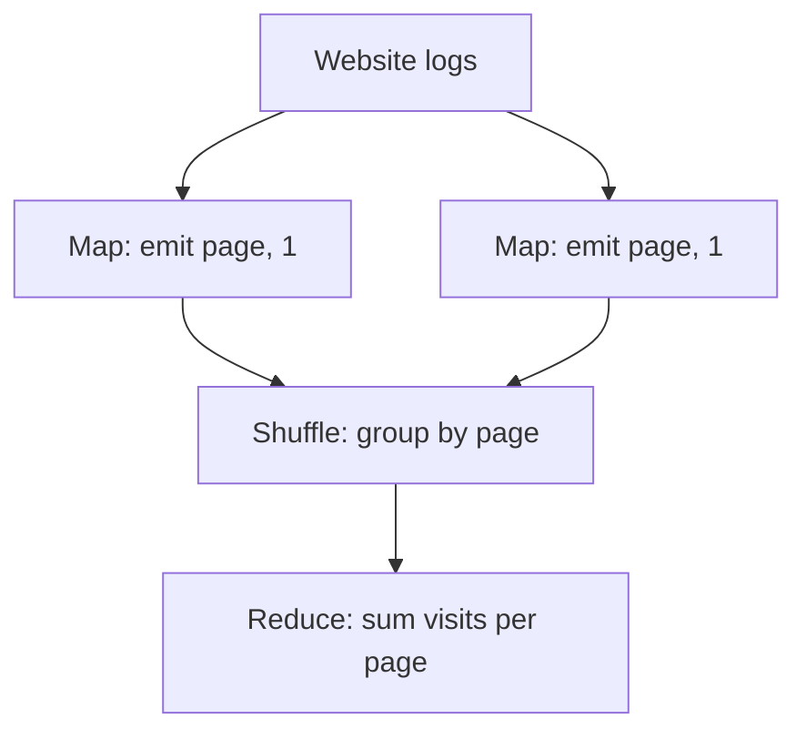

## What is Hadoop?

**Apache Hadoop is a framework for distributed storage and processing of large datasets.** A group of connected computers is called a **cluster**. Each computer is a **node**.

| Component | Purpose |
|---|---|
| **HDFS** | Distributed file system: stores data across multiple nodes. |
| **MapReduce** | Processes data in parallel and combines the results. |
| **YARN** | Allocates cluster resources and schedules tasks. |

## How does Hadoop store data?

HDFS divides files into large **blocks** and distributes them across nodes.

It uses **replication**: each block has multiple copies, usually three. If a node fails, another copy remains available. This provides **fault tolerance**.



*This simplified example shows three replicas of each block.*

## How does Hadoop process data?

**MapReduce** divides a job into parallel tasks:

1. **Map:** processes input records and produces key–value pairs.
2. **Shuffle:** groups intermediate values by key.
3. **Reduce:** combines values into final results.

For example, counting website visits per page:



Hadoop tries to run processing near the stored data. This is called **data locality**, and it reduces network traffic.

## What is Hadoop used for?

Hadoop is designed mainly for **batch processing**: process a large collection of data and receive results later.

Examples include log analysis, historical sales reports, and preparing large datasets for machine learning.

## What are its drawbacks?

- **High latency:** MapReduce has task startup overhead and frequently writes intermediate data to disk.
- **Operational complexity:** clusters require configuration, monitoring, and maintenance.
- **Small-file overhead:** many tiny files consume metadata resources in the HDFS **NameNode**.
- **Replication overhead:** three replicas require roughly three times the storage.
- **Limited record updates:** HDFS is designed mainly for large sequential reads and writes, rather than frequent updates to individual records.

## Why has the industry moved away traditional Hadoop?

**Cloud platforms and newer processing tools now have substantial adoption:**

- **Cloud adoption:** Flexera’s 2026 survey of **753 cloud decision-makers** found **73% using hybrid cloud** and **71% using cloud data warehouses**. These percentages describe surveyed organizations, not all companies worldwide. [flexera.com](https://www.flexera.com/blog/finops/flexera-2026-state-of-the-cloud-report-the-convergence-of-cloud-and-value/?utm_source=chatgpt.com)
- **Modern data platforms:** In February 2026, **Databricks reported over 20,000 organizations** using its platform and **more than 65% annual revenue growth**. [Databricks](https://www.databricks.com/company/newsroom/press-releases/databricks-grows-65-yoy-surpasses-5-4-billion-revenue-run-rate?trk=article-ssr-frontend-pulse_little-text-block\&utm_source=chatgpt.com)
- **Cloud analytics:** **Snowflake reports over 12,000 companies** using its cloud data platform. [snowflake.com](https://www.snowflake.com/en/why-snowflake/enterprise-ready/?utm_source=chatgpt.com)

# Hadoop fundamentals with Python: storage, resources, and MapReduce

## Before you start

Connect to the classroom network (`10.0.0.0/8`) and open `https://10.9.3.71:9870/`.

The certificate warning is expected because this local teaching server uses a self-signed certificate. Verify the address before continuing, then sign in:

- User: `david_4`
- Password: `king_1089_`

The protected pages are:

| Page | Address | What it shows |
| --- | --- | --- |
| HDFS NameNode | `https://10.9.3.71:9870/` | Storage, files, blocks, and DataNodes |
| YARN | `https://10.9.3.71:8088/cluster` | Workers, resources, and applications |
| JobHistory | `https://10.9.3.71:19888/jobhistory` | Completed jobs and counters |

All three use the same login.

## Shared-class rules

1. Replace `STUDENT01` with your assigned account number, for example `STUDENT12`.
2. Work only inside `/shared/STUDENT01` (your own folder).
3. Never delete or change somebody else's folder.
4. Do not add a delete operation to the program.
5. Do not store private or important files here.

## Set up Python

On Linux or macOS, check Python and create an isolated virtual environment:

```bash
python3 --version
python3 -m venv .venv
```

On Linux or macOS, install `requests` inside it with:

```bash
.venv/bin/python -m pip install requests
```

On Windows PowerShell, create it with `python -m venv .venv`, then install the package with `.venv\Scripts\python.exe -m pip install requests`.

Create `hadoop_lab.py`, paste in the starter code below, and change `STUDENT01` to your assigned number:

```python
from collections import Counter
from pathlib import Path
from pprint import pprint

import requests
import urllib3


BASE_URL = "https://10.9.3.71:9870/webhdfs/v1"
LOGIN = ("david_4", "king_1089_")
STUDENT = "STUDENT01"  # Change this.
MY_FOLDER = f"/shared/{STUDENT}"

# Only this teaching server uses verify=False. Production code should verify TLS.
urllib3.disable_warnings(urllib3.exceptions.InsecureRequestWarning)

session = requests.Session()
session.auth = LOGIN
session.verify = False


def webhdfs(method, path, operation, **parameters):
    """Send one WebHDFS request and stop if Hadoop reports an error."""
    response = session.request(
        method,
        f"{BASE_URL}{path}",
        params={"op": operation, "user.name": STUDENT, **parameters},
        timeout=30,
    )
    response.raise_for_status()
    return response
```

Each activity gives you a block to place **after** the starter code. Replace the previous activity block each time unless told otherwise. On Linux or macOS, run the file with:

```bash
.venv/bin/python hadoop_lab.py
```

On Windows PowerShell, use `.venv\Scripts\python.exe hadoop_lab.py`.

## Activity 1: list the shared folder

```python
response = webhdfs("GET", "/shared", "LISTSTATUS")
items = response.json()["FileStatuses"]["FileStatus"]

for item in items:
    print(item["type"], item["pathSuffix"])
```

`response.json()` converts JSON into Python dictionaries and lists. You should see instructor demo folders.

Question: which component knows the *names and locations* of files—the NameNode or DataNode?

## Activity 2: create your HDFS folder

```python
response = webhdfs("PUT", MY_FOLDER, "MKDIRS")
print(response.json())
```

Expected: `{'boolean': True}`. Run Activity 1 again and find your folder.

## Activity 3: create and upload a file

First let Python create a local file:

```python
local_file = Path("about-me.txt")
local_file.write_text(
    "Name: Ada\n"
    "Favourite subject: Science\n"
    "One thing I want to learn: data analysis\n",
    encoding="utf-8",
)
print(f"Created {local_file} ({local_file.stat().st_size} bytes)")
```

Change the example text to describe yourself and run it. Then replace that block with the upload code:

```python
local_file = Path("about-me.txt")
url = f"{BASE_URL}{MY_FOLDER}/about-me.txt"
query = {"op": "CREATE", "overwrite": "true", "user.name": STUDENT}

with local_file.open("rb") as file_data:
    response = session.put(
        url,
        params=query,
        data=file_data,
        allow_redirects=True,
        timeout=30,
    )

response.raise_for_status()
print("Uploaded to", f"{MY_FOLDER}/about-me.txt")
```

WebHDFS redirects the upload from the NameNode to the DataNode. `requests` follows that hand-off. `overwrite=true` lets you repeat this with your own file. Run Activity 1 again and find the file.

## Activity 4: download and compare the file

```python
local_text = Path("about-me.txt").read_text(encoding="utf-8")
response = webhdfs("GET", f"{MY_FOLDER}/about-me.txt", "OPEN")

print(response.text)
print("Copies match:", local_text == response.text)
```

Expected: `Copies match: True`. The bytes live on the DataNode; the NameNode tells the client where to find them.

## Activity 5: inspect metadata

```python
response = webhdfs("GET", f"{MY_FOLDER}/about-me.txt", "GETFILESTATUS")
status = response.json()["FileStatus"]
pprint(status)
```

Find `length`, `owner`, `permission`, `blockSize`, and `replication`. The block size is much larger than this file, but HDFS does not fill unused space with empty data.

Questions:

1. Is `length` smaller or larger than `blockSize`?
2. Why is replication `1` less safe than replication `3`?

## Activity 6: check integrity

```python
response = webhdfs("GET", f"{MY_FOLDER}/about-me.txt", "GETFILECHECKSUM")
checksum = response.json()["FileChecksum"]
pprint(checksum)
print("Checksum bytes:", checksum["bytes"])
```

Record `bytes`. Edit the local file, upload it again with Activity 3, and rerun this code.

Question: did the checksum change when the content changed?

## Activity 7: rename the file

A rename is mainly a NameNode metadata operation.

```python
response = webhdfs(
    "PUT",
    f"{MY_FOLDER}/about-me.txt",
    "RENAME",
    destination=f"{MY_FOLDER}/profile.txt",
)
print(response.json())
```

Expected: `{'boolean': True}`. Confirm it with Activity 1, then rename it back:

```python
response = webhdfs(
    "PUT",
    f"{MY_FOLDER}/profile.txt",
    "RENAME",
    destination=f"{MY_FOLDER}/about-me.txt",
)
print(response.json())
```

## Activity 8: summarize your folder

```python
response = webhdfs("GET", MY_FOLDER, "GETCONTENTSUMMARY")
summary = response.json()["ContentSummary"]
pprint(summary)
```

Find `fileCount`, `directoryCount`, `length`, and `spaceConsumed`.

Question: why are `length` and `spaceConsumed` similar on this server? Hint: check replication.

## Activity 9: understand permissions

HDFS permissions have owner, group, and other categories. With `644`, the owner can read and write while group and other can only read. With `700`, only the owner has access.

Set your folder to `700`, inspect it, then restore `755`:

```python
webhdfs("PUT", MY_FOLDER, "SETPERMISSION", permission="700")
response = webhdfs("GET", MY_FOLDER, "GETFILESTATUS")
print("Temporary permission:", response.json()["FileStatus"]["permission"])

webhdfs("PUT", MY_FOLDER, "SETPERMISSION", permission="755")
response = webhdfs("GET", MY_FOLDER, "GETFILESTATUS")
print("Restored permission:", response.json()["FileStatus"]["permission"])
```

This class uses Hadoop's “simple” user mode behind one shared web password. Anyone can supply another `user.name`, so this demonstrates permissions but is not strong identity security.

## Activity 10: inspect HDFS in the browser

Open `https://10.9.3.71:9870/` and sign in.

1. Find **Datanodes** and confirm one node is live.
2. Find configured capacity, used space, and remaining space.
3. Open **Utilities → Browse the file system**.
4. Browse to `/shared`, then your folder.
5. Browse to `/shared/INSTRUCTOR_DEMO/wordcount-input/words.txt`.

Question: what happens to the files if the only DataNode is permanently lost?

## Activity 11: verify WordCount with Python

The instructor prepared this input:

```text
hadoop stores data
hadoop processes data
yarn schedules work
data data data
```

MapReduce first **maps** each word to a pair such as `(data, 1)`, then **reduces** equal words by adding their values. Predict the counts for `data`, `hadoop`, and `yarn`.

Read the real HDFS input and calculate the result locally:

```python
input_path = "/shared/INSTRUCTOR_DEMO/wordcount-input/words.txt"
input_text = webhdfs("GET", input_path, "OPEN").text
print("Input from HDFS:\n" + input_text)

# Map
mapped_pairs = [(word, 1) for word in input_text.split()]
print("Mapped pairs:", mapped_pairs)

# Reduce
local_counts = Counter(word for word, value in mapped_pairs)
print("Local Python result:")
for word in sorted(local_counts):
    print(word, local_counts[word])
```

This code runs on your computer. It demonstrates the algorithm but is **not** a distributed Hadoop job. Now read the output of the real MapReduce job that ran through YARN:

```python
output_path = "/shared/INSTRUCTOR_DEMO/wordcount-output/part-r-00000"
hadoop_output = webhdfs("GET", output_path, "OPEN").text
print("Hadoop MapReduce result:\n" + hadoop_output)
```

Expected counts:

```text
data      5
hadoop    2
processes 1
schedules 1
stores    1
work      1
yarn      1
```

Question: do the local Python result and distributed Hadoop result agree?

## Activity 12: follow the job through YARN

Open `https://10.9.3.71:8088/cluster` and sign in.

YARN gives CPU and memory to applications and asks NodeManagers to run their containers. A YARN **container** is a bundle of resources for a task; it is not a Docker container.

1. Find the number of active nodes in **Cluster Metrics**.
2. Confirm there is one active NodeManager.
3. Open **Applications → FINISHED**.
4. Find the application named `word count`.
5. Confirm its final status is `SUCCEEDED`.

Questions:

1. Which accepted the application: ResourceManager or DataNode?
2. Which supplied task resources: NodeManager or NameNode?

## Activity 13: inspect JobHistory

Open `https://10.9.3.71:19888/jobhistory`, sign in, and open the completed WordCount job. Find:

- Map tasks: `1`.
- Reduce tasks: `1`.
- Map input records: `4` (four lines).
- Map output records: `12` (twelve words).
- Reduce output records: `7` (seven different words).
- Job state: `SUCCEEDED`.

Counters measure how much data was read and produced and whether tasks failed, without changing the program.

## Activity 14: connect the workflows

Put the MapReduce steps in order:

- ___ The reducer writes final count files into HDFS.
- ___ The client submits an application to YARN.
- ___ The mapper reads input blocks from HDFS.
- ___ The NameNode supplies input locations.
- ___ The ResourceManager assigns resources on a NodeManager.
- ___ Equal intermediate keys are shuffled together.

Correct order: NameNode locations → submission → resource assignment → map → shuffle → reduce/output.

The Python/WebHDFS path is separate: Python request → NameNode location → DataNode data.

## Instructor-led live run (optional)

Students watch YARN while the instructor runs the built-in example from the Docker host:

```bash
docker exec codex-hadoop-namenode hadoop jar \
  /opt/hadoop/share/hadoop/mapreduce/hadoop-mapreduce-examples-3.4.1.jar \
  wordcount \
  /shared/INSTRUCTOR_DEMO/wordcount-input \
  /shared/INSTRUCTOR_DEMO/wordcount-output-live
```

Refresh YARN and JobHistory, then read the result with Python:

```python
path = "/shared/INSTRUCTOR_DEMO/wordcount-output-live/part-r-00000"
print(webhdfs("GET", path, "OPEN").text)
```

The output path must be new. If it exists, use a name such as `wordcount-output-live-2`; Hadoop refuses to overwrite job output.

## What you learned

- Python can use HTTPS and JSON to work with WebHDFS.
- The NameNode manages paths and metadata; DataNodes store file bytes.
- Hadoop stores large data in blocks and normally replicates it for reliability.
- This one-DataNode, replication-1 server is for learning, not production storage.
- YARN schedules applications and allocates worker resources.
- MapReduce maps records, shuffles matching keys, reduces values, and writes HDFS output.
- Local Python can demonstrate the algorithm, but only the Hadoop job is distributed through YARN.
- JobHistory and counters explain completed work.
