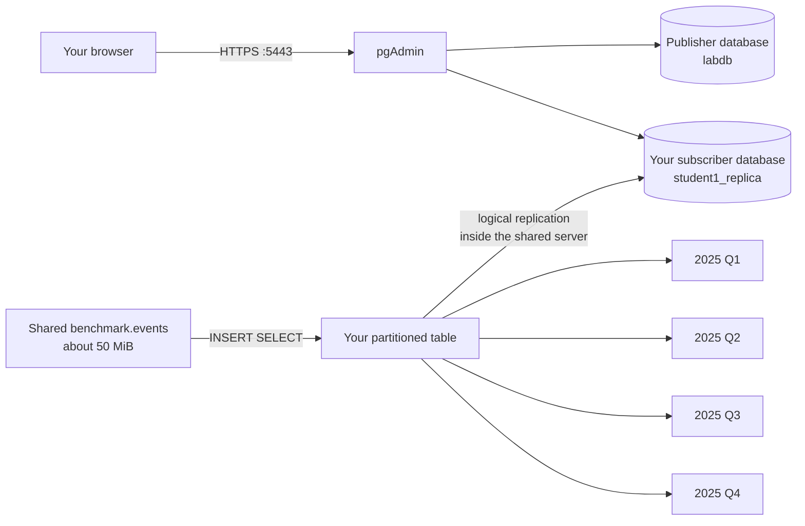
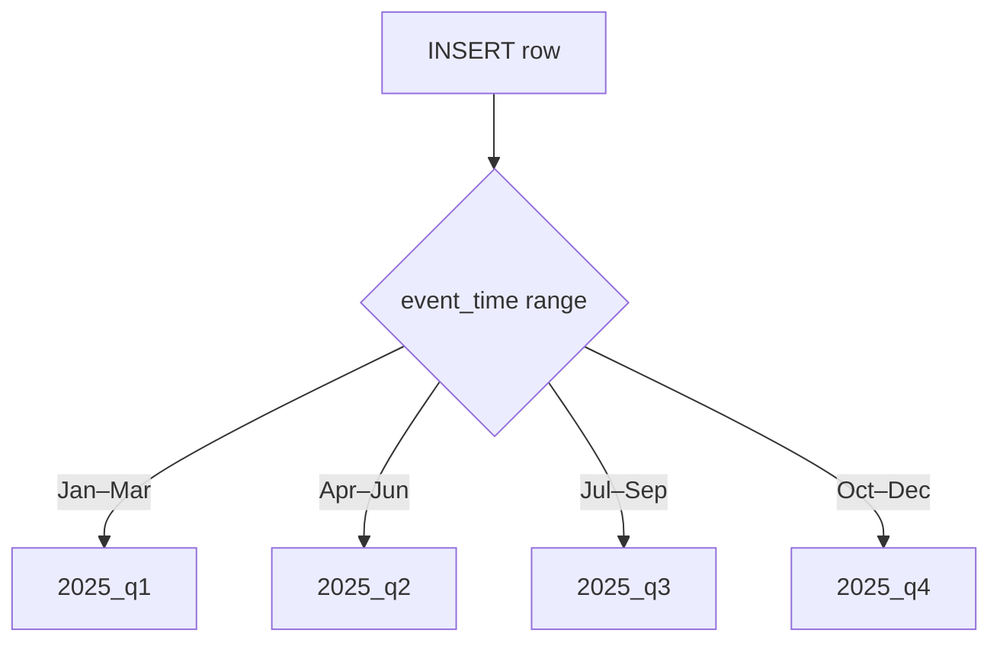
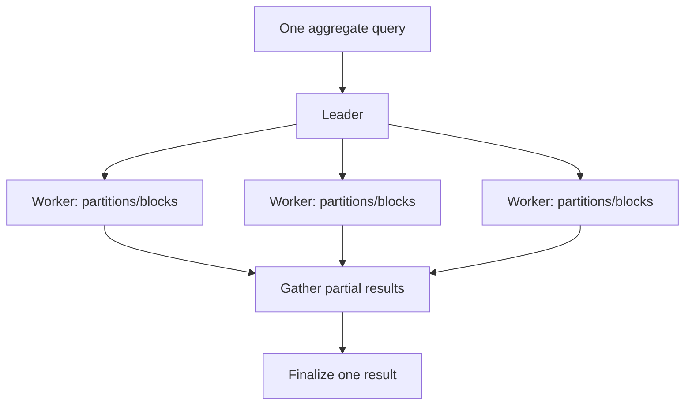
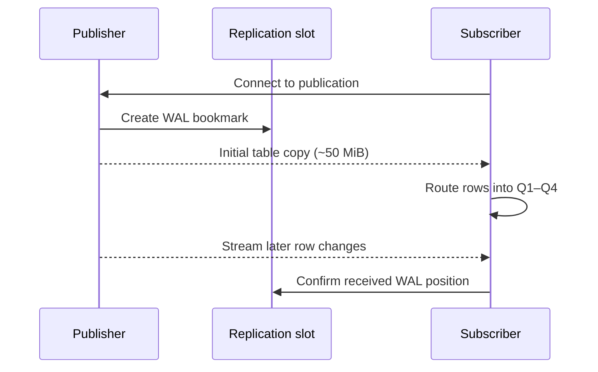

# PostgreSQL lab: partition, parallelize, and replicate 50 MiB

In this lab you will use pgAdmin in a browser to make a personal, partitioned copy of a shared dataset and logically replicate it to a separate database on the shared PostgreSQL server. You do **not** need Docker, PostgreSQL, or `psql` installed on your computer. Allow 60–90 minutes.

## The finished system

The classroom server runs pgAdmin and one PostgreSQL instance. The publisher and subscriber are separate databases in that instance. Keeping them in separate databases is essential because logical replication identifies a table by its schema and table name.



You will learn three different ideas:

| Idea | Plain-English meaning |
| --- | --- |
| Partitioning | One logical table is stored as smaller child tables according to a rule. |
| Parallel query | Several PostgreSQL worker processes cooperate on one query. |
| Logical replication | Selected table changes are copied to another PostgreSQL database. |

Partitioning is not replication: partitions divide rows. Replication is not parallel query: it makes another copy. Parallel query does not create another stored copy.

## Your assigned identity

Use one row only. All examples below are for Student 1.

| Student | Database user | Database password | Publisher schema/table | Publication | Subscriber database | Subscription/slot |
| --- | --- | --- | --- | --- | --- | --- |
| 1 | `student1` | `student1_replica_2026` | `student1.student1_readings` | `student1_publication` | `student1_replica` | `student1_subscription` |
| 2 | `student2` | `student2_replica_2026` | `student2.student2_readings` | `student2_publication` | `student2_replica` | `student2_subscription` |
| 3 | `student3` | `student3_replica_2026` | `student3.student3_readings` | `student3_publication` | `student3_replica` | `student3_subscription` |

If you are Student 2 or 3, replace **every** `student1` in the examples with `student2` or `student3`, including database, table, publication, subscription, and slot names. Use your matching password.

> **Instructor prerequisite:** Before the lab, create one empty subscriber database per student (`student1_replica`, and so on), owned by the matching student, and make it visible through that student's pgAdmin server connection. Each student role needs `CREATE` on its subscriber database, membership in `pg_create_subscription`, the `LOGIN` and `REPLICATION` role attributes, and `SELECT` on its published source table. The server also needs logical replication and enough replication slots/workers enabled. Students should not create or administer these databases themselves.

## 1. Check pgAdmin and the network

Join the classroom LAN and browse to:

```text
https://10.9.3.71:5443/
```

If the page does not open, check that you are on the classroom network and ask the instructor. Your computer only needs browser access to pgAdmin; it does not need a direct PostgreSQL connection on port 5432.

## 2. Open pgAdmin

1. This private lab uses a self-signed certificate. Check the exact address, then accept the warning.
2. Web login: `postgres@lab.edu` / `this_is_not_p@ssword`.
3. Expand **Servers → PostgreSQL classroom lab**.
4. Select **Publisher as student1** (or your assigned number).
5. Enter your student database password from the table. Do not save it on a shared machine.
6. Expand **Databases → labdb**, right-click `labdb`, and choose **Query Tool**.

The pgAdmin web login opens the application. The separate student database login controls which database objects you can change.

Run this source-server check:

```sql
SELECT current_user, current_database(), version();

SELECT count(*) AS rows,
       pg_size_pretty(pg_total_relation_size('benchmark.events')) AS stored_size
FROM benchmark.events;
```

Expected: user `student1`, database `labdb`, and approximately 50 MiB. The loader stops after crossing 50 MiB, so a small overshoot is normal.

Keep this browser tab open. It is the **publisher Query Tool**. In later steps you will open a second Query Tool connected to your subscriber database. Always check the database shown in the Query Tool title before running SQL.

## 3. Create your personally named partitioned table

In pgAdmin's Query Tool, run this entire block after making all required student-number replacements:

```sql
CREATE TABLE student1.student1_readings (
    event_id bigint NOT NULL,
    event_time timestamptz NOT NULL,
    device_id integer NOT NULL,
    region text NOT NULL,
    reading double precision NOT NULL,
    payload text NOT NULL,
    PRIMARY KEY (event_id, event_time)
) PARTITION BY RANGE (event_time);

CREATE TABLE student1.student1_readings_2025_q1
PARTITION OF student1.student1_readings
FOR VALUES FROM ('2025-01-01') TO ('2025-04-01');

CREATE TABLE student1.student1_readings_2025_q2
PARTITION OF student1.student1_readings
FOR VALUES FROM ('2025-04-01') TO ('2025-07-01');

CREATE TABLE student1.student1_readings_2025_q3
PARTITION OF student1.student1_readings
FOR VALUES FROM ('2025-07-01') TO ('2025-10-01');

CREATE TABLE student1.student1_readings_2025_q4
PARTITION OF student1.student1_readings
FOR VALUES FROM ('2025-10-01') TO ('2026-01-01');

CREATE INDEX student1_readings_device_idx
ON student1.student1_readings (device_id);
```

The parent is a logical routing table. Each range has an inclusive `FROM` and exclusive `TO`; for example, midnight on April 1 belongs to Q2. PostgreSQL requires every unique/primary-key constraint on a range-partitioned table to include the partition key, so this primary key contains both `event_id` and `event_time`.

Copy the shared rows into your table:

```sql
INSERT INTO student1.student1_readings
    (event_id, event_time, device_id, region, reading, payload)
SELECT event_id, event_time, device_id, region, reading, payload
FROM benchmark.events;
```

You now own a separate personal copy. Confirm that PostgreSQL routed rows into four physical partitions:

```sql
SELECT tableoid::regclass AS physical_partition, count(*) AS rows
FROM student1.student1_readings
GROUP BY tableoid
ORDER BY physical_partition;

SELECT pg_size_pretty(sum(pg_total_relation_size(relid))) AS all_partitions_size
FROM pg_partition_tree('student1.student1_readings')
WHERE isleaf;
```

Expected: four partition rows and roughly 50 MiB or more. Index/row-layout differences mean it need not equal the shared table byte-for-byte.



## 4. Observe partition pruning and parallel query

First request only May. PostgreSQL can prune Q1, Q3, and Q4 before scanning:

```sql
EXPLAIN (ANALYZE, BUFFERS)
SELECT avg(reading)
FROM student1.student1_readings
WHERE event_time >= '2025-05-01'
  AND event_time <  '2025-06-01';
```

Find the Q2 partition name in the plan and verify the other three are absent. This is **partition pruning**.

Now make parallel work easy to see for this teaching session, then scan all partitions:

```sql
SET max_parallel_workers_per_gather = 4;
SET min_parallel_table_scan_size = 0;
SET parallel_setup_cost = 0;
SET parallel_tuple_cost = 0;

EXPLAIN (ANALYZE, BUFFERS)
SELECT region, avg(reading), count(*)
FROM student1.student1_readings
GROUP BY region;
```

Look for `Gather`, `Workers Planned`, `Workers Launched`, `Partial Aggregate`, `Parallel Append`, or `Parallel Seq Scan`. The planner may choose fewer than four workers. These `SET` commands affect only your session and deliberately influence planner costs for demonstration; they are not production tuning advice.



## 5. Publish your partitioned root

Still in the publisher Query Tool, run:

```sql
CREATE PUBLICATION student1_publication
FOR TABLE student1.student1_readings
WITH (
    publish = 'insert, update, delete, truncate',
    publish_via_partition_root = true
);
```

`publish_via_partition_root=true` publishes changes using the parent table's identity. The subscriber can route incoming rows through its own partitioned parent.

Check that you published only your table:

```sql
SELECT pubname, pubviaroot
FROM pg_publication
WHERE pubname = 'student1_publication';

SELECT schemaname, tablename
FROM pg_publication_tables
WHERE pubname = 'student1_publication';
```

A publication selects changes; it does not create or send anything until a subscriber connects.

## 6. Prepare your shared subscriber database in pgAdmin

In the pgAdmin object browser, expand **Databases**, right-click your assigned subscriber database (`student1_replica` for Student 1), and choose **Query Tool**. This opens a second Query Tool tab. Before doing anything else, run:

```sql
SELECT current_user, current_database();
```

Expected: user `student1` and database `student1_replica`. Stop and select the correct database if either value is wrong.

Logical replication copies data changes, but it does not copy schemas, table definitions, partitions, or indexes. In this **subscriber Query Tool**, create the destination schema, parent, and four children:

```sql
CREATE SCHEMA student1;

CREATE TABLE student1.student1_readings (
    event_id bigint NOT NULL,
    event_time timestamptz NOT NULL,
    device_id integer NOT NULL,
    region text NOT NULL,
    reading double precision NOT NULL,
    payload text NOT NULL,
    PRIMARY KEY (event_id, event_time)
) PARTITION BY RANGE (event_time);

CREATE TABLE student1.student1_readings_2025_q1
PARTITION OF student1.student1_readings
FOR VALUES FROM ('2025-01-01') TO ('2025-04-01');

CREATE TABLE student1.student1_readings_2025_q2
PARTITION OF student1.student1_readings
FOR VALUES FROM ('2025-04-01') TO ('2025-07-01');

CREATE TABLE student1.student1_readings_2025_q3
PARTITION OF student1.student1_readings
FOR VALUES FROM ('2025-07-01') TO ('2025-10-01');

CREATE TABLE student1.student1_readings_2025_q4
PARTITION OF student1.student1_readings
FOR VALUES FROM ('2025-10-01') TO ('2026-01-01');

CREATE INDEX student1_readings_device_idx
ON student1.student1_readings (device_id);
```

Confirm that the subscriber table starts empty:

```sql
SELECT count(*) AS subscriber_rows
FROM student1.student1_readings;
```

Expected: `0`.

## 7. Create the subscription and copy about 50 MiB

The publisher and subscriber databases are on the same PostgreSQL instance. PostgreSQL cannot create the replication slot as part of `CREATE SUBSCRIPTION` in this arrangement because the command can wait on its own transaction. Therefore, create the slot separately on the publisher first.

Return to the **publisher Query Tool** connected to `labdb`. Verify the database, then create the slot:

```sql
SELECT current_database();

SELECT *
FROM pg_create_logical_replication_slot(
    'student1_subscription',
    'pgoutput'
);
```

Expected: database `labdb`, slot name `student1_subscription`, and an LSN. A replication slot is a durable WAL bookmark.

Now return to the **subscriber Query Tool** connected to `student1_replica` and run:

```sql
SELECT current_database();

CREATE SUBSCRIPTION student1_subscription
CONNECTION 'host=10.9.3.71 port=5432 dbname=labdb user=student1 password=student1_replica_2026 sslmode=require application_name=student1_subscription'
PUBLICATION student1_publication
WITH (
    copy_data = true,
    create_slot = false,
    slot_name = 'student1_subscription',
    enabled = true
);
```

Expected: database `student1_replica` and `CREATE SUBSCRIPTION`. The subscription uses the existing slot, performs the initial copy, and starts an apply worker.

In the publisher Query Tool, get the source count:

```sql
SELECT count(*) AS publisher_rows
FROM student1.student1_readings;
```

In the subscriber Query Tool, rerun this query until its value equals the publisher count:

```sql
SELECT count(*) AS subscriber_rows
FROM student1.student1_readings;
```

Replication is asynchronous, so the initial copy may take a little time. Click pgAdmin's **Execute/Refresh** button to run the count again; do not recreate the subscription.

Still in the subscriber Query Tool, check that incoming rows were routed into four partitions:

```sql
SELECT tableoid::regclass AS partition, count(*) AS rows
FROM student1.student1_readings
GROUP BY tableoid
ORDER BY partition;
```

Check the subscriber worker:

```sql
SELECT subname, pid, received_lsn, latest_end_lsn, latest_end_time
FROM pg_stat_subscription
WHERE subname = 'student1_subscription';
```

Expected: one row with a non-empty `pid`. LSN values are positions in WAL, not row numbers.



## 8. Prove new changes replicate

In the **source pgAdmin Query Tool**, insert a Q2 row:

```sql
INSERT INTO student1.student1_readings
    (event_id, event_time, device_id, region, reading, payload)
SELECT max(event_id) + 1,
       '2025-05-15 12:00:00+00',
       4242,
       'east',
       123.45,
       'created after subscription'
FROM student1.student1_readings;
```

In the **subscriber Query Tool** connected to `student1_replica`, find it and its physical partition:

```sql
SELECT tableoid::regclass AS partition,
       event_id,
       event_time,
       device_id,
       reading
FROM student1.student1_readings
WHERE device_id = 4242
  AND payload = 'created after subscription';
```

Expected: it appears in `student1_readings_2025_q2`. Replication is asynchronous, so repeat after one second if needed.

Do not write into the subscriber table. Logical replication does not resolve conflicts; a local duplicate primary key can stop the apply worker.

## Theory and limitations

Logical replication uses publish/subscribe and sends row-level changes derived from WAL. Physical replication copies the whole cluster at a lower level. Logical replication is a good fit here because each student selects one table.

- DDL, schemas, partitions, users, permissions, and sequence state are not replicated.
- The subscriber table must already exist with compatible columns and partition ranges.
- The composite primary key is the replication identity used to locate updated/deleted rows.
- Replication is asynchronous, so brief lag is normal.
- An abandoned slot keeps WAL on the publisher and can fill its disk.
- `sslmode=require` encrypts traffic but does not verify this self-signed server's identity. Production should use a trusted CA and `sslmode=verify-full`.
- The classroom `REPLICATION` role is powerful. This setup belongs only on an isolated teaching LAN, not the Internet or a hostile shared environment.
