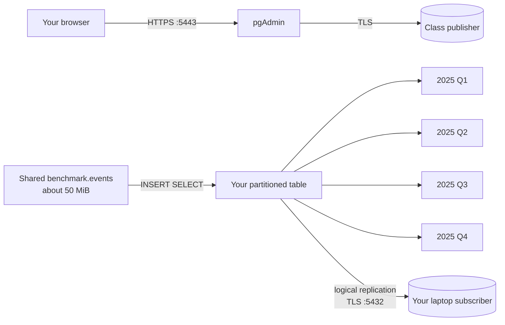
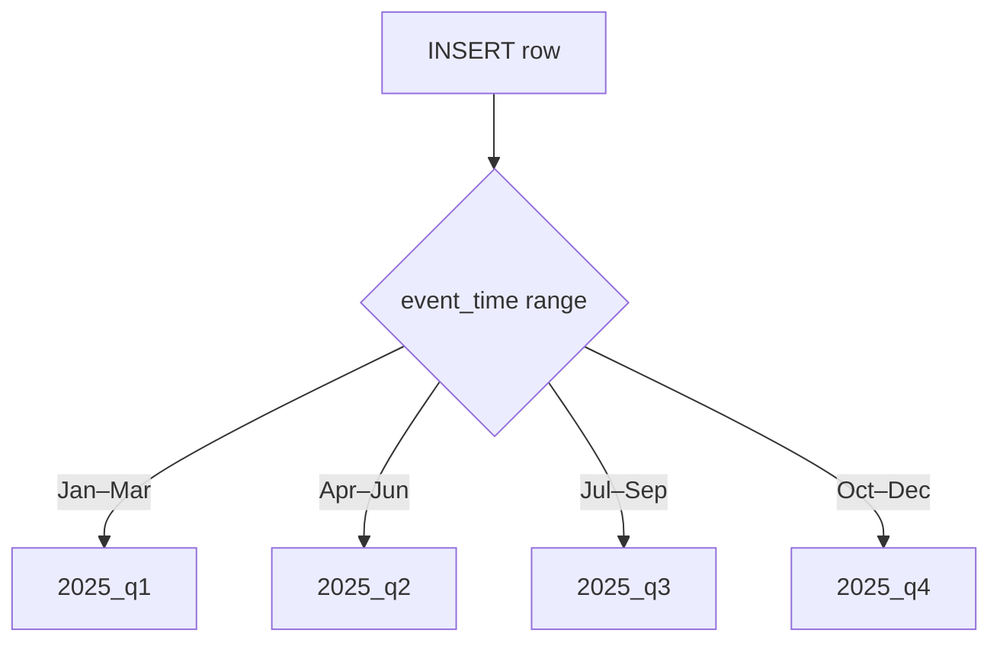
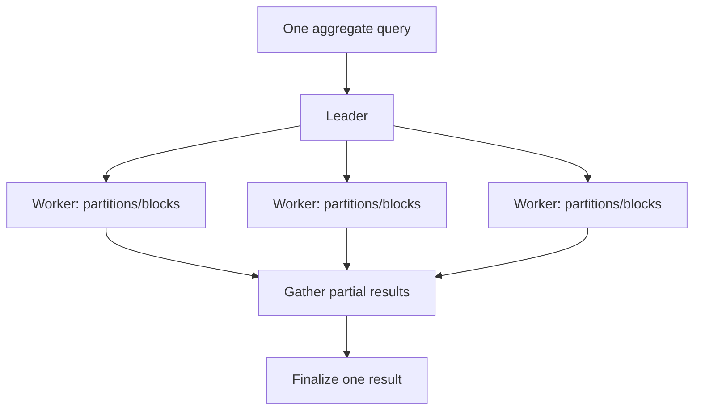
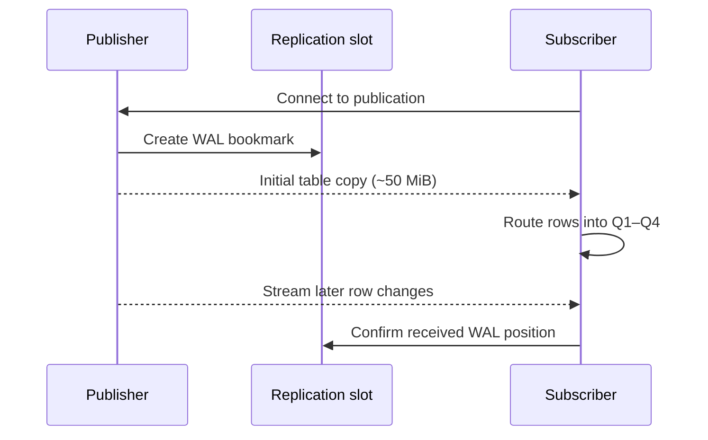

# PostgreSQL lab: partition, parallelize, and replicate 50 MiB

In this lab you will use a browser and Docker to make a personal, partitioned copy of a shared dataset and logically replicate it to your laptop. You do **not** need PostgreSQL or `psql` installed: the Docker image contains the client. Allow 60–90 minutes.

## The finished system

The classroom server runs PostgreSQL (the publisher) and pgAdmin over HTTPS. Your laptop runs a PostgreSQL subscriber.



You will learn three different ideas:

| Idea | Plain-English meaning |
| --- | --- |
| Partitioning | One logical table is stored as smaller child tables according to a rule. |
| Parallel query | Several PostgreSQL worker processes cooperate on one query. |
| Logical replication | Selected table changes are copied to another PostgreSQL database. |

Partitioning is not replication: partitions divide rows. Replication is not parallel query: it makes another copy. Parallel query does not create another stored copy.

## Your assigned identity

Use one row only. All examples below are for Student 1.

| Student | Database user | Database password | Schema/table | Publication | Local container/subscription |
| --- | --- | --- | --- | --- | --- |
| 1 | `student1` | `student1_replica_2026` | `student1.student1_readings` | `student1_publication` | `student1_subscription` |
| 2 | `student2` | `student2_replica_2026` | `student2.student2_readings` | `student2_publication` | `student2_subscription` |
| 3 | `student3` | `student3_replica_2026` | `student3.student3_readings` | `student3_publication` | `student3_subscription` |

If you are Student 2 or 3, replace **every** `student1` in commands with `student2` or `student3`, including inside table, publication, subscription, and container names. Use your matching password.

## 1. Check Docker and the network

Join the classroom LAN, start Docker Desktop/Engine, and run in Terminal, PowerShell, or Command Prompt:

```text
docker version
```

Both Client and Server sections must appear. Then test TCP 5432:

- Windows PowerShell: `Test-NetConnection 10.9.3.71 -Port 5432`
- Linux/macOS with Netcat: `nc -vz 10.9.3.71 5432`

If it times out, check the classroom network and ask the instructor.

## 2. Open pgAdmin

1. Browse to `https://10.9.3.71:5443/`.
2. This private lab uses a self-signed certificate. Check the exact address, then accept the warning.
3. Web login: `postgres@lab.edu` / `this_is_not_p@ssword`.
4. Expand **Servers → PostgreSQL classroom lab**.
5. Select only **Publisher as student1** (or your assigned number).
6. Enter your student database password from the table. Do not save it on a shared machine.
7. Expand **Databases → labdb** and choose **Tools → Query Tool**.

The pgAdmin web login opens the application. The separate student database login controls which database objects you can change.

Run this source-server check:

```sql
SELECT current_user, current_database(), version();

SELECT count(*) AS rows,
       pg_size_pretty(pg_total_relation_size('benchmark.events')) AS stored_size
FROM benchmark.events;
```

Expected: user `student1`, database `labdb`, and approximately 50 MiB. The loader stops after crossing 50 MiB, so a small overshoot is normal.

## 3. Create your personally named partitioned table

In pgAdmin's Query Tool, run this entire block after making all required student-number replacements:

```sql
CREATE TABLE student1.student1_readings (
    event_id bigint NOT NULL,
    event_time timestamptz NOT NULL,
    device_id integer NOT NULL,
    region text NOT NULL,
    reading double precision NOT NULL,
    payload text NOT NULL,
    PRIMARY KEY (event_id, event_time)
) PARTITION BY RANGE (event_time);

CREATE TABLE student1.student1_readings_2025_q1
PARTITION OF student1.student1_readings
FOR VALUES FROM ('2025-01-01') TO ('2025-04-01');

CREATE TABLE student1.student1_readings_2025_q2
PARTITION OF student1.student1_readings
FOR VALUES FROM ('2025-04-01') TO ('2025-07-01');

CREATE TABLE student1.student1_readings_2025_q3
PARTITION OF student1.student1_readings
FOR VALUES FROM ('2025-07-01') TO ('2025-10-01');

CREATE TABLE student1.student1_readings_2025_q4
PARTITION OF student1.student1_readings
FOR VALUES FROM ('2025-10-01') TO ('2026-01-01');

CREATE INDEX student1_readings_device_idx
ON student1.student1_readings (device_id);
```

The parent is a logical routing table. Each range has an inclusive `FROM` and exclusive `TO`; for example, midnight on April 1 belongs to Q2. PostgreSQL requires every unique/primary-key constraint on a range-partitioned table to include the partition key, so this primary key contains both `event_id` and `event_time`.

Copy the shared rows into your table:

```sql
INSERT INTO student1.student1_readings
    (event_id, event_time, device_id, region, reading, payload)
SELECT event_id, event_time, device_id, region, reading, payload
FROM benchmark.events;
```

You now own a separate personal copy. Confirm that PostgreSQL routed rows into four physical partitions:

```sql
SELECT tableoid::regclass AS physical_partition, count(*) AS rows
FROM student1.student1_readings
GROUP BY tableoid
ORDER BY physical_partition;

SELECT pg_size_pretty(sum(pg_total_relation_size(relid))) AS all_partitions_size
FROM pg_partition_tree('student1.student1_readings')
WHERE isleaf;
```

Expected: four partition rows and roughly 50 MiB or more. Index/row-layout differences mean it need not equal the shared table byte-for-byte.



## 4. Observe partition pruning and parallel query

First request only May. PostgreSQL can prune Q1, Q3, and Q4 before scanning:

```sql
EXPLAIN (ANALYZE, BUFFERS)
SELECT avg(reading)
FROM student1.student1_readings
WHERE event_time >= '2025-05-01'
  AND event_time <  '2025-06-01';
```

Find the Q2 partition name in the plan and verify the other three are absent. This is **partition pruning**.

Now make parallel work easy to see for this teaching session, then scan all partitions:

```sql
SET max_parallel_workers_per_gather = 4;
SET min_parallel_table_scan_size = 0;
SET parallel_setup_cost = 0;
SET parallel_tuple_cost = 0;

EXPLAIN (ANALYZE, BUFFERS)
SELECT region, avg(reading), count(*)
FROM student1.student1_readings
GROUP BY region;
```

Look for `Gather`, `Workers Planned`, `Workers Launched`, `Partial Aggregate`, `Parallel Append`, or `Parallel Seq Scan`. The planner may choose fewer than four workers. These `SET` commands affect only your session and deliberately influence planner costs for demonstration; they are not production tuning advice.



## 5. Publish your partitioned root

Still in the publisher Query Tool, run:

```sql
CREATE PUBLICATION student1_publication
FOR TABLE student1.student1_readings
WITH (
    publish = 'insert, update, delete, truncate',
    publish_via_partition_root = true
);
```

`publish_via_partition_root=true` publishes changes using the parent table's identity. The subscriber can route incoming rows through its own partitioned parent.

Check that you published only your table:

```sql
SELECT pubname, pubviaroot
FROM pg_publication
WHERE pubname = 'student1_publication';

SELECT schemaname, tablename
FROM pg_publication_tables
WHERE pubname = 'student1_publication';
```

A publication selects changes; it does not create or send anything until a subscriber connects.

## 6. Start a PostgreSQL subscriber on your laptop

Run locally. Downloading the image the first time can take several minutes:

```text
docker run --name student1_subscription -e POSTGRES_PASSWORD=local_only_password -e POSTGRES_DB=labdb -p 55432:5432 -d postgres:18-bookworm
```

Wait for readiness:

```text
docker exec student1_subscription pg_isready -U postgres -d labdb
```

Expected: `accepting connections`.

Logical replication does not copy table definitions or partitions. Create the destination schema, parent, and four children yourself:

```text
docker exec student1_subscription psql -U postgres -d labdb -v ON_ERROR_STOP=1 -c "CREATE SCHEMA student1; CREATE TABLE student1.student1_readings (event_id bigint NOT NULL, event_time timestamptz NOT NULL, device_id integer NOT NULL, region text NOT NULL, reading double precision NOT NULL, payload text NOT NULL, PRIMARY KEY (event_id, event_time)) PARTITION BY RANGE (event_time); CREATE TABLE student1.student1_readings_2025_q1 PARTITION OF student1.student1_readings FOR VALUES FROM ('2025-01-01') TO ('2025-04-01'); CREATE TABLE student1.student1_readings_2025_q2 PARTITION OF student1.student1_readings FOR VALUES FROM ('2025-04-01') TO ('2025-07-01'); CREATE TABLE student1.student1_readings_2025_q3 PARTITION OF student1.student1_readings FOR VALUES FROM ('2025-07-01') TO ('2025-10-01'); CREATE TABLE student1.student1_readings_2025_q4 PARTITION OF student1.student1_readings FOR VALUES FROM ('2025-10-01') TO ('2026-01-01'); CREATE INDEX student1_readings_device_idx ON student1.student1_readings (device_id);"
```

Confirm that the local table is empty:

```text
docker exec student1_subscription psql -U postgres -d labdb -c "SELECT count(*) FROM student1.student1_readings;"
```

Expected: `0`.

## 7. Create the subscription and copy about 50 MiB

Run this locally as one line:

```text
docker exec student1_subscription psql -U postgres -d labdb -v ON_ERROR_STOP=1 -c "CREATE SUBSCRIPTION student1_subscription CONNECTION 'host=10.9.3.71 port=5432 dbname=labdb user=student1 password=student1_replica_2026 sslmode=require application_name=student1_subscription' PUBLICATION student1_publication WITH (copy_data=true, create_slot=true, enabled=true);"
```

The subscription creates a durable replication slot, performs the initial copy, and starts an apply worker. Wait until the local count equals the source count:

```text
docker exec student1_subscription psql -U postgres -d labdb -c "SELECT count(*) FROM student1.student1_readings;"
```

Check that the subscriber also routed rows into four partitions:

```text
docker exec student1_subscription psql -U postgres -d labdb -c "SELECT tableoid::regclass AS partition, count(*) FROM student1.student1_readings GROUP BY tableoid ORDER BY partition;"
```

Check the subscriber worker:

```text
docker exec student1_subscription psql -U postgres -d labdb -x -c "SELECT subname, pid, received_lsn, latest_end_lsn, latest_end_time FROM pg_stat_subscription;"
```

Expected: a non-empty `pid`. LSN values are positions in WAL, not row numbers.



## 8. Prove new changes replicate

In the **source pgAdmin Query Tool**, insert a Q2 row:

```sql
INSERT INTO student1.student1_readings
    (event_id, event_time, device_id, region, reading, payload)
SELECT max(event_id) + 1,
       '2025-05-15 12:00:00+00',
       4242,
       'east',
       123.45,
       'created after subscription'
FROM student1.student1_readings;
```

On your computer, find it and its physical partition:

```text
docker exec student1_subscription psql -U postgres -d labdb -c "SELECT tableoid::regclass AS partition, event_id, event_time, device_id, reading FROM student1.student1_readings WHERE device_id=4242 AND payload='created after subscription';"
```

Expected: it appears in `student1_readings_2025_q2`. Replication is asynchronous, so repeat after one second if needed.

Do not write into the subscriber table. Logical replication does not resolve conflicts; a local duplicate primary key can stop the apply worker.

## Theory and limitations

Logical replication uses publish/subscribe and sends row-level changes derived from WAL. Physical replication copies the whole cluster at a lower level. Logical replication is a good fit here because each student selects one table.

- DDL, schemas, partitions, users, permissions, and sequence state are not replicated.
- The subscriber table must already exist with compatible columns and partition ranges.
- The composite primary key is the replication identity used to locate updated/deleted rows.
- Replication is asynchronous, so brief lag is normal.
- An abandoned slot keeps WAL on the publisher and can fill its disk.
- `sslmode=require` encrypts traffic but does not verify this self-signed server's identity. Production should use a trusted CA and `sslmode=verify-full`.
- The classroom `REPLICATION` role is powerful. This setup belongs only on an isolated teaching LAN, not the Internet or a hostile shared environment.
