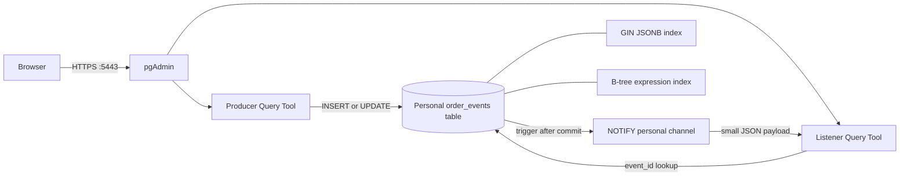
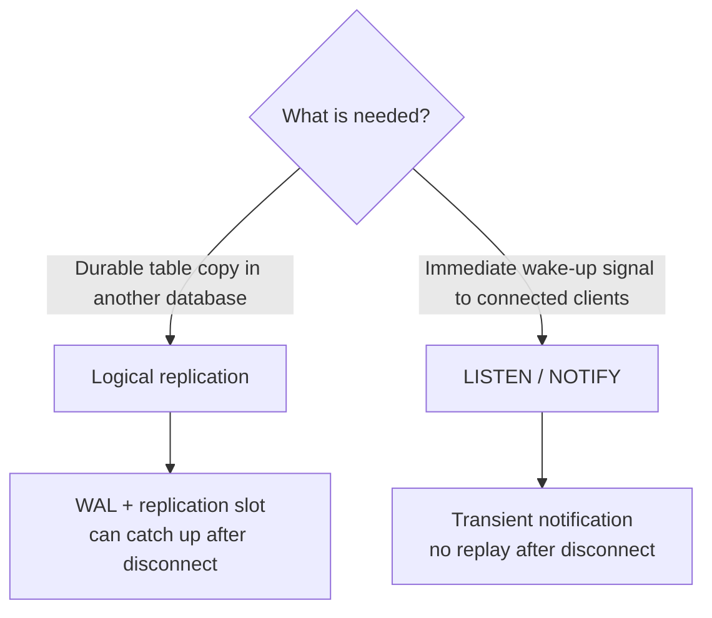
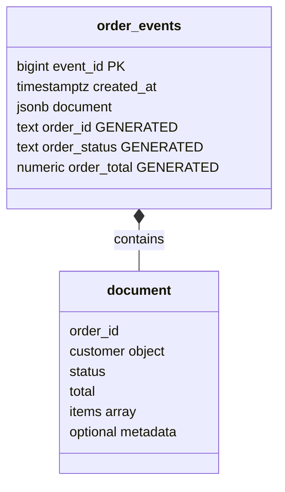
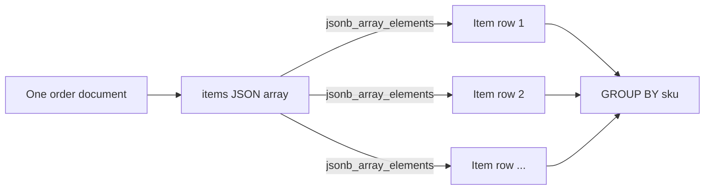
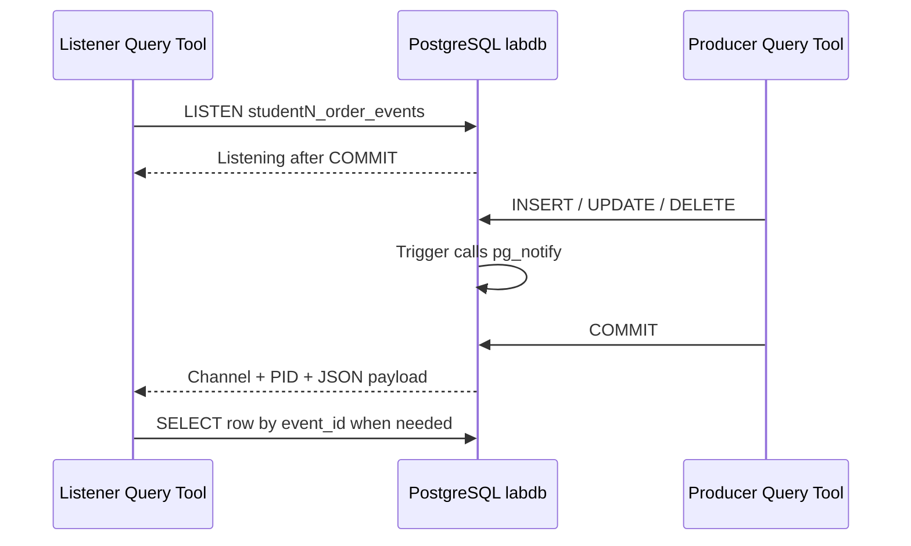
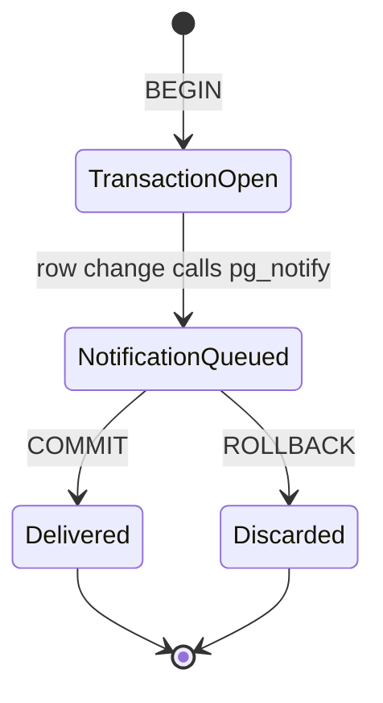

# PostgreSQL lab: JSONB analytics and live publish/subscribe

In this lab you will build a semi-structured order-event store, query and index JSON documents, and publish live change notifications to a second pgAdmin session. You need only a browser.

This is the companion to `POSTGRES_STUDENT_LAB.md`. That lab uses logical publication/subscription to copy stored rows between databases. This lab uses `LISTEN`/`NOTIFY` to signal live application events inside one database. The two mechanisms solve different problems.

## What you will build



You will learn:

| Feature | Job in this lab |
| --- | --- |
| `jsonb` | Store valid, queryable JSON in a binary representation. |
| Generated columns | Expose important JSON fields as ordinary typed columns. |
| GIN index | Search containment across many JSON documents. |
| Expression index | Speed up one frequently used nested JSON value. |
| SQL/JSON path | Search arrays and irregular document shapes. |
| `LISTEN`/`NOTIFY` | Send a small live signal to every connected listener. |
| Trigger | Publish a notification automatically after a row change. |

## Important distinction: two kinds of publish/subscribe



| Property | Logical publication/subscription | `LISTEN`/`NOTIFY` in this lab |
| --- | --- | --- |
| Purpose | Replicate row changes | Wake connected application sessions |
| Scope | Can cross databases/servers | Same database only |
| Durable catch-up | Yes, through a replication slot | No |
| Copies table data | Yes | No |
| Typical message | Row change from WAL | Channel, backend PID, short text payload |

The table is the durable truth. A notification is only a prompt to query that table.

## 1. Open the correct pgAdmin server

1. Browse to `https://10.9.3.71:5443/`.
2. Verify the address and accept the private lab's self-signed certificate warning.
3. Sign in to pgAdmin with `postgres@lab.edu` / `this_is_not_p@ssword`.
4. Expand **Servers → PostgreSQL classroom lab**.
5. Open your numbered **publisher (labdb)** server. Do **not** use the subscriber server in this lab.
6. Enter the database password assigned to your student account. Do not save it on a shared computer.
7. Right-click the server and choose **Query Tool**. Leave **Auto-commit** enabled.

Paste and run this check:

```sql
SELECT current_user AS my_user,
       current_database() AS must_be_labdb,
       version() AS server_version;

SELECT set_config(
    'search_path',
    quote_ident(current_user) || ', public',
    false
) AS personal_search_path;
```

Expected: `current_user` is your own `student1`, `student2`, or `student3`; the database is `labdb`; and the search path starts with the same student name. `set_config` makes all unqualified objects in this Query Tool session belong to your personal schema.

**Stop if the database is not `labdb` or the user is not your assigned account.**

## 2. Reset only this lab's objects

This block removes objects from a previous attempt. It does not touch the partitioning/replication lab or another student's schema.

```sql
DROP TABLE IF EXISTS order_events CASCADE;
DROP FUNCTION IF EXISTS publish_order_event() CASCADE;
```

`IF EXISTS` makes this safe on the first run. The `CASCADE` removes the trigger attached to this one table, if present.

## 3. Create a hybrid relational/JSONB table

Paste and run the entire block:

```sql
CREATE TABLE order_events (
    event_id bigint GENERATED ALWAYS AS IDENTITY PRIMARY KEY,
    created_at timestamptz NOT NULL DEFAULT clock_timestamp(),
    document jsonb NOT NULL,

    order_id text GENERATED ALWAYS AS (document ->> 'order_id') STORED,
    order_status text GENERATED ALWAYS AS (document ->> 'status') STORED,
    order_total numeric(12,2) GENERATED ALWAYS AS (
        (document ->> 'total')::numeric(12,2)
    ) STORED,

    CONSTRAINT document_must_be_object
        CHECK (jsonb_typeof(document) = 'object'),
    CONSTRAINT document_required_keys
        CHECK (document ?& ARRAY['order_id', 'customer', 'status', 'total', 'items']),
    CONSTRAINT order_id_required
        CHECK (order_id IS NOT NULL AND order_id <> ''),
    CONSTRAINT order_status_allowed
        CHECK (order_status IN ('new', 'paid', 'packed', 'shipped', 'cancelled')),
    CONSTRAINT order_total_nonnegative
        CHECK (order_total >= 0),
    CONSTRAINT items_must_be_array
        CHECK (jsonb_typeof(document -> 'items') = 'array'),
    CONSTRAINT order_id_unique UNIQUE (order_id)
);
```

Why mix columns and JSONB?

- `event_id` and `created_at` have stable relational types and are efficient for ordering.
- `document` accepts varying customer, item, and metadata fields.
- Generated columns provide typed access, constraints, and ordinary B-tree indexing for important JSON values without duplicating application input.
- Checks provide a small contract. PostgreSQL validates JSON syntax automatically, but JSONB alone does not require particular keys or value meanings.



## 4. Insert heterogeneous JSON documents

JSON objects do not all need identical optional fields. Paste this block:

```sql
INSERT INTO order_events (document) VALUES
(
  '{
     "order_id": "DEMO-001",
     "customer": {"id": 101, "name": "Nino", "country": "GE", "vip": true},
     "status": "paid",
     "total": 79.90,
     "items": [
       {"sku": "BOOK-SQL", "qty": 1, "price": 49.90},
       {"sku": "MUG-BLUE", "qty": 2, "price": 15.00}
     ],
     "coupon": "WELCOME"
   }'::jsonb
),
(
  '{
     "order_id": "DEMO-002",
     "customer": {"id": 102, "name": "Mariam", "country": "AM"},
     "status": "new",
     "total": 120.00,
     "items": [{"sku": "SSD-1TB", "qty": 1, "price": 120.00}],
     "delivery": {"method": "locker", "city": "Yerevan"}
   }'::jsonb
),
(
  '{
     "order_id": "DEMO-003",
     "customer": {"id": 103, "name": "Giorgi", "country": "GE"},
     "status": "shipped",
     "total": 35.50,
     "items": [{"sku": "CABLE-USBC", "qty": 5, "price": 7.10}],
     "tracking": {"carrier": "POST", "code": "GE123"}
   }'::jsonb
);
```

Inspect JSONB and the generated columns:

```sql
SELECT event_id,
       order_id,
       order_status,
       order_total,
       document -> 'customer' ->> 'country' AS country,
       jsonb_pretty(document) AS formatted_document
FROM order_events
ORDER BY event_id;
```

Key operators used here:

| Expression | Meaning |
| --- | --- |
| `document -> 'customer'` | Return a JSON object/array value. |
| `document ->> 'status'` | Return a JSON scalar as SQL text. |
| `document #>> '{customer,country}'` | Return a nested path as SQL text. |
| `document @> '{...}'::jsonb` | Does the left JSON contain the right JSON? |
| `document ? 'coupon'` | Does this top-level key exist? |
| `document @? 'jsonpath'` | Does a SQL/JSON path find any item? |

## 5. Generate a larger document collection

The following statement creates 20,000 realistic, varied documents. It may take several seconds. Paste it unchanged:

```sql
INSERT INTO order_events (document)
SELECT jsonb_build_object(
           'order_id', format('BULK-%s', to_char(g, 'FM000000')),
           'customer', jsonb_build_object(
               'id', 100000 + g,
               'country', (ARRAY['GE', 'AM', 'AZ', 'TR', 'DE'])[1 + (g % 5)],
               'segment', (ARRAY['retail', 'business', 'education'])[1 + (g % 3)]
           ),
           'status', (ARRAY['new', 'paid', 'packed', 'shipped', 'cancelled'])[1 + (g % 5)],
           'total', round((10 + (g % 9000) * 0.13)::numeric, 2),
           'items', jsonb_build_array(
               jsonb_build_object(
                   'sku', format('SKU-%s', 1 + (g % 250)),
                   'qty', 1 + (g % 5),
                   'price', round((5 + (g % 500) * 0.17)::numeric, 2)
               ),
               jsonb_build_object(
                   'sku', format('SKU-%s', 251 + (g % 250)),
                   'qty', 1 + ((g + 2) % 4),
                   'price', round((3 + (g % 300) * 0.11)::numeric, 2)
               )
           ),
           'metadata', jsonb_build_object(
               'source', (ARRAY['web', 'mobile', 'partner'])[1 + (g % 3)],
               'campaign', format('campaign-%s', 1 + (g % 12)),
               'trace', repeat(md5(g::text), 4)
           )
       )
FROM generate_series(1, 20000) AS series(g);

ANALYZE order_events;
```

Verify the collection:

```sql
SELECT count(*) AS document_count,
       pg_size_pretty(pg_total_relation_size('order_events')) AS total_table_size,
       min(created_at) AS first_created,
       max(created_at) AS last_created
FROM order_events;
```

Expected: `20003` documents. Size can differ slightly across runs and PostgreSQL builds.

## 6. Query nested JSONB

### 6.1 Containment

Find paid Georgian orders. The right-hand document can be only a fragment:

```sql
SELECT order_id,
       order_total,
       document #>> '{customer,segment}' AS segment
FROM order_events
WHERE document @> '{"customer":{"country":"GE"},"status":"paid"}'::jsonb
ORDER BY order_total DESC
LIMIT 10;
```

### 6.2 Optional keys

Only the hand-written demo documents contain a top-level coupon:

```sql
SELECT order_id,
       document ->> 'coupon' AS coupon
FROM order_events
WHERE document ? 'coupon';
```

### 6.3 SQL/JSON path through arrays

Find documents containing an item with quantity at least 5:

```sql
SELECT order_id,
       jsonb_path_query_array(
           document,
           '$.items[*] ? (@.qty >= 5)'
       ) AS matching_items
FROM order_events
WHERE document @? '$.items[*] ? (@.qty >= 5)'
ORDER BY event_id
LIMIT 10;
```

JSON path is useful when documents vary: missing fields normally produce no match for these operators instead of forcing every document into one rigid shape.

### 6.4 Turn arrays into rows

`jsonb_array_elements` is set-returning: each item becomes a row that SQL can aggregate.

```sql
SELECT item ->> 'sku' AS sku,
       sum((item ->> 'qty')::integer) AS units,
       count(*) AS order_lines
FROM order_events
CROSS JOIN LATERAL jsonb_array_elements(document -> 'items') AS expanded(item)
GROUP BY item ->> 'sku'
ORDER BY units DESC, sku
LIMIT 10;
```



## 7. Compare plans, then add indexes

First capture the plan before the JSON index:

```sql
EXPLAIN (ANALYZE, BUFFERS)
SELECT count(*)
FROM order_events
WHERE document @> '{"customer":{"country":"GE"},"status":"paid"}'::jsonb;
```

Look for `Seq Scan`: PostgreSQL examines the document collection without a suitable JSON index.

Now create three indexes and refresh statistics:

```sql
CREATE INDEX order_events_document_gin
ON order_events
USING gin (document jsonb_path_ops);

CREATE INDEX order_events_country_idx
ON order_events ((document #>> '{customer,country}'));

CREATE INDEX order_events_status_created_idx
ON order_events (order_status, created_at DESC);

ANALYZE order_events;
```

Run the containment plan again:

```sql
EXPLAIN (ANALYZE, BUFFERS)
SELECT count(*)
FROM order_events
WHERE document @> '{"customer":{"country":"GE"},"status":"paid"}'::jsonb;
```

Look for `Bitmap Index Scan on order_events_document_gin` and `Bitmap Heap Scan`. A planner can still choose a sequential scan when a filter returns a large fraction of a small table; that is a cost decision, not an error.

Test the targeted expression index:

```sql
EXPLAIN (ANALYZE, BUFFERS)
SELECT count(*)
FROM order_events
WHERE document #>> '{customer,country}' = 'DE';
```

Look for `Bitmap Index Scan on order_events_country_idx`.

The two JSONB GIN operator classes have different trade-offs:

| Operator class | Supports | Typical trade-off |
| --- | --- | --- |
| Default `jsonb_ops` | `?`, `?|`, `?&`, `@>`, `@?`, `@@` | More flexible; usually larger. |
| `jsonb_path_ops` used here | `@>`, `@?`, `@@` | Usually smaller and focused; not key-existence `?`. |

One broad GIN index is not automatically better than a small expression index. Index the operators and paths used by real queries, and remember that every index adds write and storage cost.

## 8. Safely modify JSONB

Update one document with `jsonb_set`, keeping the rest of it intact:

```sql
UPDATE order_events
SET document = jsonb_set(document, '{status}', '"packed"'::jsonb, false)
               || jsonb_build_object('packed_at', clock_timestamp())
WHERE order_id = 'DEMO-002'
RETURNING order_id,
          order_status,
          document ->> 'packed_at' AS packed_at,
          jsonb_pretty(document) AS changed_document;
```

Expected: the generated `order_status` changes to `packed`, and the optional `packed_at` key appears. JSONB updates write a new row version; they do not edit one byte in place.

## 9. Create automatic event publication

Create a trigger function that sends a compact JSON payload. It sends identifiers, not the full document; the listener can query the durable table for details.

```sql
CREATE OR REPLACE FUNCTION publish_order_event()
RETURNS trigger
LANGUAGE plpgsql
AS $function$
DECLARE
    changed_row order_events%ROWTYPE;
    notification jsonb;
BEGIN
    changed_row := CASE WHEN TG_OP = 'DELETE' THEN OLD ELSE NEW END;

    notification := jsonb_build_object(
        'operation', TG_OP,
        'event_id', changed_row.event_id,
        'order_id', changed_row.order_id,
        'status', changed_row.order_status,
        'sent_at', clock_timestamp()
    );

    PERFORM pg_notify(
        TG_TABLE_SCHEMA || '_order_events',
        notification::text
    );

    RETURN changed_row;
END
$function$;

CREATE TRIGGER order_events_publish_change
AFTER INSERT OR UPDATE OR DELETE ON order_events
FOR EACH ROW
EXECUTE FUNCTION publish_order_event();
```

The trigger runs once per changed row. The notification becomes visible only if the surrounding transaction commits.

## 10. Subscribe in a second Query Tool

Keep the current tab open; it is the **Producer**. Open a second Query Tool on the same numbered **publisher (labdb)** server and call it the **Listener**.

In the Listener, paste and run:

```sql
SELECT current_user, current_database();

SELECT set_config(
    'search_path',
    quote_ident(current_user) || ', public',
    false
);

DO $listen$
BEGIN
    EXECUTE format(
        'LISTEN %I',
        current_user || '_order_events'
    );
END
$listen$;

SELECT * FROM pg_listening_channels();
```

Expected: the channel is your own `student1_order_events`, `student2_order_events`, or `student3_order_events`. Keep this Query Tool open; listening belongs to this database session and ends when the session closes.

At the bottom of the Listener, select the **Notifications** tab. pgAdmin records the time, channel/event, server process ID, and payload there.



## 11. Publish live events

Return to the Producer Query Tool. Paste and run:

```sql
INSERT INTO order_events (document)
VALUES (
  '{
     "order_id": "LIVE-001",
     "customer": {"id": 9001, "name": "Live customer", "country": "GE"},
     "status": "new",
     "total": 42.00,
     "items": [{"sku": "EVENT-DEMO", "qty": 1, "price": 42.00}]
   }'::jsonb
)
RETURNING event_id, order_id, order_status;
```

Switch to the Listener's **Notifications** tab. Expected payload resembles:

```json
{"sent_at":"...","status":"new","order_id":"LIVE-001","event_id":20004,"operation":"INSERT"}
```

The exact timestamp, key order, event ID, and backend PID can differ.

Back in the Producer, update the same document:

```sql
UPDATE order_events
SET document = jsonb_set(document, '{status}', '"paid"'::jsonb, false)
WHERE order_id = 'LIVE-001'
RETURNING event_id, order_id, order_status;
```

Expected: the Listener receives another payload with `"operation":"UPDATE"` and `"status":"paid"`.

## 12. Prove commit and rollback behavior

Notifications follow transaction boundaries. In the Producer, paste and run only this first block:

```sql
BEGIN;

INSERT INTO order_events (document)
VALUES (
  '{
     "order_id": "LIVE-ROLLBACK",
     "customer": {"id": 9002, "country": "AM"},
     "status": "new",
     "total": 9.99,
     "items": [{"sku": "TEMP", "qty": 1, "price": 9.99}]
   }'::jsonb
);
```

Check the Listener: no notification should arrive yet because the transaction is open. Now run this in the Producer:

```sql
ROLLBACK;
```

Expected: no notification arrives, and this check returns zero:

```sql
SELECT count(*) AS rolled_back_rows
FROM order_events
WHERE order_id = 'LIVE-ROLLBACK';
```

Now prove commit delivery. Run this first block in the Producer:

```sql
BEGIN;

INSERT INTO order_events (document)
VALUES (
  '{
     "order_id": "LIVE-COMMIT",
     "customer": {"id": 9003, "country": "AZ"},
     "status": "new",
     "total": 19.99,
     "items": [{"sku": "KEPT", "qty": 1, "price": 19.99}]
   }'::jsonb
);
```

Again, nothing should arrive while the transaction is open. Run:

```sql
COMMIT;
```

Expected: the notification arrives after commit and the row remains stored.



## 13. Demonstrate that notifications are not a queue

In the Listener, stop listening:

```sql
UNLISTEN *;
SELECT * FROM pg_listening_channels();
```

Expected: zero channel rows.

In the Producer, publish an event while nobody is listening:

```sql
INSERT INTO order_events (document)
VALUES (
  '{
     "order_id": "LIVE-OFFLINE",
     "customer": {"id": 9004, "country": "TR"},
     "status": "new",
     "total": 29.99,
     "items": [{"sku": "OFFLINE", "qty": 1, "price": 29.99}]
   }'::jsonb
);
```

Resubscribe in the Listener:

```sql
DO $listen$
BEGIN
    EXECUTE format(
        'LISTEN %I',
        current_user || '_order_events'
    );
END
$listen$;
```

The missed notification is not replayed, but the durable row still exists:

```sql
SELECT event_id, order_id, order_status, created_at
FROM order_events
WHERE order_id = 'LIVE-OFFLINE';
```

This is the reliable design pattern:

1. Commit the `LISTEN` registration.
2. Query the durable table for current state or rows after the last processed ID.
3. Treat later notifications as wake-up hints.
4. On reconnect, query the table again to recover anything missed.

For a production work queue requiring acknowledgement, retries, ownership, and replay, store jobs in a table or use a dedicated message broker. Do not treat `NOTIFY` alone as a durable queue.

## 14. Final verification

Run this in either Query Tool:

```sql
SELECT current_user,
       current_database(),
       count(*) AS stored_documents,
       count(*) FILTER (WHERE order_id LIKE 'LIVE-%') AS live_demo_documents,
       pg_size_pretty(pg_total_relation_size('order_events')) AS table_and_indexes
FROM order_events;

SELECT indexname, indexdef
FROM pg_indexes
WHERE schemaname = current_user
  AND tablename = 'order_events'
ORDER BY indexname;

SELECT trigger_name, event_manipulation
FROM information_schema.triggers
WHERE event_object_schema = current_user
  AND event_object_table = 'order_events'
ORDER BY trigger_name, event_manipulation;
```

Expected:

- At least `20006` stored documents: 3 hand-written, 20,000 bulk, and 3 committed `LIVE-*` rows.
- Five index objects: three created explicitly, one for the primary key, and one for the unique order ID constraint.
- Three trigger rows: `INSERT`, `UPDATE`, and `DELETE` for one trigger name.

## Limitations and production notes

- `jsonb` is flexible, not schema-free. Important structure still needs checks, generated columns, application validation, or a schema-validation extension.
- JSONB stores a normalized binary form. It does not preserve whitespace, object-key order, or duplicate object keys.
- Updating any part of a JSONB document creates a new row version and can require index maintenance. Very large, frequently changing documents may be better split into relational tables.
- GIN is powerful for containment and JSON-path searches but consumes storage and slows writes. Targeted B-tree expression indexes can be better for common scalar filters.
- `LISTEN` registrations are session-local and database-local. Closing the Listener or reconnecting clears them.
- Notifications are delivered only after commit and are discarded on rollback.
- Notifications are visible to every session listening on the channel. Do not place secrets in a payload.
- The default payload must be shorter than 8,000 bytes. Large data belongs in a table; send a key in the payload.
- Identical notifications from one transaction can be folded together. Never use notification count as a business counter.
- A listener that remains inside a long transaction can delay notification-queue cleanup. Keep listener transactions short.
- For durable cross-database copies, use logical replication. For durable job delivery, use a table-backed queue or message broker.
