# Lecture 1 — Big Data, distributed systems, and the CAP theorem

## Purpose of this lecture

This lecture builds an intuition for three questions:

1. When does ordinary data become **Big Data**?
2. Why do we distribute data across several machines?
3. What must a distributed system sacrifice when its machines cannot communicate?

By the end, you should be able to explain Big Data without quoting a vague number of gigabytes, reason about CAP using an everyday example, and discuss a database's CAP behavior without blindly calling the whole product “CP” or “AP”.

---

## 1. Two useful definitions of Big Data

For this course, we use these two definitions.

> **Definition 1 — the single-machine limit:** Big Data is data whose amount or required throughput cannot be handled by one machine while still satisfying the system's non-functional requirements.

> **Definition 2 — the deferred-analysis limit:** Big Data is data that is cheaper to store than to analyze immediately.

Both definitions are correct and useful. They describe two different reasons why a data system becomes “big”.

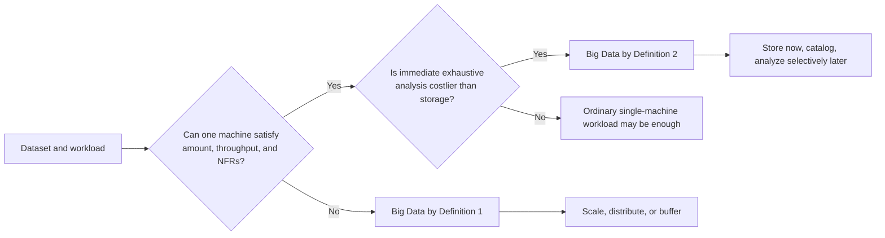

### 1.1 Why “more than N gigabytes” is a poor definition

The same 500 GB can be ordinary data in one system and Big Data in another.

- A 500 GB archive read once per month may fit comfortably on one server.
- A 500 GB fraud dataset that must answer every request in 20 milliseconds may exceed one server's CPU or I/O capacity.
- A continuous 500 GB-per-minute sensor feed is a throughput problem even if each event is tiny.
- A 50 GB image dataset may be computationally “big” if every image requires expensive inference.

“Big” is therefore relative to **the workload, deadline, budget, hardware, and reliability target**, not only the byte count.

### 1.2 What are non-functional requirements?

Functional requirements say **what** a system does: “store an order”, “find a customer”, or “calculate a report”. Non-functional requirements describe **how well** it must do it.

| Requirement | Example target | Why one machine may fail |
| --- | --- | --- |
| Latency | 99% of reads under 50 ms | Queues grow when CPU, memory, or disk saturates. |
| Throughput | Ingest 2 million events/s | One network interface or storage device reaches its limit. |
| Availability | 99.99% service uptime | One server is one failure domain. |
| Durability | No acknowledged payment may disappear | One copy is vulnerable to disk or host loss. |
| Recovery time | Restore service in under 30 seconds | Restoring terabytes from backup takes much longer. |
| Geographic latency | Users on three continents under 100 ms | The speed of light makes one location too far away. |
| Retention | Keep seven years of raw events | Storage no longer fits economically on the machine. |
| Compliance | Keep EU records inside the EU | Data may need several controlled locations. |
| Cost | Stay below a fixed monthly budget | A bigger single server may cost more than several commodity nodes. |

The single-machine definition does **not** mean “the disk is completely full”. A machine can have free disk space and still fail the latency, write-rate, recovery, or availability requirement.

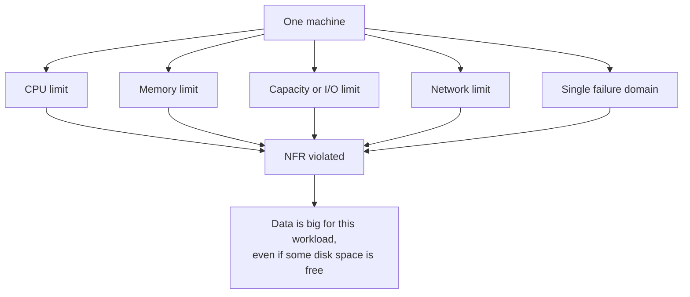

### 1.3 A capacity example

Suppose one server can safely process 40,000 events per second while keeping the 99th-percentile latency below 100 ms.

- Required input: 25,000 events/s → one server may be enough.
- Required input: 100,000 events/s → one server is not enough for the stated requirement.
- Required input: 25,000 normally but 200,000 during a match → buffering, elastic scaling, or more machines are required.

The data becomes “big” at the point where the **requirement and capacity stop matching**, not at a universal byte boundary.

### 1.4 Understanding the second definition

Imagine 100,000 cameras. Keeping the compressed recordings is relatively mechanical: receive bytes and append them to storage. Understanding every frame immediately may require decoding video, detecting objects, reading license plates, correlating locations, and running several machine-learning models.

If storing one day costs less than analyzing that day immediately, a rational system may:

1. capture the raw data now;
2. store it cheaply;
3. add enough metadata to find it later;
4. analyze selected data when a question, budget, or model becomes available.

This pattern appears in data lakes, log archives, scientific instruments, clickstreams, telemetry, satellite imagery, and genomics.

The definition does **not** say that analysis is unimportant. It says that immediate exhaustive analysis is economically or computationally unjustified.

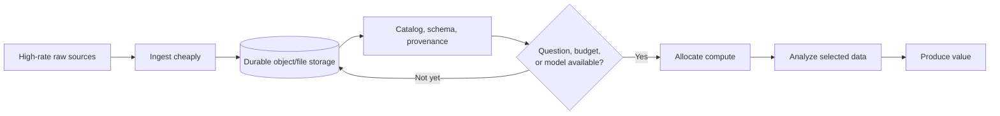

### 1.5 Data is perishable even when bytes are not

Storing data postpones computation, but postponement has costs:

- schemas and meanings can be forgotten;
- privacy obligations remain;
- encryption keys and access policies must be maintained;
- undocumented data becomes a “data swamp”;
- delayed insight can lose business value;
- keeping everything forever is neither free nor automatically legal.

Good deferred-analysis systems retain provenance: who produced the data, when, in which format, under which consent and retention rule.

### 1.6 The familiar “V” model

The V model is a vocabulary, not a competing definition.

| V | Question | Example |
| --- | --- | --- |
| Volume | How much data exists? | Petabytes of historical logs. |
| Velocity | How quickly does it arrive or need to be processed? | Card transactions arriving continuously. |
| Variety | How many shapes and formats exist? | Tables, JSON, text, images, and audio. |
| Veracity | How uncertain or dirty is it? | Duplicate sensors and missing timestamps. |
| Value | Is processing it worth the cost? | Fraud prevented or decisions improved. |

The first definition often exposes volume and velocity limits. The second highlights the gap between storage cost and the cost of extracting value.

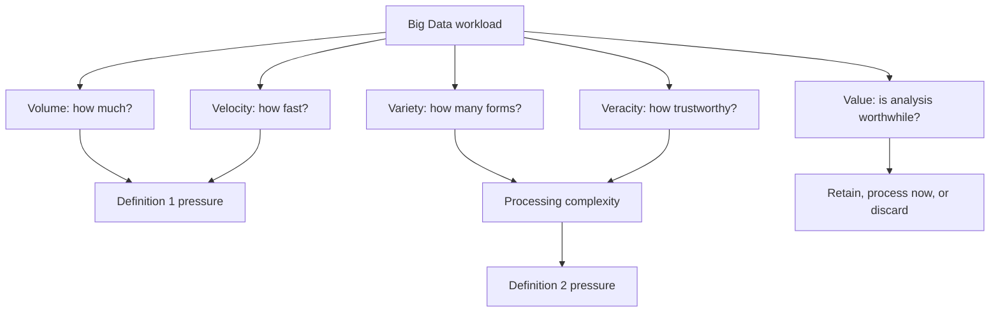

### 1.7 Scale up, scale out, and separate storage from compute

**Scaling up** means replacing one machine with a larger one: more RAM, CPU, disks, or network capacity. It is simple, but has a ceiling and may create an expensive failure domain.

**Scaling out** means adding machines and dividing work among them. It can increase total capacity and fault tolerance, but creates network failures, coordination, replication, rebalancing, and consistency problems.

**Separating storage and compute** means storing data in a shared durable layer and allocating compute only when analysis runs. This fits the second definition particularly well: retain cheaply, then rent computation when needed.

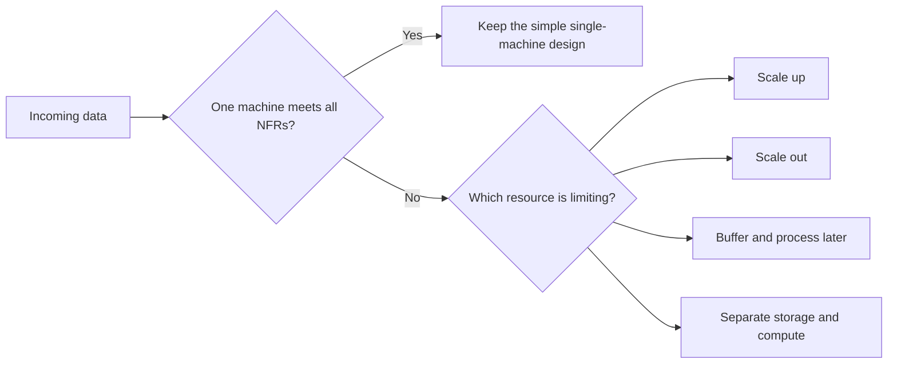

### 1.8 Batch and streaming are responses to time requirements

- **Batch processing** operates on a bounded collection and returns results later. Example: calculate yesterday's revenue each morning.
- **Stream processing** operates on an unbounded flow and incrementally produces results. Example: detect a suspicious payment within two seconds.
- A system often uses both: a fast approximate stream view plus a slower authoritative batch recomputation.

Big Data does not automatically require Hadoop, Spark, Kafka, or any particular product. Those are tools chosen after the workload and guarantees are understood.

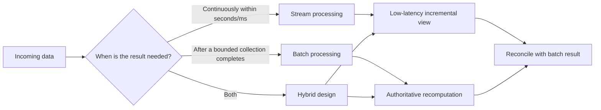

---

## 2. Why distribution changes the problem

On one machine, memory access may fail and a process may crash, but there is no uncertainty about whether another server received a message. Across machines, a message can be late, duplicated, reordered, or lost. A server can be alive while unreachable from another server.

### 2.1 Failure or slowness?

Suppose node A sends a message to node B and hears nothing for five seconds. Possible explanations include:

- B crashed;
- B is alive but overloaded;
- A's network interface failed;
- B's network interface failed;
- a switch or route between them failed;
- the reply was lost;
- the reply is merely slow.

A cannot know which explanation is true from silence alone. Timeouts turn uncertainty into a decision, not into knowledge.

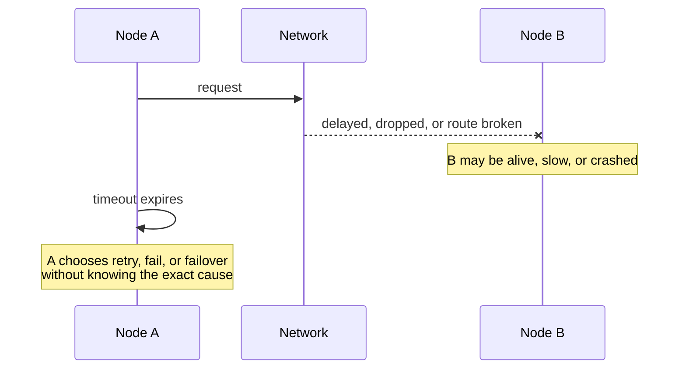

### 2.2 Vocabulary

| Term | Intuitive meaning |
| --- | --- |
| Node | One participating process or machine. |
| Cluster | Nodes cooperating as one service. |
| Replica | Another copy of the same data. |
| Shard | A subset of the whole dataset. |
| Quorum | Enough votes, usually a majority, to make one side authoritative. |
| Leader | The node currently coordinating writes for some data. |
| Network partition | Some live nodes cannot communicate with other live nodes. |
| Stale read | A read returns an older value than the newest accepted write. |
| Split brain | Two separated sides both act as the authority. |

Network partition is the “P” in CAP. It is unrelated to splitting a PostgreSQL table into date partitions, which is covered in Lecture 2.

---

## 3. CAP theorem, precisely and intuitively

CAP is about what happens **during a communication partition** in a distributed read/write system.

### 3.1 The three letters

**C — Consistency**

CAP consistency is usually interpreted as **linearizability**: operations appear to happen one at a time in a single order that respects real time. After a write has completed, a later read must see that write or a newer one, never an older value.

This is not the same “C” as ACID consistency. ACID consistency means transactions preserve application invariants. The words overlap; the ideas do not.

**A — Availability**

Every request received by a non-failing node eventually gets a successful response. An error saying “I cannot safely answer” is not CAP availability. Availability here does not promise a fast response, and ordinary uptime percentages are a related but different operational measure.

**P — Partition tolerance**

The system continues with a defined behavior even when the network loses or delays an arbitrary number of messages between groups of nodes.

### 3.2 What the theorem actually says

> When a network partition occurs, a distributed system cannot guarantee both linearizable consistency and availability for every request. It must reject/delay some operations, or permit some operations that may observe/diverge from the latest state.

The useful choice is therefore normally **CP versus AP during a partition**, not “pick any two letters at all times”. If a real multi-node system simply ignores P, a network failure still happens; the design has merely failed to define safe behavior.

When the network is healthy, a well-designed system can provide both consistency and availability. CAP describes the forced choice during the partition.

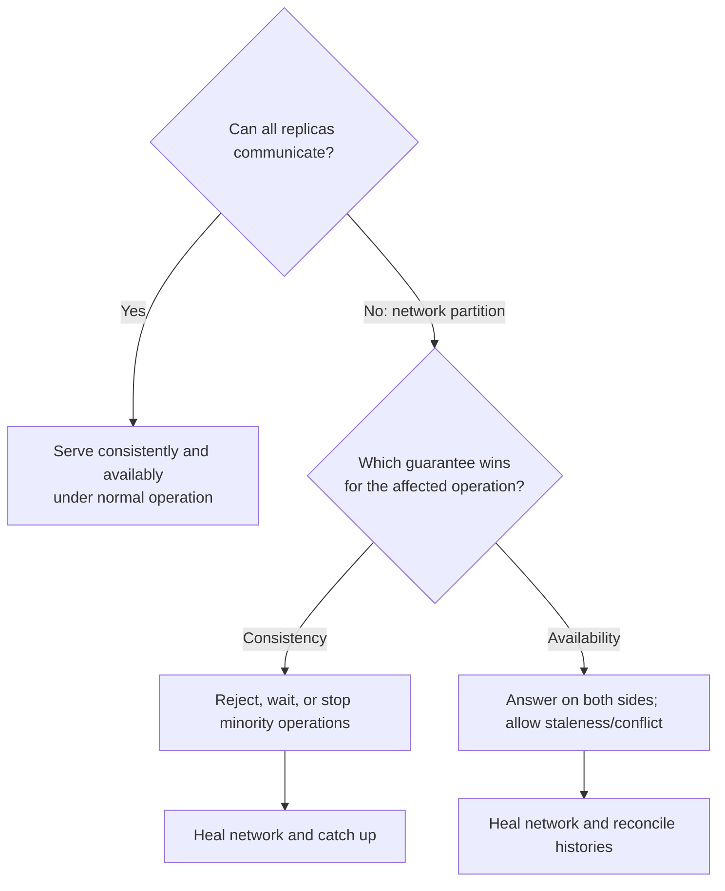

---

## 4. The three-person opinion survey

Mariam, Nino, and Luka survey citizens about a proposed city park. Each citizen may vote once: `YES` or `NO`. The current result must be shown on a public screen.

### 4.1 Centralized version: one authoritative notebook

Mariam owns the only notebook. Nino and Luka bring every response to Mariam, who checks the citizen ID, records the vote, and reports the total.

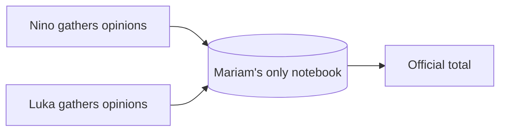

There is one truth, so copies cannot disagree. But Mariam is a bottleneck and single point of failure. If Nino cannot reach Mariam, Nino cannot safely record a vote. This design has avoided distributed replica disagreement by refusing to have distributed replicas.

Calling it “CA” can be a useful classroom shorthand **only inside its non-partitioned scope**. It does not magically remain available when the only server fails or becomes unreachable.

### 4.2 Distributed version: three copied notebooks

All three people now keep a copy. Under normal conditions, they immediately exchange every new vote. Reads are local and work is shared.

Then a storm breaks communication:

- Mariam and Nino can still communicate.
- Luka is alive but cannot communicate with them.
- Citizens are still arriving at all locations.

This is a network partition: `{Mariam, Nino} | {Luka}`.

### 4.3 CP decision: preserve one official truth

The rule says a majority—two of the three notebooks—must approve a vote. Mariam and Nino form a majority and continue. Luka cannot reach a majority, so Luka refuses new votes and cannot promise a current total.

Consequences:

- no two accepted official histories conflict;
- the isolated location is unavailable for writes;
- some citizens must retry later;
- after communication returns, Luka catches up from the majority history.

This is the intuition behind consensus/quorum systems. **Consistency wins; availability is sacrificed on the minority side.**

### 4.4 AP decision: every location continues serving

The rule now says every person may keep accepting votes independently. Luka continues even while isolated.

Suppose citizen 42 tells Luka `YES`, then walks to Mariam and changes the vote to `NO`. During the partition:

- Luka's notebook says citizen 42 = `YES`;
- Mariam and Nino say citizen 42 = `NO`;
- both sides returned successful responses.

When communication returns, the system needs a conflict rule: latest timestamp wins, a deterministic region wins, both values are retained for a person to review, or the data type merges safely.

Consequences:

- every location remains available;
- totals may temporarily disagree;
- reconciliation may lose an update if the conflict rule is crude;
- the application must tolerate staleness or conflicts.

**Availability wins; immediate consistency is sacrificed.**

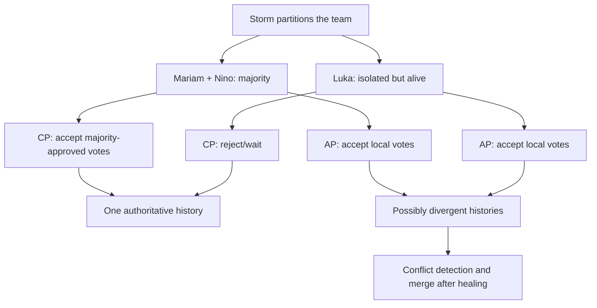

### 4.5 Data type matters

Some facts merge more naturally than others.

- Independent “like” counters can be merged with a conflict-free counter.
- A set of observed sensor IDs can be unioned.
- Two different delivery addresses for one order need a business decision.
- Two withdrawals from the same remaining balance cannot both be accepted safely without reservations, escrow, or coordination.

AP is not “wrong data by definition”. It means the application needs a model whose concurrent changes can be reconciled or whose temporary disagreement is acceptable.

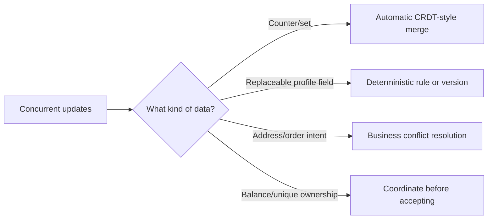

### 4.6 Real-life choices

| Scenario | Likely choice during partition | Reason |
| --- | --- | --- |
| Bank withdrawal against one balance | CP-like | Rejecting/delaying is safer than spending the same money twice. |
| Leader election | CP | Two leaders can issue contradictory commands. |
| Service discovery configuration | CP for writes | Stale or conflicting ownership can be dangerous. |
| Social “like” count | AP-like | Temporary count differences are usually acceptable. |
| Shopping-cart additions | AP-like with merge | Let users shop; merge independent additions later. |
| Emergency field notes | AP-like | Capturing observations may be more important than a current global view. |
| Unique username registration | CP or partitioned ownership | Two successful claims for one name are hard to reconcile. |
| Product catalog browsing | AP-like reads | A briefly stale description is preferable to no catalog. |

One application can make different choices for different operations. A catalog may allow stale product-description reads but require coordinated inventory reservation.

---

## 5. Database landscape through a CAP lens

### 5.1 Read this table carefully

A database product is not permanently one letter pair. Behavior depends on deployment topology, read/write concern, quorum, operation, version, and failure type. “CP” and “AP” below are **teaching descriptions of a common mode during a network partition**, not universal product certifications.

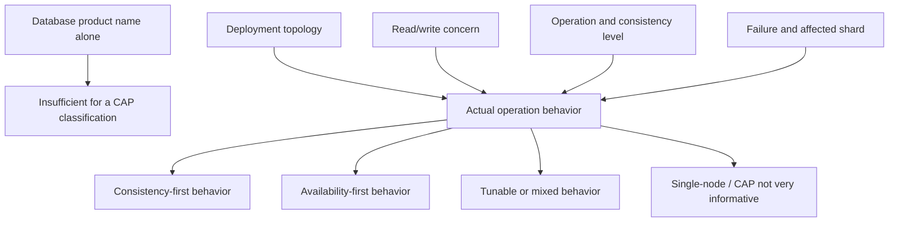

### 5.2 Systems commonly operated in a consistency-first mode

| Database/system | Typical partition behavior | Important nuance |
| --- | --- | --- |
| etcd | A side without Raft quorum cannot commit; majority side continues. | Linearizable reads use consensus; serializable reads may be stale. |
| Apache ZooKeeper | Writes require a quorum, so a minority cannot commit. | Ordinary reads can be stale; `sync`/client procedures matter. |
| Consul KV/catalog | Raft leader and quorum protect authoritative writes. | Stale reads can be explicitly requested for availability/latency. |
| Google Cloud Spanner | A write commits after a voting quorum; strong reads preserve external consistency. | Stale reads are also available as an explicit performance choice. |
| CockroachDB | A range without lease/quorum stops serving consistent writes. | Other ranges with quorum can remain available; availability is per range. |
| YugabyteDB YSQL/YCQL strong operations | Raft quorum owns each tablet's authoritative history. | Availability is per tablet and depends on replica placement. |
| FoundationDB | Coordinated transaction history prioritizes strict serializability. | Loss of enough coordinators/storage replicas makes affected work unavailable. |
| TiDB with TiKV | Raft groups require quorum to accept authoritative writes. | Different key ranges can have different failure availability. |
| HBase | Region ownership and coordination avoid concurrent authoritative writers. | The affected region can become unavailable during recovery. |
| Google Cloud Bigtable | Strong single-row operations use replicated tablet infrastructure. | Multi-cluster routing and app profiles can expose different consistency choices. |
| MongoDB replica set with majority writes and primary reads | A minority primary steps down; only a majority partition can elect a writable primary. | Secondary/local reads can trade consistency for read availability. |

### 5.3 Systems commonly operated in an availability-first/eventual mode

| Database/system | Typical partition behavior | Important nuance |
| --- | --- | --- |
| Apache Cassandra with `ONE`/`LOCAL_ONE` | A reachable replica can accept/read a value; replicas repair later. | `QUORUM` and lightweight transactions make stronger choices. |
| ScyllaDB with low consistency levels | Reachable replicas continue and reconcile later. | Like Cassandra, consistency is chosen per operation. |
| Riak KV | Dynamo-style replicas accept operations according to configurable `R/W` quorums and reconcile siblings. | Strong-consistency bucket types are a separate mode. |
| Apache CouchDB multi-node/multi-site replication | Sites can accept local updates and later replicate conflicts. | Conflict winners are deterministic, but applications may need to resolve losing revisions. |
| Amazon DynamoDB global tables in multi-Region eventual mode | Regions accept local work and asynchronously converge. | DynamoDB now also offers multi-Region strong consistency for eligible global tables. |
| Azure Cosmos DB with multi-region writes and weaker consistency | Regions can favor local availability and reconcile according to configured policies. | Five consistency levels expose a spectrum; strong mode changes the trade-off. |
| Redis Active-Active/CRDT deployments | Regions accept local CRDT-compatible changes and merge. | This is a specific active-active product/deployment, not ordinary Redis Pub/Sub. |
| Aerospike in AP mode | Partitions can remain available and reconcile after healing. | Strong-consistency namespaces choose different behavior. |
| Couchbase cross-datacenter replication (XDCR) | Each cluster can accept local writes and replicate asynchronously. | Within-cluster durability and consistency settings are separate decisions. |

### 5.4 Tunable and mixed systems

These are especially important because a single label hides the design.

| System | Knob or scope that changes the trade-off |
| --- | --- |
| Cassandra / ScyllaDB | `ONE`, `LOCAL_ONE`, `QUORUM`, `LOCAL_QUORUM`, `ALL`, plus lightweight transactions. |
| DynamoDB | Eventually or strongly consistent reads; eventual or strong multi-Region global-table mode where supported. |
| Azure Cosmos DB | Strong, bounded staleness, session, consistent prefix, or eventual consistency. |
| MongoDB | Write concern, read concern, read preference, journaling, and whether a majority exists. |
| Redis | Standalone, Sentinel, Cluster, sharded Pub/Sub, and Active-Active are different architectures and guarantees. |
| PostgreSQL | Single server, synchronous/asynchronous streaming replicas, and logical multi-writer designs behave differently. |
| MySQL | Standalone, asynchronous replication, Group Replication, and InnoDB Cluster do not share one CAP answer. |
| Elasticsearch/OpenSearch | Acknowledgment level, number/placement of shard replicas, and operation type matter. |
| Couchbase | Per-operation durability, within-cluster replication, and asynchronous XDCR are separate layers. |
| FoundationDB / Spanner / CockroachDB | Strong transactions are consistency-first, while explicitly stale reads can improve read availability and latency. |

### 5.5 “CA” examples: only after limiting the scope

| Single-node deployment | Why it looks CA | What it does **not** promise |
| --- | --- | --- |
| SQLite | One local database file gives one authoritative order while the process and storage work. | No service if that host/storage is inaccessible. |
| DuckDB | One analytical process can give transactional consistency without replica partitions. | It is not a fault-tolerant distributed service by itself. |
| PostgreSQL standalone | One primary provides one transactional truth. | A host/network failure can make it unavailable. |
| MySQL/MariaDB standalone | One server avoids replica disagreement. | The server remains a single failure domain. |
| SQL Server standalone | One database engine owns the state. | High availability requires another architecture with new trade-offs. |
| Oracle Database standalone | One instance avoids inter-replica partitions. | RAC/Data Guard deployments require separate analysis. |

CAP is not very informative for a non-distributed single-node database because there are no communicating replicas to divide. “CA” means “C and A while the assumed no-partition environment is operating”, not “never fails”.

### 5.6 What cannot be inferred from CAP

CAP does not tell you:

- query language or data model;
- transaction isolation level;
- whether acknowledged data survives disk loss;
- normal-operation latency;
- maximum throughput;
- backup quality;
- security;
- behavior after the partition heals;
- whether conflicts are easy to merge;
- how much of the database is unavailable.

CAP is one question in a design review, not a database ranking system.

---

## 6. Beyond CAP: what happens when there is no partition?

PACELC extends the conversation:

> **If there is a Partition (P), choose Availability or Consistency (A/C); Else (E), choose lower Latency or stronger Consistency (L/C).**

Even on a healthy network, waiting for replicas in distant regions increases latency. A system may offer strong consistency and accept that delay, or serve a nearby replica and accept possible staleness.

The speed-of-light problem cannot be optimized away. Product configuration merely chooses where the delay and uncertainty appear.

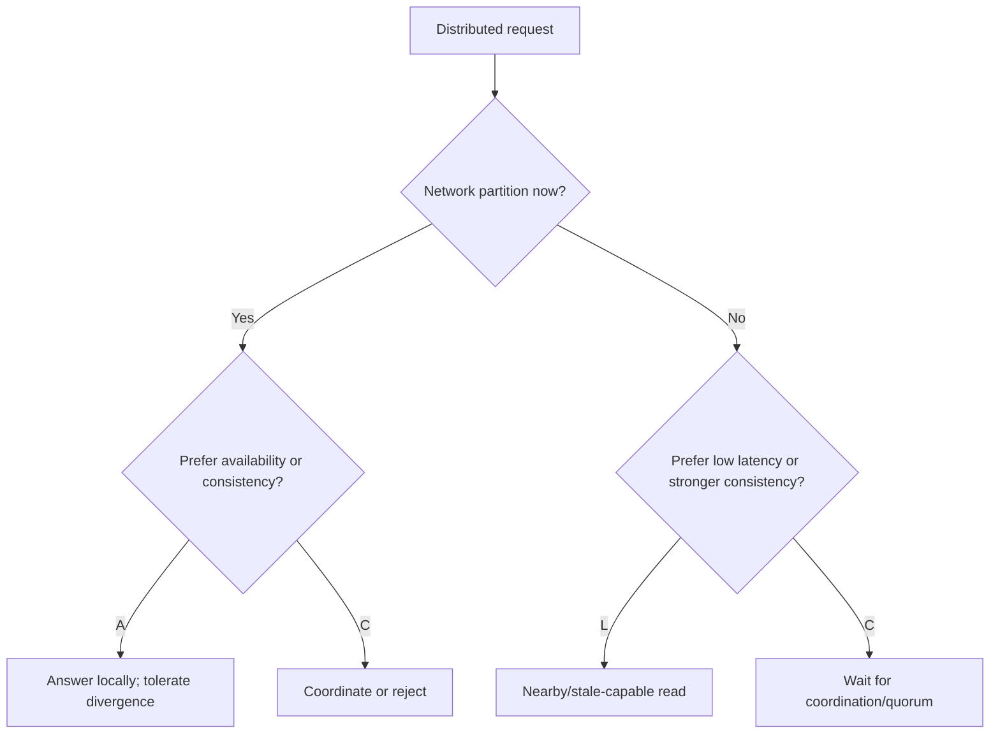

---

## 7. Common misconceptions

### “CAP says choose any two of three”

Too vague. During an actual partition, P is the condition, and the operational choice is C or A for affected operations.

### “Consistency means every replica has identical bytes at every instant”

No. Linearizable service behavior can coexist with followers that lag, provided stale followers do not answer in a way that violates the contract.

### “Availability means 99.999% uptime”

Not in the theorem. CAP availability is a response property for every request to a non-failing node.

### “Eventual consistency means random or permanently wrong”

No. If updates stop and communication resumes, replicas should converge. The useful questions are how long convergence takes and how concurrent updates are reconciled.

### “Replication automatically gives consistency”

Replication creates more copies. A protocol is still needed to decide when a write is committed and which copy may answer.

### “NoSQL is AP and SQL is CP”

False. The table above includes SQL consistency-first systems, tunable NoSQL systems, and single-node systems outside CAP's interesting scope.

### “A network partition and a table partition are the same”

False. A network partition separates communicating nodes. A table partition separates rows by a key such as date. Lecture 2 uses “partitioning” in the database-layout sense.

---

## 8. Design checklist

Before selecting a distributed database, answer these questions for each important operation:

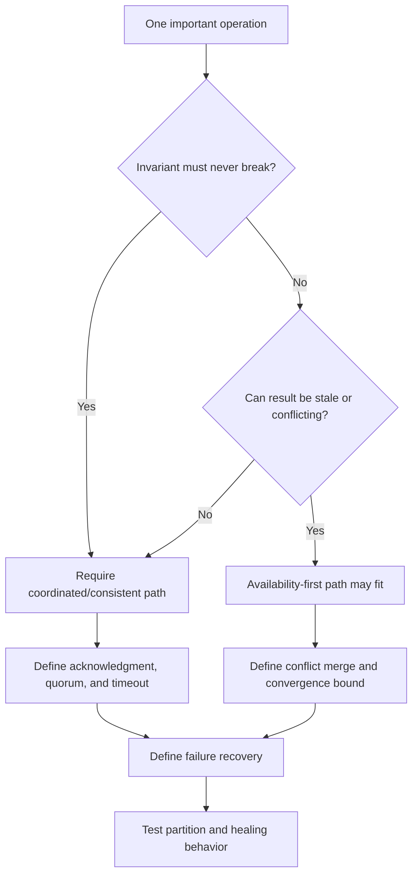

1. What is the unit of consistency: one key, one row, one shard, or a multi-row transaction?
2. Which invariants must never be violated?
3. Can a request fail or wait during a partition?
4. Can a read be stale? By how much?
5. Can two regions accept concurrent writes to the same object?
6. If yes, how are conflicts detected and resolved?
7. What acknowledgment makes a write “successful”?
8. Can that acknowledged write later be lost or rolled back?
9. Is availability measured for the entire cluster or for each shard/range?
10. What happens when communication returns?

---

## 9. Classroom activities

### Activity A — Is it Big Data?

For each case, identify which course definition applies and which NFR creates the limit.

1. A university stores 2 TB of old PDFs and searches them twice per year.
2. A game receives 800,000 position updates per second and must detect cheating in one second.
3. A telescope produces images faster than the available GPUs can classify them, but object storage is affordable.
4. A hospital has 20 GB of current patient data but requires operation during any single-server failure.

Suggested reasoning:

1. Probably ordinary data unless recovery/search requirements make it big.
2. Definition 1: throughput and latency.
3. Definition 2: cheaper to store than analyze immediately.
4. Definition 1: availability and fault-tolerance NFR, despite small volume.

### Activity B — Run the opinion survey

Split the class into Mariam, Nino, Luka, clients, and a network controller.

1. Start with three identical sheets.
2. Submit three votes while everyone can communicate.
3. The controller separates Luka.
4. First enforce the majority rule and observe which clients fail.
5. Reset, allow all sides to accept votes, and submit conflicting changes for the same citizen.
6. Reconnect and try three merge rules: latest timestamp, majority value, and manual review.

Discuss whether clock errors make “latest timestamp wins” trustworthy.

### Activity C — Choose the behavior, not the product

For each operation, choose what may happen during a partition and justify it:

- view a profile photo;
- reserve the last concert ticket;
- add an item to a cart;
- change a password;
- increment a video view counter;
- elect the scheduler leader.

### Activity D — CAP diagnosis

For a three-replica system with nodes A, B, and C, A is isolated while B and C can communicate.

1. If a write requires two acknowledgments, where can writes succeed?
2. If any one replica may accept a write, what conflict becomes possible?
3. If A serves old reads, is the system linearizable?
4. Does having three copies by itself answer any of these questions?

Answers: only B/C; concurrent histories; no; no—the protocol and requested guarantees decide.

---

## 10. Where Hadoop fits

Hadoop is one possible response to the first Big Data definition and is especially natural for the second.

- **HDFS** splits large files into blocks, distributes those blocks across DataNodes, and normally replicates them. This lets aggregate storage and read throughput grow beyond one machine.
- The **NameNode** manages filesystem metadata; DataNodes store the bytes. This is a distributed design with different roles, not “one very large disk”.
- **MapReduce** sends parallel computation toward the machines holding the relevant blocks, then shuffles and reduces intermediate results.
- Batch jobs can retain raw data cheaply and analyze it later, directly matching the idea that storage can be cheaper than immediate exhaustive analysis.
- **YARN** allocates cluster CPU and memory to applications; HDFS is the storage layer, not the computation scheduler.

Hadoop does not define Big Data, and Big Data does not require Hadoop. A single capable database, object storage plus elastic compute, a stream processor, or a cloud warehouse may better fit a particular set of requirements.

The companion [Hadoop lab](hadoop_lab1.md) makes HDFS blocks, replication, WebHDFS, YARN, and MapReduce observable on the classroom cluster.

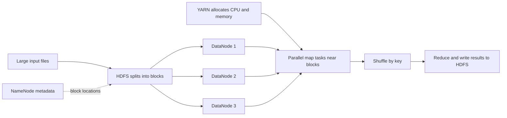

---

## 11. Summary

- Big Data is relative to requirements, not a universal byte count.
- In this course, data is “big” when one machine cannot meet the required amount/throughput and other NFRs, or when storage is cheaper than immediate analysis.
- Distribution raises capacity and fault tolerance but introduces partial failure and uncertainty.
- During a network partition, a distributed service cannot guarantee both linearizable consistency and successful responses everywhere.
- CP rejects or delays unsafe operations; AP accepts more operations and must tolerate staleness or reconciliation.
- Database products are often tunable, and different operations in one product may make different choices.
- CAP does not replace analysis of durability, isolation, latency, recovery, security, or cost.

## Further reading

- [Brewer's CAP theorem retrospective (ACM)](https://doi.org/10.1145/1773912.1773921)
- [Apache Cassandra: Dynamo architecture and tunable consistency](https://cassandra.apache.org/doc/latest/cassandra/architecture/dynamo.html)
- [etcd API guarantees](https://etcd.io/docs/v3.3/learning/api_guarantees/)
- [Apache ZooKeeper internals and consistency guarantees](https://zookeeper.apache.org/doc/current/zookeeperInternals)
- [Google Cloud Spanner replication](https://cloud.google.com/spanner/docs/replication)
- [MongoDB read concern](https://www.mongodb.com/docs/manual/reference/read-concern/)
- [MongoDB replica-set elections and network partitions](https://www.mongodb.com/docs/manual/core/replica-set-elections/)
- [DynamoDB read and global-table consistency](https://docs.aws.amazon.com/amazondynamodb/latest/developerguide/HowItWorks.ReadConsistency.html)
- [Azure Cosmos DB consistency levels](https://learn.microsoft.com/azure/cosmos-db/consistency-levels)
