# Lecture 2 — Partitioning, replication, sharding, and PostgreSQL

## Purpose of this lecture

This lecture separates three ideas that are frequently confused:

- **Partitioning** divides one logical dataset into pieces.
- **Replication** makes additional copies of data.
- **Sharding** places different horizontal pieces on independently operated database nodes.

We then implement the ideas in PostgreSQL and explain exactly where native PostgreSQL ends and a distributed extension or application-level design begins.

---

## 1. The library analogy

Imagine a library containing one million books.

### Partitioning

Keep books A–F on shelf 1, G–M on shelf 2, and so on. Every book has one intended shelf. The shelves divide the collection.

### Replication

Create another complete copy of the library in a second building. The same book exists in both places.

### Sharding

Place A–F in the east branch, G–M in the west branch, and the remaining ranges elsewhere. Each branch is an independently reachable storage system responsible for part of the collection.

### Replicated sharding

Give every branch a backup copy of its assigned books. Now the system both divides and copies data.

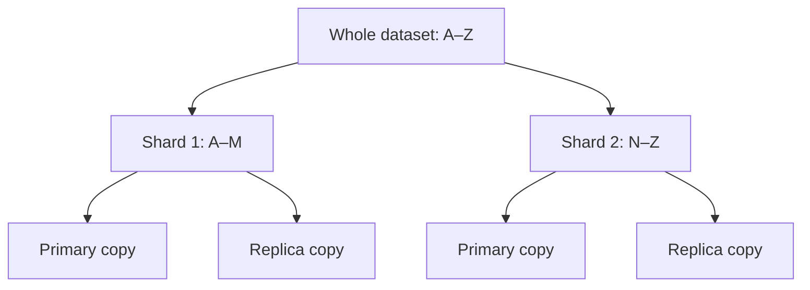

The important question is always: **does this operation create another copy, or decide which rows belong where?**

---

## 2. Partitioning

Partitioning splits a logical dataset according to a rule. It can happen inside one database server, across disks, or across servers.

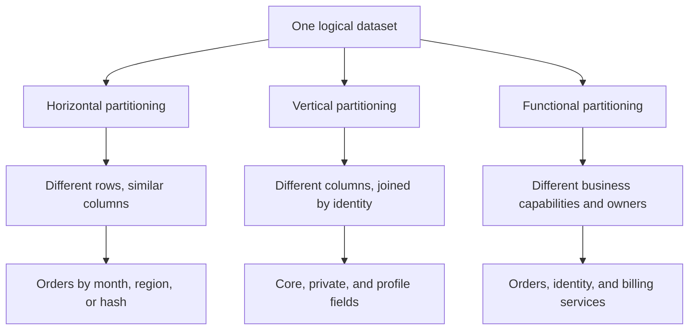

### 2.1 Horizontal partitioning

Rows are divided while columns remain similar.

| Partition | Rows |
| --- | --- |
| `orders_2026_q1` | Orders from January through March 2026. |
| `orders_2026_q2` | Orders from April through June 2026. |
| `orders_eu` | Orders whose region is EU. |
| `orders_hash_0` | Customer IDs whose hash has remainder 0. |

Every partition represents a predicate such as `created_at >= ... AND created_at < ...`.

### 2.2 Vertical partitioning

Columns are divided, usually around access, size, or security boundaries.

```text
customer_core(customer_id, name, status)
customer_private(customer_id, passport_number, date_of_birth)
customer_profile(customer_id, biography, avatar)
```

This can keep frequently read rows narrow and isolate sensitive or large attributes. The tables are rejoined by `customer_id` when needed.

### 2.3 Functional partitioning

Different business capabilities own different datasets: orders in one service, identity in another, billing in a third. This is sometimes called decomposition by bounded context. It is broader than table partitioning and changes transaction boundaries and team ownership.

### 2.4 Partitioning strategies

| Strategy | Routing rule | Strength | Risk |
| --- | --- | --- | --- |
| Range | Date/ID belongs between lower and upper bounds. | Efficient range scans and retention. | Newest range may become hot. |
| List | Value belongs to an explicit group, such as a region. | Meaningful placement and policy control. | Uneven groups and maintenance. |
| Hash | `hash(key) mod N` selects a piece. | Usually spreads load evenly. | Range scans touch many pieces; changing N moves data. |
| Directory | A lookup service maps key to location. | Flexible placement and migration. | Directory is extra critical infrastructure. |
| Composite | Range by month, then hash by customer. | Addresses multiple access patterns. | More pieces and operational complexity. |

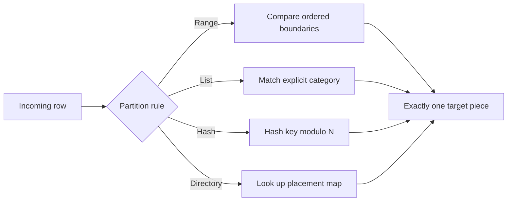

### 2.5 Partition pruning

If a query predicate matches the partition rule, the database can avoid irrelevant pieces.

```sql
SELECT sum(total)
FROM orders
WHERE created_at >= DATE '2026-04-01'
  AND created_at <  DATE '2026-05-01';
```

With monthly range partitions, only April needs scanning. This is **partition pruning**. It is not automatically faster if the query touches every partition, the partition key is absent, or there are thousands of poorly chosen partitions.

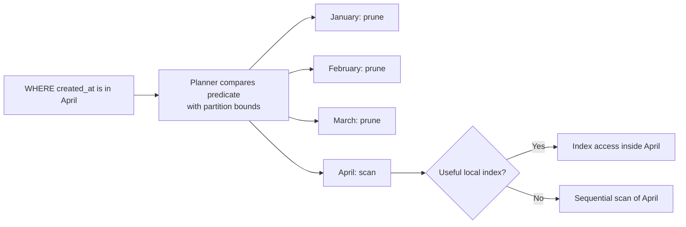

### 2.6 A partition is not an index

- A partition decides the physical subset in which a row lives.
- An index accelerates lookup within a table or partition.
- Partitions can have indexes.
- A query can be pruned to one partition and still need an index there.

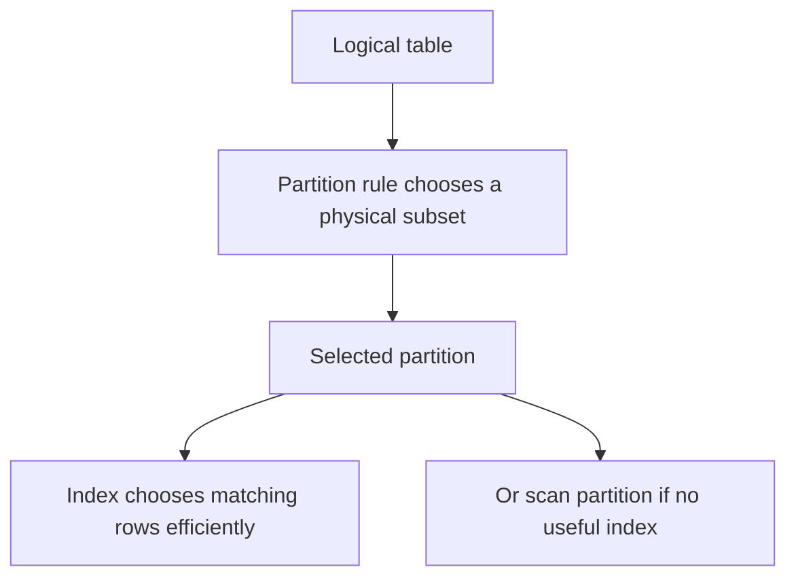

### 2.7 Benefits and costs

Benefits:

- prune irrelevant data;
- load or remove a whole time period efficiently;
- move cold partitions to different storage;
- reduce the size of individual indexes;
- perform maintenance one piece at a time;
- enable later distribution if boundaries are suitable.

Costs:

- choosing and changing the key;
- handling missing/default partitions;
- more catalog metadata and planning work;
- unique constraints may need the partition key;
- skew and hot partitions;
- cross-partition queries remain expensive;
- too many partitions can be worse than one table.

---

## 3. Replication

Replication maintains multiple copies of the same logical data on different storage locations or nodes.

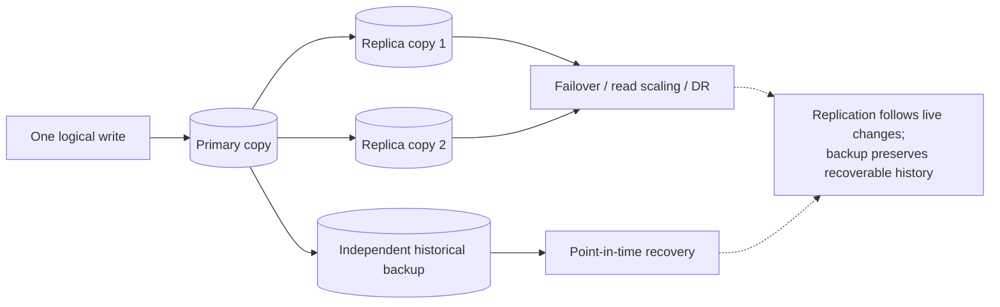

### 3.1 Why replicate?

| Goal | How a replica helps | Important limitation |
| --- | --- | --- |
| High availability | A standby can take over after failure. | Failover detection and promotion are still needed. |
| Durability | One disk/host loss does not remove every copy. | A mistaken `DELETE` can replicate to every copy. |
| Read scaling | Read-only queries can use replicas. | They may be stale and can add primary load. |
| Geographic latency | Users read a nearby copy. | Synchronous global writes add network latency. |
| Disaster recovery | A copy exists in another failure domain. | Replication is not a versioned, isolated backup. |
| Analytics/CDC | A downstream system consumes changes. | Schema, lag, and data-quality operations remain. |

### 3.2 Replication is not backup

If an administrator drops a table, replication may quickly and correctly drop it everywhere. If an application corrupts a row, the corruption is also copied. Backups provide an independently retained historical recovery point; replication provides live redundant state. Production systems normally need both.

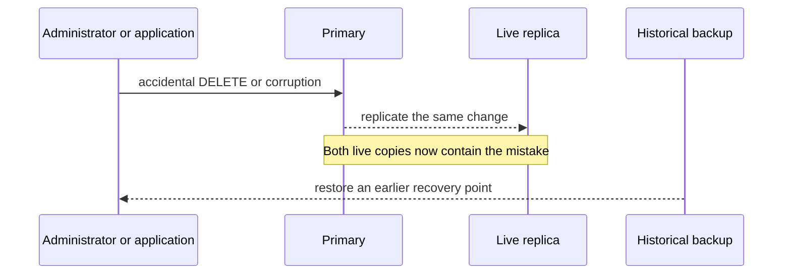

### 3.3 Primary–replica replication

One primary accepts writes. Replicas copy its change log.

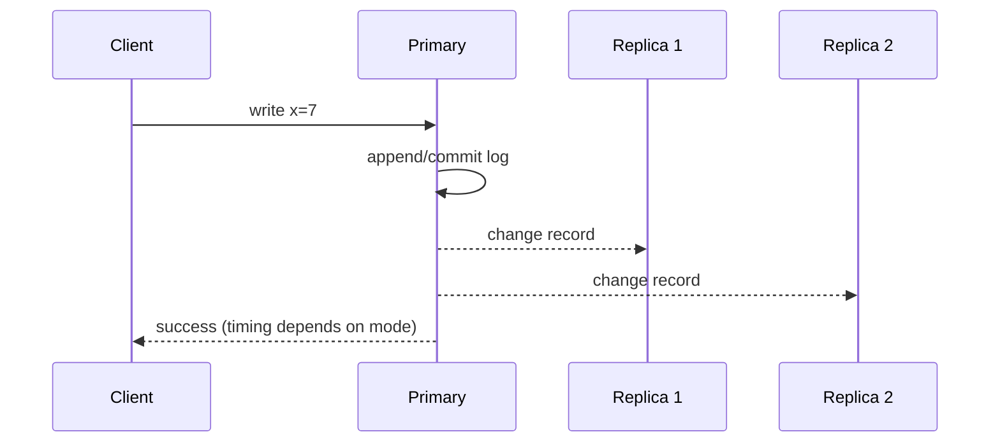

The response timing is the crucial policy.

### 3.4 Synchronous versus asynchronous

**Asynchronous replication**

1. Primary commits locally.
2. Primary replies to the client.
3. Replica receives the change later.

Advantages: lower write latency and continued primary progress when a replica is slow. Risks: stale replica reads and possible loss of recently acknowledged transactions if the primary is destroyed before the replica receives them.

**Synchronous replication**

1. Primary writes locally.
2. One or more replicas confirm a configured stage.
3. Primary replies to the client.

Advantages: stronger durability/failover guarantees. Risks: network round trips increase latency, and a required unavailable replica can block commits.

“Synchronous” still needs a precise acknowledgment stage: received in memory, written to an operating-system cache, flushed to durable storage, or applied and visible to reads.

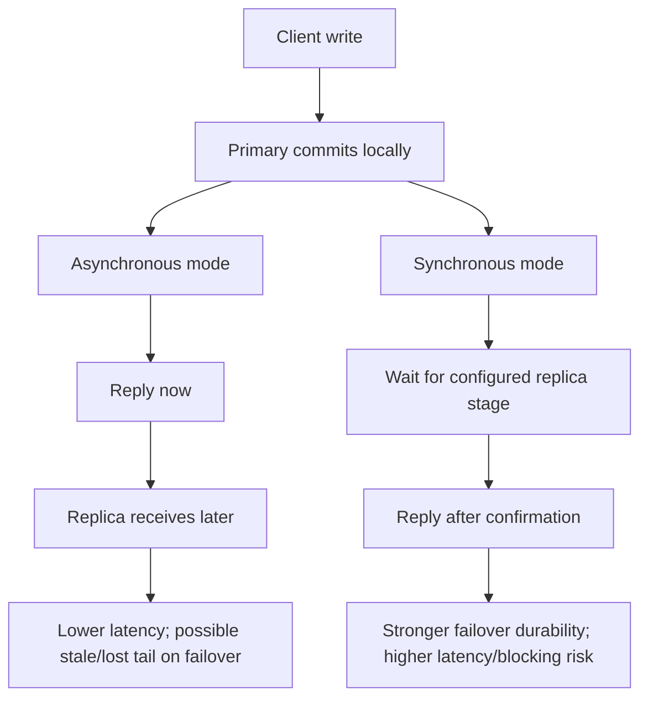

### 3.5 Single-leader, multi-leader, and leaderless

| Model | Write location | Main advantage | Main difficulty |
| --- | --- | --- | --- |
| Single leader | One leader per dataset/shard. | One write order is easier to reason about. | Leader can be a bottleneck; failover is required. |
| Multi-leader | Several leaders accept writes. | Regional autonomy and offline work. | Conflicting concurrent writes. |
| Leaderless | Client/coordinator writes to several replicas. | No permanent leader dependency. | Quorum, repair, versions, and conflict resolution. |

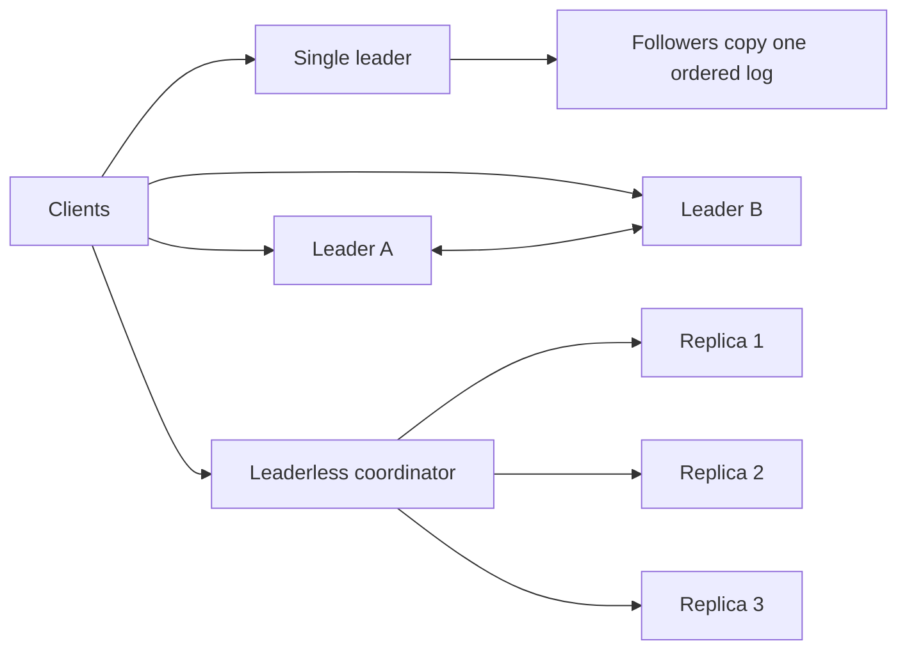

### 3.6 Replication factor and quorum intuition

Let `N` be replica count, `W` required write acknowledgments, and `R` replicas consulted by a read. If `W + R > N`, read and write sets must overlap in at least one replica. With `N=3`, `W=2`, and `R=2`, every accepted read quorum intersects the accepted write quorum.

That arithmetic is useful but not sufficient by itself. Version ordering, concurrent writes, clock assumptions, repair, failures during operations, and the exact protocol determine the real guarantee.

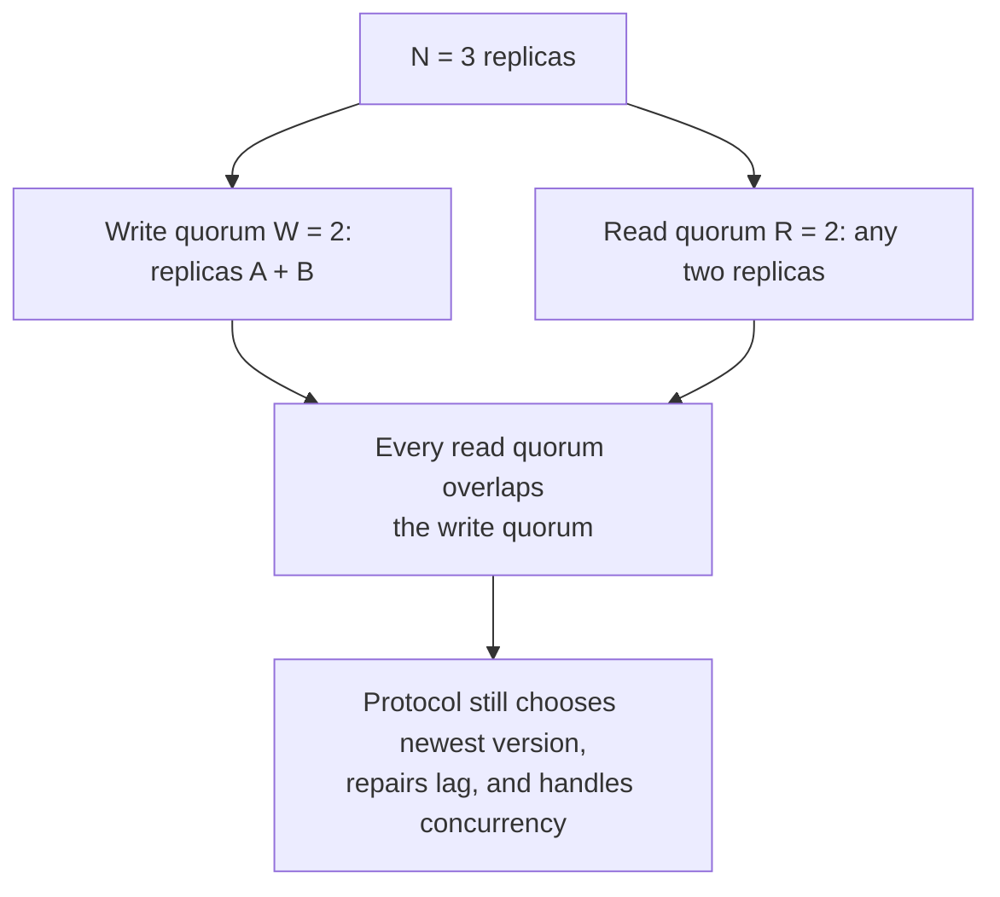

### 3.7 Replication lag

Lag can be measured in several ways:

- bytes or log positions behind;
- seconds between primary commit and replica replay;
- number of unapplied transactions;
- whether a required application checkpoint is visible.

A replica “0 seconds behind” measurement can be misleading if the primary is idle or clocks are unreliable. Monitor actual log positions and application-relevant freshness.

### 3.8 Failover and split brain

Failover is not simply “start sending traffic to replica B”. A safe process must determine that the old primary cannot continue accepting writes, promote exactly one sufficiently current replica, update routing, and later reintegrate the old primary.

**Fencing** prevents an old primary from continuing to mutate shared state. Examples include revoking a lease, terminating storage access, or requiring a new epoch/token on every write. Without fencing, two primaries may create split brain.

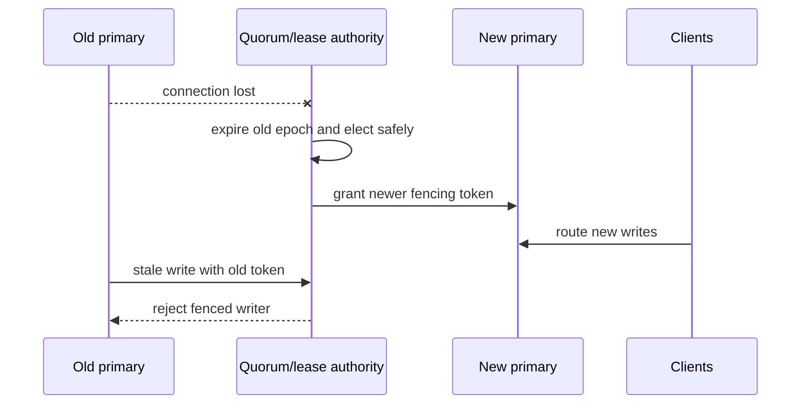

---

## 4. Sharding

Sharding is horizontal partitioning across independently operated database nodes. Each shard owns a subset of rows and usually has its own CPU, RAM, disk, transaction log, and failure behavior.

### 4.1 Why shard?

- the data no longer fits one server economically;
- write throughput exceeds one primary;
- indexes or working sets exceed memory;
- tenants or regions need isolation;
- maintenance/recovery of one giant database takes too long.

Sharding is usually a late architectural step because it moves complexity into routing, transactions, joins, uniqueness, migrations, and operations.

### 4.2 The shard key

The shard key answers: “Given this request, which shard owns the data?” A good key usually has:

- high cardinality;
- even data and request distribution;
- presence in common queries;
- stable values;
- alignment with transaction boundaries.

Example candidates:

| Key | Advantage | Problem |
| --- | --- | --- |
| `customer_id` hash | Even distribution; customer operations are local. | Reports across all customers fan out. |
| `country_code` list | Data residency and geographic locality. | Countries vary greatly in size. |
| `created_at` range | Efficient retention and time scans. | Current shard receives nearly all writes. |
| Monotonic `order_id` range | Simple routing and scans. | Latest shard is hot. |
| Random UUID hash | Usually distributes writes. | Related rows may land apart unless key includes tenant. |

### 4.3 Routing architectures

**Application routing:** application code or a shared library computes the shard. Fast, but every application must use identical rules.

**Proxy/coordinator routing:** clients connect to one endpoint, which parses/routs queries. Easier clients, but the routing tier must scale and understand enough query semantics.

**Database-native routing:** the distributed database manages metadata and placement. Operationally convenient, though the underlying distributed costs remain.

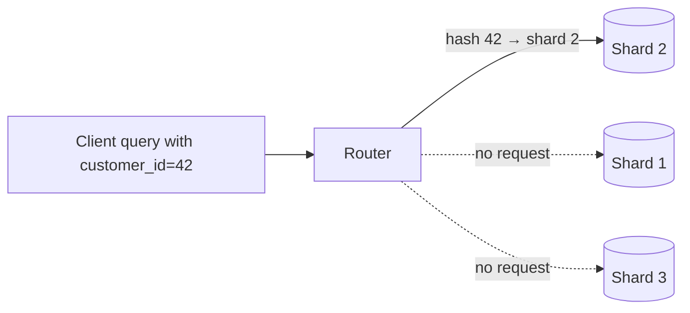

### 4.4 Scatter–gather

A query without the shard key may be sent to every shard. Results are then merged, sorted, and limited centrally.

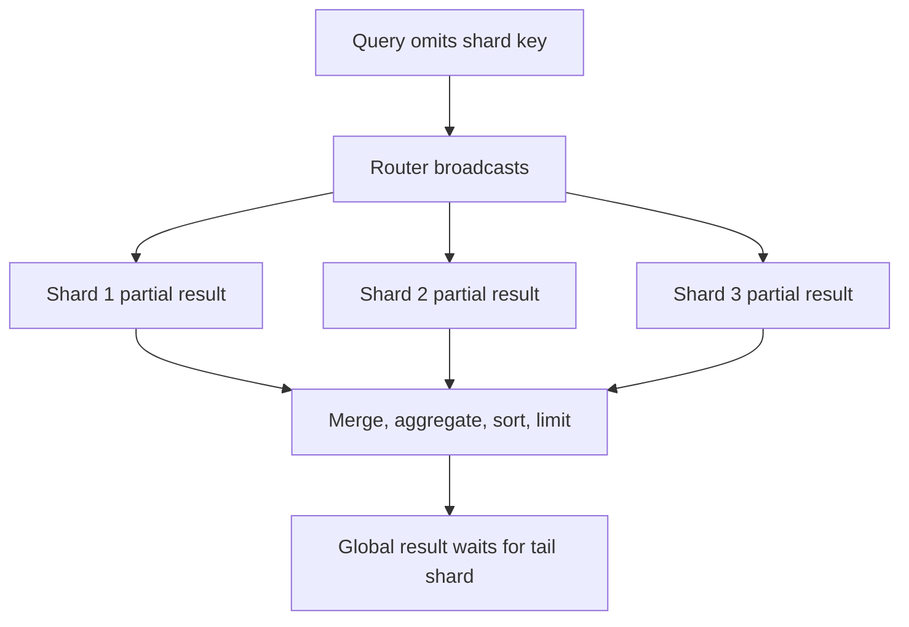

```sql
SELECT product_id, sum(quantity)
FROM order_items
GROUP BY product_id
ORDER BY sum(quantity) DESC
LIMIT 10;
```

If rows are sharded by `customer_id`, this global top-ten query needs partial aggregates from every shard. Parallelism helps, but total work, network transfer, tail latency, and failure probability grow.

### 4.5 Cross-shard transactions

A transfer between accounts on different shards needs atomic work across independent logs. Distributed transaction protocols can preserve atomicity, but add coordination, locks, failure recovery, and latency. Common design responses are:

- co-locate data that changes together;
- model the operation as an event/workflow with compensation;
- use reservations and idempotency;
- accept a distributed transaction where the invariant truly requires it.

“Avoid distributed transactions” is advice, not a proof that they are never needed.

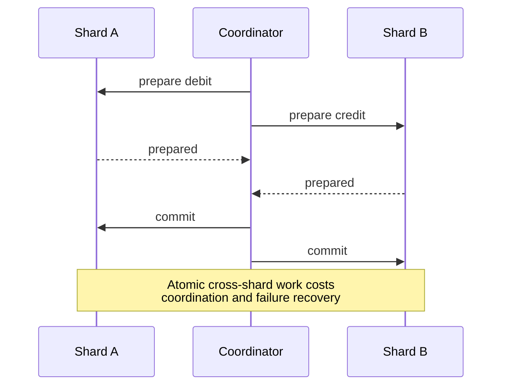

### 4.6 Global uniqueness

A local unique index only proves uniqueness inside one shard. Global IDs can be produced using:

- UUIDs or random IDs with negligible collision probability;
- shard-ID + local sequence;
- a centralized/consensus ID allocator;
- partitioned ownership of a namespace;
- a globally coordinated unique constraint, if the database supports it.

The design must distinguish probabilistic uniqueness from a strict business invariant such as one username worldwide.

### 4.7 Rebalancing

Adding a shard does not magically move existing data. A safe resharding process often needs to:

1. choose a new placement map;
2. copy a consistent snapshot;
3. capture concurrent changes;
4. verify counts/checksums;
5. switch reads and writes;
6. retain a rollback window;
7. remove the old copy later.

Consistent hashing reduces movement for some key-value workloads, but does not eliminate migration or application validation.

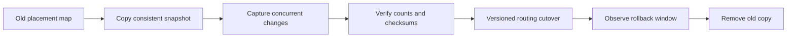

### 4.8 Hot shards

Even data distribution does not guarantee even traffic. One celebrity, tenant, product, or current time range may dominate requests. Techniques include key salting, sub-sharding a hot tenant, caching, separating read models, rate limiting, and choosing a composite key.

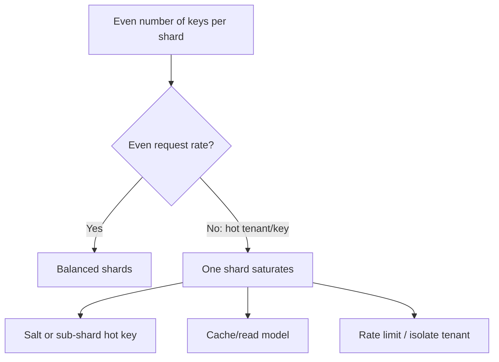

---

## 5. Compare the three ideas

| Property | Table partitioning | Replication | Sharding |
| --- | --- | --- | --- |
| Creates extra copies? | No | Yes | Not by itself |
| Divides rows? | Usually | No | Yes |
| Necessarily uses many servers? | No | Usually, for useful fault tolerance | Yes by definition here |
| Main goal | Manage/query subsets | Redundancy, reads, recovery | Horizontal capacity |
| Main risk | Bad key / too many pieces | Lag / failover / split brain | Routing / skew / cross-shard work |
| Can combine with others? | Yes | Yes | Yes |

A production design might use monthly partitions inside every shard and three replicas for every shard. The words describe independent axes.

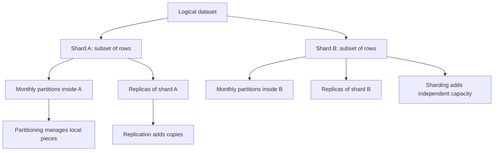

---

## 6. PostgreSQL table partitioning

PostgreSQL declarative partitioning supports `RANGE`, `LIST`, and `HASH`. The partitioned parent is virtual; rows are stored in leaf partitions.

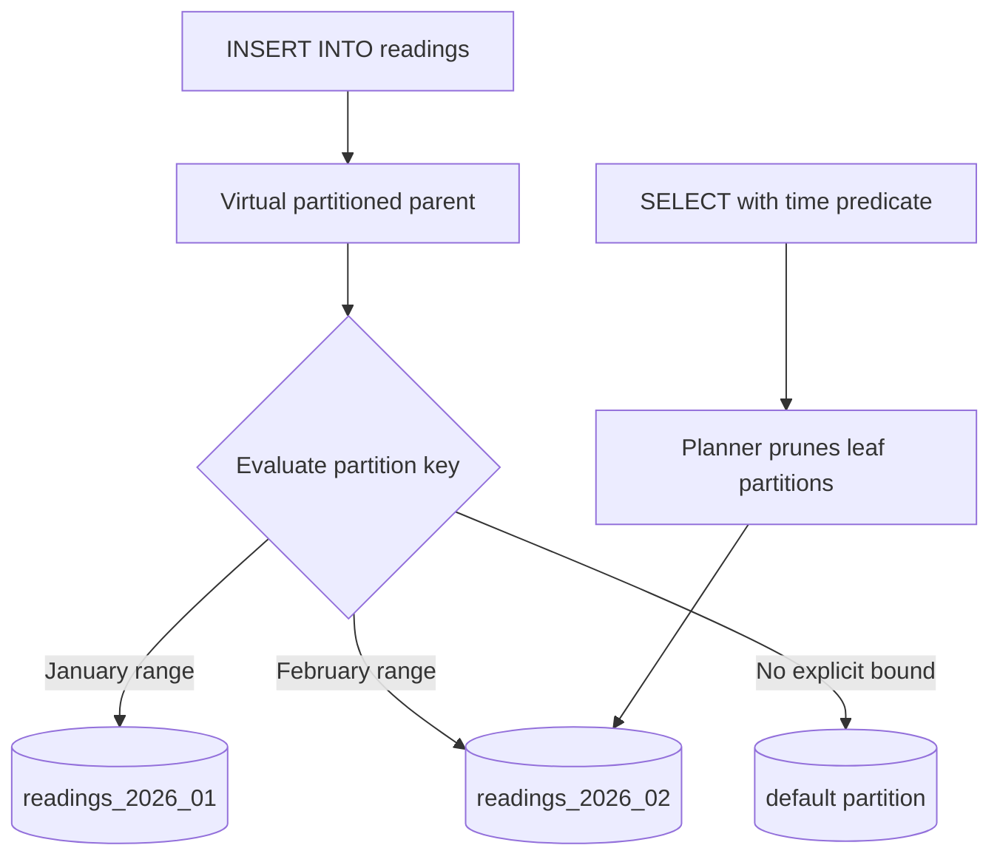

### 6.1 Range partitioning by time

```sql
CREATE TABLE readings (
    reading_id bigint GENERATED ALWAYS AS IDENTITY,
    device_id bigint NOT NULL,
    measured_at timestamptz NOT NULL,
    value double precision NOT NULL,
    PRIMARY KEY (reading_id, measured_at)
) PARTITION BY RANGE (measured_at);

CREATE TABLE readings_2026_01
PARTITION OF readings
FOR VALUES FROM ('2026-01-01 00:00:00+00')
           TO ('2026-02-01 00:00:00+00');

CREATE TABLE readings_2026_02
PARTITION OF readings
FOR VALUES FROM ('2026-02-01 00:00:00+00')
           TO ('2026-03-01 00:00:00+00');

CREATE TABLE readings_default
PARTITION OF readings DEFAULT;

CREATE INDEX readings_device_time_idx
ON readings (device_id, measured_at DESC);
```

Bounds are lower-inclusive and upper-exclusive. Exactly midnight on February 1 belongs to February, not January. The primary key includes the partition key because PostgreSQL must be able to enforce uniqueness across the structure using partition-local indexes.

The default partition prevents an insert from failing when an expected month is missing, but it can hide maintenance mistakes. Monitor it and move rows into proper partitions.

### 6.2 Show where rows live

```sql
SELECT tableoid::regclass AS physical_table, count(*)
FROM readings
GROUP BY tableoid
ORDER BY physical_table;
```

`tableoid` identifies the physical relation that produced each row.

### 6.3 Verify pruning

```sql
EXPLAIN (ANALYZE, BUFFERS)
SELECT avg(value)
FROM readings
WHERE measured_at >= '2026-02-10 00:00:00+00'
  AND measured_at <  '2026-02-11 00:00:00+00';
```

The plan should reference February and omit January. Wrapping the key in an expression can make pruning harder; predicates that directly match bounds are easiest for the planner.

### 6.4 List partitioning

```sql
CREATE TABLE customer_events (
    tenant_region text NOT NULL,
    event_id bigint NOT NULL,
    payload jsonb NOT NULL,
    PRIMARY KEY (tenant_region, event_id)
) PARTITION BY LIST (tenant_region);

CREATE TABLE customer_events_eu
PARTITION OF customer_events FOR VALUES IN ('EU');

CREATE TABLE customer_events_us
PARTITION OF customer_events FOR VALUES IN ('US');
```

This can express policy boundaries, but a region with most customers becomes larger/hotter. A second hash sub-partitioning layer may help at the cost of complexity.

### 6.5 Hash partitioning

```sql
CREATE TABLE sessions (
    account_id bigint NOT NULL,
    session_id uuid NOT NULL,
    created_at timestamptz NOT NULL,
    PRIMARY KEY (account_id, session_id)
) PARTITION BY HASH (account_id);

CREATE TABLE sessions_p0 PARTITION OF sessions
FOR VALUES WITH (MODULUS 4, REMAINDER 0);
CREATE TABLE sessions_p1 PARTITION OF sessions
FOR VALUES WITH (MODULUS 4, REMAINDER 1);
CREATE TABLE sessions_p2 PARTITION OF sessions
FOR VALUES WITH (MODULUS 4, REMAINDER 2);
CREATE TABLE sessions_p3 PARTITION OF sessions
FOR VALUES WITH (MODULUS 4, REMAINDER 3);
```

This divides data inside the PostgreSQL instance. It does **not** automatically create four servers or four independent write primaries.

### 6.6 Fast retention operations

```sql
ALTER TABLE readings DETACH PARTITION readings_2026_01;
-- Archive or verify the detached ordinary table.
DROP TABLE readings_2026_01;
```

Dropping/detaching a whole old partition avoids deleting rows one by one and avoids the vacuum work such a mass delete creates. Locking and version-specific concurrent-detach behavior still need production planning.

### 6.7 Partitioning mistakes

- creating one partition per user when there may be millions of users;
- partitioning a small table with no maintenance or pruning benefit;
- choosing a key absent from common predicates;
- forgetting to create future date partitions;
- expecting partitioning alone to distribute CPU across servers;
- assuming every index becomes globally unique;
- using local time boundaries without deciding daylight-saving semantics;
- never testing `EXPLAIN` to see whether pruning occurs.

---

## 7. PostgreSQL replication

PostgreSQL provides both physical/streaming replication and logical replication. They solve different problems.

### 7.1 Write-ahead log intuition

PostgreSQL records changes in the **write-ahead log (WAL)** before modified data pages need to reach their final on-disk locations. Replication transports or decodes this ordered change history.

### 7.2 Physical streaming replication

Physical replication sends WAL records so a standby can reproduce the primary cluster at the storage level.

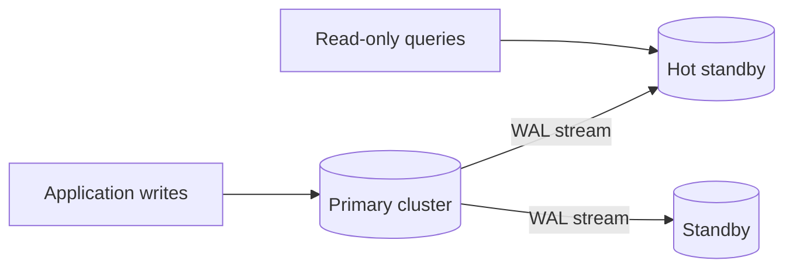

Characteristics:

- the standby represents the whole PostgreSQL cluster, not a selected table;
- the standby normally replays the primary's WAL and is read-only;
- it is suitable for HA, disaster recovery, and read-only workloads;
- it is asynchronous by default;
- failover/promotion and client routing need operational tooling;
- a replication slot can retain required WAL, but an abandoned slot can fill the primary's disk.

Simplified primary settings include `wal_level = replica`, sufficient `max_wal_senders`, authentication in `pg_hba.conf`, and often a physical replication slot. A standby is initialized from a consistent base backup and configured with `primary_conninfo`. This is an administrative procedure, not just a SQL statement.

### 7.3 Synchronous physical replication

`synchronous_standby_names` identifies standbys whose acknowledgment may be required. `synchronous_commit` controls what a transaction waits for.

Conceptually:

```text
asynchronous: client success <- primary local commit
synchronous:  client success <- primary + configured standby stage
```

If a required synchronous standby is unreachable, commits may wait. This is the CAP/durability trade-off appearing as a PostgreSQL configuration decision.

### 7.4 Monitor physical replication

On the primary:

```sql
SELECT application_name,
       client_addr,
       state,
       sync_state,
       sent_lsn,
       write_lsn,
       flush_lsn,
       replay_lsn,
       pg_size_pretty(pg_wal_lsn_diff(sent_lsn, replay_lsn)) AS replay_gap
FROM pg_stat_replication;
```

The log positions show pipeline stages. Monitoring must also alert on missing expected replicas and old replication slots.

### 7.5 Logical replication

Logical replication decodes row-level changes and uses a publish/subscribe model. It can select tables and cross major versions/platforms because the subscriber applies logical changes rather than reproducing the exact storage blocks.

```mermaid
sequenceDiagram
    participant A as Application
    participant P as Publisher
    participant W as WAL and logical slot
    participant S as Subscriber
    A->>P: commit row change
    P->>W: append WAL
    S->>W: request publication changes
    W-->>S: decoded INSERT/UPDATE/DELETE
    S->>S: apply to compatible table
    S-->>W: acknowledge log position
```

Publisher:

```sql
-- Required server configuration includes wal_level = logical.
CREATE TABLE public.orders (
    order_id bigint PRIMARY KEY,
    customer_id bigint NOT NULL,
    status text NOT NULL,
    total numeric(12,2) NOT NULL
);

CREATE PUBLICATION orders_publication
FOR TABLE public.orders
WITH (publish = 'insert, update, delete, truncate');
```

Subscriber (the compatible table must already exist):

```sql
CREATE TABLE public.orders (
    order_id bigint PRIMARY KEY,
    customer_id bigint NOT NULL,
    status text NOT NULL,
    total numeric(12,2) NOT NULL
);

CREATE SUBSCRIPTION orders_subscription
CONNECTION 'host=publisher.example dbname=shop user=replicator sslmode=verify-full'
PUBLICATION orders_publication;
```

Do not paste secrets into shared scripts or shell history. Production connections should use managed credentials and verified TLS.

Typical startup behavior:

1. subscriber creates/uses a replication slot;
2. existing rows are copied from a consistent snapshot;
3. changes that occur during the copy are retained;
4. subscriber applies subsequent changes continuously.

### 7.6 Replica identity

To apply `UPDATE` or `DELETE`, the subscriber needs to identify the old row. A primary key is normally the replica identity.

```sql
ALTER TABLE orders REPLICA IDENTITY USING INDEX orders_pkey;
```

`REPLICA IDENTITY FULL` can use old values of all columns but is often more expensive and has type/index limitations. Prefer a suitable key.

### 7.7 Logical replication does not replicate everything

Important PostgreSQL 18 restrictions include:

- DDL and schema changes are not automatically replicated;
- sequences are not replicated as sequence state;
- tables must exist compatibly on the subscriber;
- large objects are not replicated;
- views, materialized views, and foreign tables are not publication targets;
- conflicts can stop/apply-error if something else writes incompatible rows on the subscriber;
- slots retain WAL until consumers acknowledge it.

For a schema change, a common safe pattern is: add compatible structure to subscribers first, update the publisher/application, wait for convergence, then remove obsolete structure later.

### 7.8 Monitor logical replication

Subscriber:

```sql
SELECT subname, pid, received_lsn, latest_end_lsn, latest_end_time
FROM pg_stat_subscription;
```

Publisher:

```sql
SELECT slot_name, slot_type, active, restart_lsn,
       pg_size_pretty(pg_wal_lsn_diff(pg_current_wal_lsn(), restart_lsn)) AS retained_wal
FROM pg_replication_slots;
```

An inactive slot with increasing retained WAL is an operational emergency waiting to happen.

### 7.9 Physical versus logical PostgreSQL replication

| Question | Physical streaming | Logical publication/subscription |
| --- | --- | --- |
| Unit copied | Whole cluster storage changes | Selected tables/rows/columns depending on publication features |
| Destination | Physical standby | Writable PostgreSQL database applying changes |
| Typical use | HA, read replica, DR | CDC, selective copy, upgrades, consolidation |
| Cross-major-version | Generally not as a normal standby | Supported use case with compatibility planning |
| DDL copied | Storage replay keeps standby physically matching | No; manage schema separately |
| Sequence state | Physical state follows cluster | Not logically replicated |
| Subscriber writes | Standby is read-only | Technically writable, but conflicts are your responsibility |

```mermaid
flowchart LR
    WAL["PostgreSQL WAL"] --> PHYS["Physical decoding/replay"]
    WAL --> LOG["Logical decoding"]
    PHYS --> STBY[("Whole-cluster standby")]
    LOG --> PUB["Selected publication"]
    PUB --> SUB[("Subscriber tables")]
    STBY --> HA["HA, DR, read-only scale"]
    SUB --> CDC["CDC, selective copy, upgrades"]
```

---

## 8. Sharding PostgreSQL

### 8.1 The honest boundary

Core PostgreSQL has excellent local table partitioning, replication, and foreign-data access. It does **not** turn a partitioned table into an automatically balanced, transparent multi-primary sharded cluster merely because `PARTITION BY` was used.

Ways to shard PostgreSQL include:

1. application-managed independent PostgreSQL databases;
2. `postgres_fdw` foreign tables, optionally used as partitions;
3. a distributed PostgreSQL extension/platform such as Citus;
4. a PostgreSQL-compatible distributed database with its own architecture.

Each has different transaction, failover, query-pushdown, rebalancing, and operational behavior.

```mermaid
flowchart TD
    PG["Need to shard PostgreSQL data"] --> APP["Application-managed databases"]
    PG --> FDW["postgres_fdw coordinator"]
    PG --> EXT["Distributed extension such as Citus"]
    PG --> COMP["PostgreSQL-compatible distributed DB"]
    APP --> OWN1["Application owns routing and migration"]
    FDW --> OWN2["Foreign tables expose remote shards"]
    EXT --> OWN3["Extension owns shard metadata/execution"]
    COMP --> OWN4["Different engine owns consensus/distribution"]
```

### 8.2 Application-level sharding

```java
int shardFor(long customerId, int shardCount) {
    return Math.floorMod(Long.hashCode(customerId), shardCount);
}
```

This simple function is deterministic, but changing `shardCount` remaps most customers. A production router needs a versioned placement map or a migration strategy. It must also route every related table consistently and handle retries without duplicate effects.

Example placement table:

```sql
CREATE TABLE shard_directory (
    tenant_id bigint PRIMARY KEY,
    shard_name text NOT NULL,
    placement_version bigint NOT NULL
);
```

The directory solves flexible placement but becomes critical metadata that must itself be highly available and strongly consistent.

### 8.3 `postgres_fdw` concept

A coordinator PostgreSQL instance can expose remote PostgreSQL tables as foreign tables.

```sql
CREATE EXTENSION postgres_fdw;

CREATE SERVER shard_eu
FOREIGN DATA WRAPPER postgres_fdw
OPTIONS (host 'eu-db.internal', dbname 'shop', port '5432');

CREATE USER MAPPING FOR app_user
SERVER shard_eu
OPTIONS (user 'fdw_app');

CREATE FOREIGN TABLE orders_eu (
    region text NOT NULL,
    order_id bigint NOT NULL,
    total numeric(12,2) NOT NULL
)
SERVER shard_eu
OPTIONS (schema_name 'public', table_name 'orders');
```

Credentials should use appropriate secure mechanisms; do not treat the example as production credential management.

Foreign tables can provide a unified SQL surface and push some filters/joins to a remote server. They do not erase network latency, partial failure, remote transaction costs, or the need to verify query pushdown with `EXPLAIN VERBOSE`.

### 8.4 Distributed extensions

Citus, for example, adds coordinator/worker metadata, distributed tables, colocated shards, query routing, and distributed execution to PostgreSQL. The shard key remains an architectural choice. Colocating rows that join or transact together is central to good performance.

Do not assume that “PostgreSQL compatible” means identical behavior to one PostgreSQL server. Check supported SQL, isolation, foreign keys, extension support, backup, rebalancing, and failure semantics for the chosen system/version.

---

## 9. A complete design example

An IoT company ingests measurements from 20 million devices.

Requirements:

- writes scale beyond one server;
- most queries select one customer and a time interval;
- retain raw data for 13 months;
- tolerate one node failure without losing acknowledged measurements;
- global fleet reports may complete later.

Possible design:

1. shard by `customer_id` hash so customer-local queries route to one shard;
2. range-partition each shard by month for pruning and retention;
3. replicate each shard to two other failure domains;
4. require a quorum/synchronous acknowledgment appropriate to the no-loss target;
5. run global reports as scatter–gather or export to an analytical store;
6. pre-create future monthly partitions;
7. monitor hot customers, replica lag, WAL retention, and cross-shard requests.

```mermaid
flowchart TB
    I[Measurement with customer_id and time] --> R{Hash customer_id}
    R --> A[Shard A]
    R --> B[Shard B]
    R --> C[Shard C]
    A --> A1[Monthly partitions]
    A --> AR[Shard A replica]
    B --> B1[Monthly partitions]
    B --> BR[Shard B replica]
    C --> C1[Monthly partitions]
    C --> CR[Shard C replica]
```

This design uses all three ideas for independent reasons.

---

## 10. Failure thought experiments

### Primary fails before asynchronous replica receives a commit

The client saw success, but the promoted replica lacks the transaction. This is a possible recovery point objective (RPO) violation. More replicas do not prevent it unless acknowledgment waits for the required replicas.

### Subscriber is offline while a logical replication slot remains

The publisher retains WAL needed by the subscriber. Disk usage grows. The right response is not blindly deleting the slot; first decide whether the subscriber will be recovered, recreated, or intentionally abandoned.

### A query omits the shard key

The router broadcasts it to all shards. One slow shard determines tail latency, and partial failures complicate whether to return partial results or fail the query.

### A new month has no PostgreSQL partition

Without a default partition, inserts fail. With one, inserts succeed in the default but pruning/maintenance intent may be violated. Automate partition creation and alert on default-partition rows.

### Two regions accept the same unique username

Local unique indexes both succeed. Reconciliation cannot satisfy both users. Strict global uniqueness needs coordinated ownership or consensus on that namespace.

```mermaid
flowchart TB
    F["Distributed failure or omission"] --> A["Async primary loss: acknowledged tail missing"]
    F --> B["Offline logical slot: WAL disk growth"]
    F --> C["Missing shard key: scatter-gather"]
    F --> D["Missing month partition: insert failure/default leak"]
    F --> E["Local uniqueness: global duplicate"]
    A --> CONTRACT["Define and test the contract"]
    B --> CONTRACT
    C --> CONTRACT
    D --> CONTRACT
    E --> CONTRACT
```

---

## 11. Classroom exercises

### Exercise A — Name the mechanism

1. Copy every order to a standby: **replication**.
2. Put January and February in different child tables on one server: **partitioning**.
3. Put customers 1–1,000,000 on server A and the rest on server B: **sharding**.
4. Give each of those servers a standby: **sharding plus replication**.
5. Put private customer columns in a separate table: **vertical partitioning**.

### Exercise B — Choose a key

For a chat system, compare sharding by `message_id`, `conversation_id`, and `created_at`. Which key keeps sending/loading one conversation local? Which produces a current-time hotspot? Which makes a conversation query scatter across shards?

Suggested answer: `conversation_id` usually provides locality; `created_at` hotspots; random/message-ID sharding can scatter one conversation.

### Exercise C — PostgreSQL plan inspection

Create three monthly partitions, insert rows, and run `EXPLAIN` for:

1. a direct time range;
2. a query without time;
3. a predicate that applies a function to the partition key.

Record which partitions appear and explain why.

### Exercise D — Replication contract

Write a one-sentence contract for each workload:

- chat typing indicator;
- payment ledger;
- analytics replica;
- disaster-recovery standby.

State acceptable data loss, read staleness, write delay, and failover time. Only then choose synchronous/asynchronous and physical/logical replication.

### Exercise E — Diagnose the false claims

- “We have three replicas, so no acknowledged writes can be lost.”
- “The table has 12 partitions, so it uses 12 servers.”
- “A read replica is a backup.”
- “Hash sharding guarantees no hot shard.”
- “Logical replication will apply my `ALTER TABLE`.”

All five are false for the reasons explained in this lecture.

---

## 12. Summary

- Partitioning divides data; replication copies data; sharding distributes row subsets across independent nodes.
- Range, list, hash, and directory placement solve different routing and maintenance problems.
- Replication improves redundancy and can scale reads, but introduces lag, failover, and acknowledgment choices.
- Sharding raises write/storage capacity but makes routing, joins, transactions, uniqueness, and rebalancing harder.
- PostgreSQL declarative partitioning is local unless foreign/distributed mechanisms are added.
- PostgreSQL physical streaming replication copies the cluster's WAL-level state and is commonly used for HA/read replicas.
- PostgreSQL logical replication selectively publishes table changes, but does not automatically replicate DDL or sequence state.
- A sound design often combines monthly table partitions, customer-based shards, and replicas for every shard.

## Further reading

- [PostgreSQL 18: declarative table partitioning](https://www.postgresql.org/docs/current/ddl-partitioning.html)
- [PostgreSQL 18: high availability, load balancing, and replication](https://www.postgresql.org/docs/current/high-availability.html)
- [PostgreSQL 18: streaming and synchronous replication](https://www.postgresql.org/docs/current/warm-standby.html)
- [PostgreSQL 18: logical replication](https://www.postgresql.org/docs/current/logical-replication.html)
- [PostgreSQL 18: logical replication restrictions](https://www.postgresql.org/docs/current/logical-replication-restrictions.html)
- [PostgreSQL 18: `postgres_fdw`](https://www.postgresql.org/docs/current/postgres-fdw.html)

Continue with the companion [PostgreSQL partitioning and logical-replication lab](hadoop_lab2_postgres.md), which creates a partitioned 50 MiB table, observes pruning/parallel query, and replicates changes into a subscriber database.
