# Lecture 3 — Publish/subscribe, Redis Pub/Sub, and event-driven applications

## Purpose of this lecture

This lecture explains the publish/subscribe communication pattern, demonstrates it with Redis, and shows when it is—and is not—the correct tool.

By the end, you should be able to:

- identify publishers, subscribers, channels, messages, and the broker;
- distinguish pub/sub from queues, request/response, logs, and database replication;
- run Redis Pub/Sub from the command line and Java;
- explain at-most-once delivery and design for disconnects;
- choose between Redis Pub/Sub and Redis Streams;
- apply pub/sub to chat, live dashboards, invalidation, and service notifications.

---

## 1. The newspaper analogy

A newspaper author does not personally phone every reader. The author publishes an article under a topic such as `sports`. Readers subscribe to topics they care about. A distribution system connects them.

In software:

- a **publisher** produces a message;
- a **channel/topic** categorizes it;
- a **subscriber** registers interest;
- a **broker** receives publications and routes them;
- the **message payload** contains the event data.

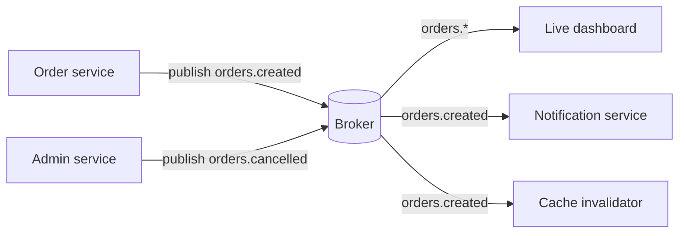

The publisher knows the channel but does not need the network address or implementation of every subscriber. Subscribers know the channel but do not need to know which publisher instance produced each message. This is **decoupling**.

### 1.1 What is decoupled?

Pub/sub can decouple participants in several dimensions:

| Dimension | Meaning |
| --- | --- |
| Identity | Publisher does not call a specific consumer. |
| Topology | Subscribers may be added without changing publisher code. |
| Time | Only durable pub/sub systems decouple online times; Redis Pub/Sub does **not**. |
| Scale | One message can fan out to many subscribers. |
| Deployment | Producers and consumers can be separate processes/services. |

The time row is essential. Redis Pub/Sub subscribers must be connected at publication time. “Decoupled” does not automatically mean “stored for later”.

---

## 2. Events, commands, and state

### 2.1 Event

An event states something that already happened.

```json
{
  "event_id": "01K...",
  "type": "order.created",
  "occurred_at": "2026-10-29T09:15:00Z",
  "order_id": 4815,
  "customer_id": 42,
  "schema_version": 1
}
```

Good event names are usually past tense: `order.created`, `payment.authorized`, `user.logged_in`.

### 2.2 Command

A command asks a particular capability to do something: `send_receipt`, `reserve_inventory`, `close_account`. Commands normally need ownership, failure reporting, retries, and often exactly one logical outcome. Broadcasting a command to every subscriber can accidentally perform the action multiple times.

### 2.3 State

State is the durable current truth: the order row, account balance, or document. A pub/sub notification is not automatically the state itself. A robust live UI often receives “order 4815 changed” and then fetches authoritative state from a database or cache.

### 2.4 Notification versus event-carried state transfer

- **Thin notification:** contains an ID and change type. Small and less likely to leak data, but consumers must fetch state.
- **Rich event:** contains enough data for consumers to update their own views. Fewer callbacks, but more schema/privacy/versioning responsibility.

Choose intentionally; do not gradually turn an undocumented string into a critical cross-service contract.

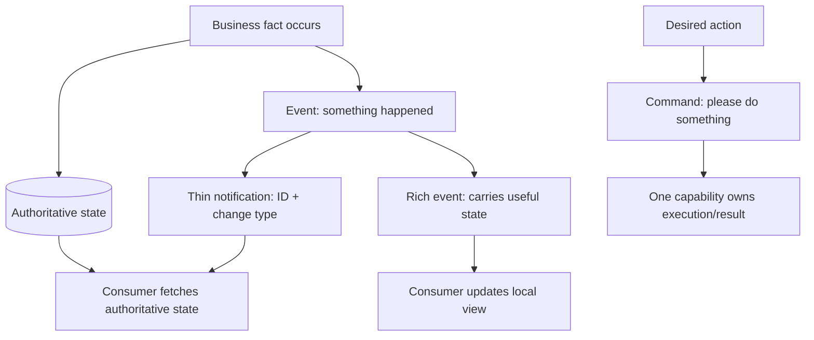

---

## 3. Pub/sub compared with neighboring patterns

### 3.1 Request/response

```text
client -> “give me order 4815” -> server
client <- order or error       <- server
```

The caller waits for one answer and knows the destination capability. Use it when an immediate result determines the next step.

### 3.2 Work queue

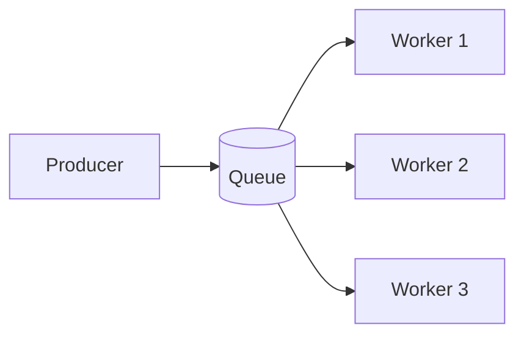

Competing workers normally divide jobs: one job is handled by one worker. Acknowledgment and retry are common. Use it to distribute background work such as image resizing.

### 3.3 Publish/subscribe fan-out

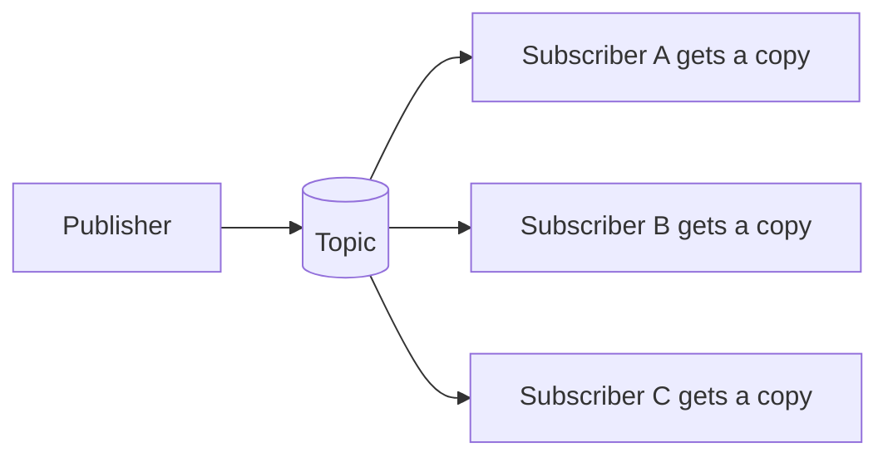

Every active interested subscriber gets the message. Use it to broadcast live information.

### 3.4 Durable log/stream

Messages are appended with positions/IDs and retained. Consumers track progress and can replay old messages. Consumer groups can combine pub/sub fan-out between groups with work sharing inside a group.

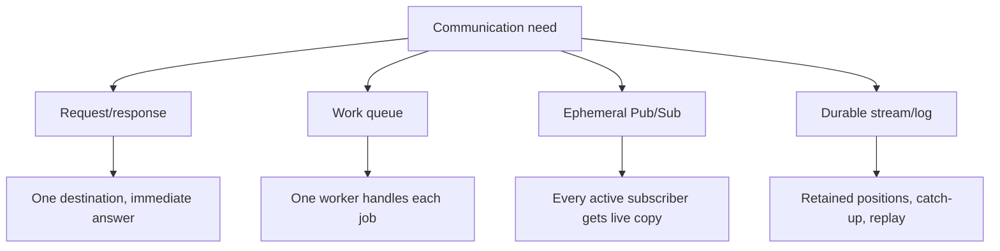

### 3.5 Comparison

| Question | Request/response | Work queue | Ephemeral pub/sub | Durable stream/log |
| --- | --- | --- | --- | --- |
| Who receives one message? | One addressed service | Usually one worker | Every active matching subscriber | Every group; one/more consumer rules within group |
| Stored when consumer is offline? | Not applicable | Usually yes | No in Redis Pub/Sub | Yes, subject to retention |
| Replay? | No | Limited/product-specific | No | Yes |
| Caller waits for result? | Usually | Usually no | No | No |
| Typical use | Query/command | Background job | Live fan-out | Audit/event pipeline/integration |

---

## 4. Delivery guarantees

### 4.1 At-most-once

A message is delivered zero or one time to a subscriber. There is no retry after a disconnect or processing failure. Redis Pub/Sub has **at-most-once** delivery.

This is appropriate when the next update will supersede the lost one or the consumer can re-read current state. Examples: typing indicators, transient presence, live metrics refresh signals.

### 4.2 At-least-once

The system retries until acknowledged, so a message may be delivered more than once. Consumers must be idempotent or deduplicate.

### 4.3 Exactly-once: specify the boundary

Exactly-once network delivery is usually not the useful business requirement. If a consumer completes work and crashes before acknowledging, the broker cannot know whether retrying duplicates the effect.

Ask instead: “Can we ensure one logical business effect?” Techniques include:

- unique `event_id` and a processed-events table;
- idempotency keys;
- database uniqueness constraints;
- transactional consumption/production where supported;
- commutative updates;
- inbox/outbox patterns.

```sql
BEGIN;

INSERT INTO processed_event(event_id)
VALUES ('01K...')
ON CONFLICT DO NOTHING;

-- Only perform the effect if the insert actually inserted a row.

COMMIT;
```

### 4.4 Ordering

Ordering must be scoped: per publisher connection, channel, key, partition, consumer, or globally. A single Redis server sends subscribers messages in publication order, but applications with several publishers should not infer a business causal order from wall-clock arrival alone.

If order matters for one aggregate, include an aggregate version:

```json
{
  "type": "order.status_changed",
  "order_id": 4815,
  "order_version": 7,
  "status": "SHIPPED"
}
```

The consumer can detect an old or missing version and reload authoritative state.

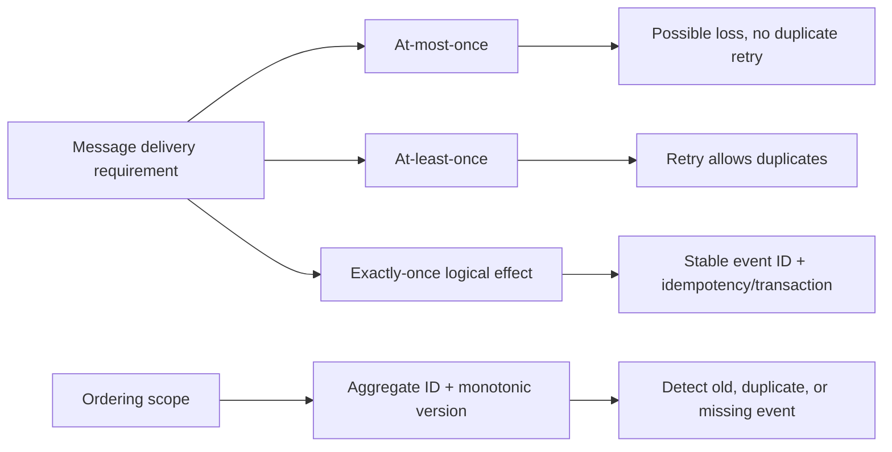

---

## 5. Redis Pub/Sub mental model

Redis implements the basic pattern with:

- `PUBLISH channel message`
- `SUBSCRIBE channel [channel ...]`
- `PSUBSCRIBE pattern [pattern ...]`
- `UNSUBSCRIBE` / `PUNSUBSCRIBE`
- `PUBSUB ...` introspection commands

Redis does not store ordinary Pub/Sub messages. Channels are routing names, not keys. If no subscriber is listening, the message disappears. If a subscriber disconnects, messages sent while it is away are lost.

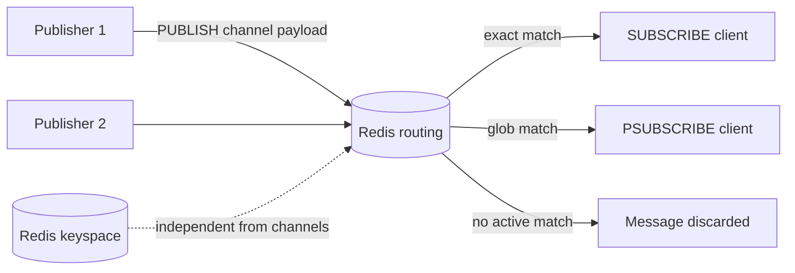

### 5.1 Important guarantees and non-guarantees

| Property | Redis Pub/Sub behavior |
| --- | --- |
| Fan-out | All currently connected matching subscribers receive the publication. |
| Delivery | At-most-once. |
| Persistence | None for Pub/Sub messages. |
| Replay | None. |
| Offline subscriber | Misses messages. |
| Exact channel | `SUBSCRIBE`. |
| Glob pattern | `PSUBSCRIBE`, such as `orders.*`. |
| Duplicate route | One publication can be received more than once if both an exact and pattern subscription match. |
| Database number scoping | None; Pub/Sub is independent of Redis keyspace database numbers. |
| Slow subscriber | Output buffer can grow; Redis disconnects clients that exceed configured limits. |

The integer returned by `PUBLISH` is an observation of current delivery targets, not a durable acknowledgment that their application logic succeeded.

### 5.2 Channel naming

A useful convention is:

```text
environment:domain:entity:event[:scope]
```

Examples:

```text
prod:orders:order:created
prod:chat:room:message:room-128
staging:cache:product:invalidated
```

Redis database numbers do not isolate Pub/Sub. Prefixing environment/tenant scope prevents accidental name collisions, but it is not a substitute for authentication and authorization.

Do not put passwords, tokens, or private customer data in channel names; channel names can appear in metrics and diagnostics.

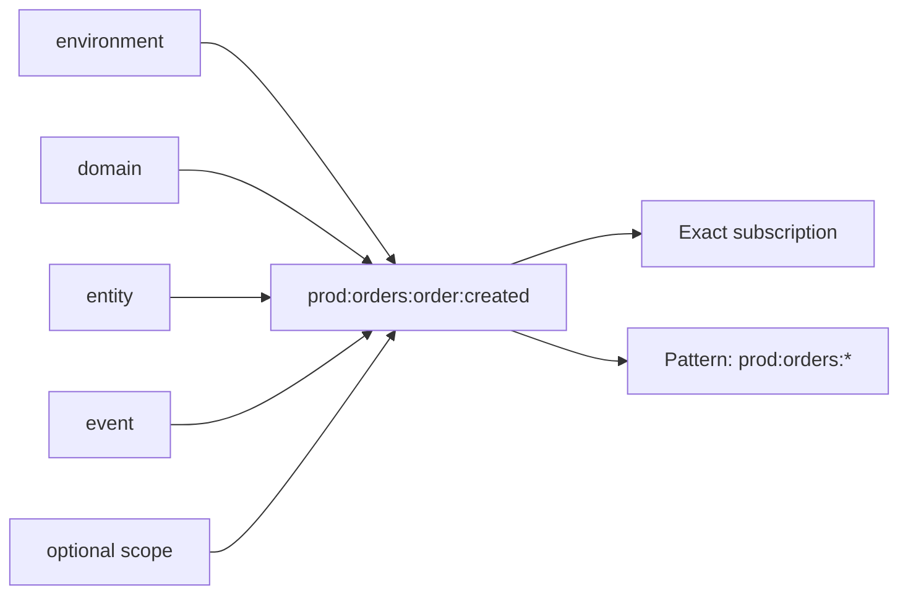

---

## 6. Command-line demonstration

### 6.1 Start a local Redis for learning

If Redis is already provided by the instructor, use that address. Otherwise, one local option is Docker:

```bash
docker run --name redis-pubsub-lab --rm -p 127.0.0.1:6379:6379 redis:8-alpine
```

Binding to `127.0.0.1` avoids exposing an unauthenticated classroom instance to the network. Production Redis must use authentication, network controls, TLS where appropriate, persistence/HA choices, monitoring, and a pinned tested image version.

Open three terminals.

### 6.2 Terminal A: exact subscriber

```bash
redis-cli SUBSCRIBE demo:orders:created
```

The command blocks and waits for pushed messages. `redis-cli` in subscribed mode is not an ordinary interactive command session; use another terminal to publish and `Ctrl-C` to exit.

### 6.3 Terminal B: pattern subscriber

```bash
redis-cli PSUBSCRIBE 'demo:orders:*'
```

The quotes prevent your shell from expanding `*` as a filename wildcard.

### 6.4 Terminal C: publisher

```bash
redis-cli PUBLISH demo:orders:created '{"event_id":"evt-1","order_id":4815}'
redis-cli PUBLISH demo:orders:cancelled '{"event_id":"evt-2","order_id":4816}'
```

Expected:

- Terminal A receives only `created`.
- Terminal B receives both.
- `PUBLISH` returns a count of matching active subscriptions/clients according to Redis command semantics, but this is not processing confirmation.

### 6.5 Prove loss while offline

1. Stop Terminal A with `Ctrl-C`.
2. Publish `evt-3` to `demo:orders:created`.
3. Start Terminal A again.

It will not receive `evt-3`. There is no history to replay.

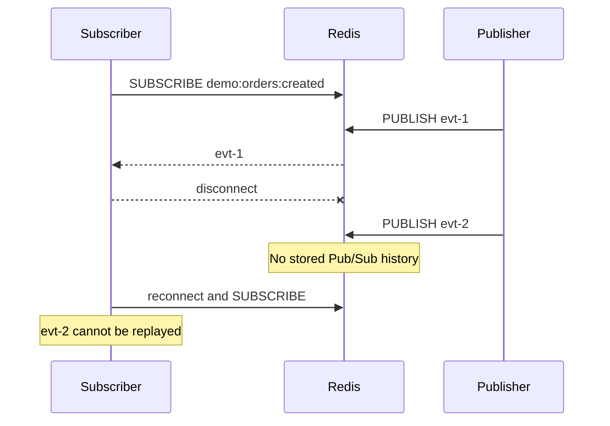

### 6.6 Introspection

From an ordinary client:

```bash
redis-cli PUBSUB CHANNELS 'demo:*'
redis-cli PUBSUB NUMSUB demo:orders:created demo:orders:cancelled
redis-cli PUBSUB NUMPAT
```

These commands help observe subscriptions. They do not prove end-to-end processing success.

---

## 7. Redis Pub/Sub from Java with Jedis

The following uses Jedis 8.0.2, the current stable release used when this lecture was prepared. Pin and test a compatible version in a real project rather than silently floating to any newest dependency.

### 7.1 Maven dependency

```xml
<dependency>
    <groupId>redis.clients</groupId>
    <artifactId>jedis</artifactId>
    <version>8.0.2</version>
</dependency>
```

### 7.2 Subscriber

```java
import redis.clients.jedis.Jedis;
import redis.clients.jedis.JedisPubSub;

public final class OrderSubscriber {
    public static void main(String[] args) {
        String host = System.getenv().getOrDefault("REDIS_HOST", "127.0.0.1");
        int port = Integer.parseInt(
                System.getenv().getOrDefault("REDIS_PORT", "6379"));

        JedisPubSub listener = new JedisPubSub() {
            @Override
            public void onMessage(String channel, String message) {
                System.out.printf("channel=%s message=%s%n", channel, message);

                // Keep this callback fast. Hand expensive work to a bounded
                // executor, or the subscriber may fall behind.
            }

            @Override
            public void onSubscribe(String channel, int subscribedChannels) {
                System.out.printf("subscribed=%s total=%d%n",
                        channel, subscribedChannels);
            }
        };

        try (Jedis jedis = new Jedis(host, port)) {
            // subscribe() blocks until unsubscribed or disconnected.
            jedis.subscribe(listener, "demo:orders:created");
        }
    }
}
```

A subscription owns a long-lived connection. Do not borrow one pooled connection, call blocking `subscribe`, and expect the same connection to perform ordinary commands concurrently under a RESP2-style design. Use a dedicated subscriber connection/thread and separate publishing connections.

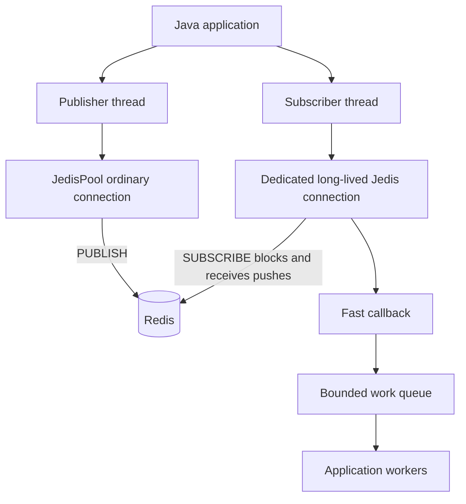

### 7.3 Publisher

```java
import redis.clients.jedis.Jedis;
import redis.clients.jedis.JedisPool;

public final class OrderPublisher {
    public static void main(String[] args) {
        String host = System.getenv().getOrDefault("REDIS_HOST", "127.0.0.1");
        int port = Integer.parseInt(
                System.getenv().getOrDefault("REDIS_PORT", "6379"));

        try (JedisPool pool = new JedisPool(host, port);
             Jedis jedis = pool.getResource()) {

            String message = """
                    {"event_id":"evt-java-1","order_id":4815,
                     "type":"order.created","schema_version":1}
                    """.strip();

            long receivers = jedis.publish("demo:orders:created", message);
            System.out.printf("Redis routed to %d active subscriber(s)%n", receivers);
        }
    }
}
```

For production, configure timeouts, authentication, TLS, reconnection with backoff/jitter, health reporting, bounded processing, and graceful shutdown. A successful `publish` call does not make the message durable.

### 7.4 Pattern subscriber

```java
JedisPubSub listener = new JedisPubSub() {
    @Override
    public void onPMessage(String pattern, String channel, String message) {
        System.out.printf("pattern=%s channel=%s payload=%s%n",
                pattern, channel, message);
    }
};

try (Jedis jedis = new Jedis("127.0.0.1", 6379)) {
    jedis.psubscribe(listener, "demo:orders:*");
}
```

Pattern subscriptions are convenient but may receive high traffic. A broad `*` subscriber can become a bottleneck and a data-exposure risk.

---

## 8. Where Redis Pub/Sub fits well

### 8.1 Live chat delivery

Application instances subscribe to room/user channels and forward messages to connected WebSocket clients. Durable chat history must still be stored elsewhere if users need messages sent while offline.

### 8.2 WebSocket fan-out across application nodes

If Alice's socket is connected to web node A and an update occurs on web node B, Redis can broadcast the update so A forwards it. Pub/Sub connects the in-memory socket registries of multiple nodes.

### 8.3 Cache invalidation

One service changes product 4815 and publishes `cache:product:invalidated` with the ID. Every application instance evicts its local copy.

Because messages can be lost, safe designs also use short TTLs, versions, or revalidation. Pub/Sub makes caches fresher; it should not be the sole correctness mechanism for critical authorization or pricing.

### 8.4 Presence and typing indicators

These are transient and frequently refreshed. If “Alice is typing” is lost, the next update or timeout repairs the display. This is an excellent at-most-once use case.

### 8.5 Live dashboards

Publish refresh signals or metric samples to connected dashboards. Periodic full refresh from authoritative storage repairs missed events.

### 8.6 Configuration refresh notification

Publish “configuration version 83 is available”; consumers fetch version 83 from durable storage. The event is a hint, not the only copy of configuration.

### 8.7 Poor fits

Do not rely on ephemeral Pub/Sub alone for:

- charging a card;
- sending every required invoice;
- an audit trail;
- guaranteed order fulfillment;
- long-running jobs;
- consumers that must catch up after maintenance;
- event sourcing;
- anything requiring replay.

Use a durable queue/log/stream and idempotent consumers for those requirements.

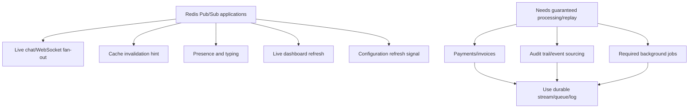

---

## 9. Redis Pub/Sub versus Redis Streams

Redis Streams are append-only log-like data structures with IDs, retention/trimming options, range reads, blocking reads, and consumer groups.

| Requirement | Redis Pub/Sub | Redis Streams |
| --- | --- | --- |
| Lowest-complexity live broadcast | Strong fit | Possible but more machinery |
| Store messages | No | Yes |
| Offline catch-up | No | Yes, while entries are retained |
| Replay from ID | No | Yes |
| Consumer acknowledgment | No | Consumer groups support pending/ack flows |
| Competing consumers | Not naturally | Consumer groups |
| Per-subscriber history | No | Separate consumer/group offsets and reads |
| Operational state | Connections/channels | Stream entries, groups, pending entries, retention |

### 9.1 Minimal Streams contrast

Producer:

```bash
redis-cli XADD demo:orders '*' type order.created order_id 4815 event_id evt-10
```

Read from the beginning:

```bash
redis-cli XRANGE demo:orders - +
```

Block waiting for entries newer than the supplied ID:

```bash
redis-cli XREAD BLOCK 10000 STREAMS demo:orders '$'
```

The syntax and lifecycle are more involved because Redis is now retaining state. That complexity buys recovery and replay.

### 9.2 Decision rule

Ask one question first:

> If the consumer is disconnected for one minute, must it later process the messages sent during that minute?

- **No:** Pub/Sub may be ideal.
- **Yes:** use Streams or another durable broker/log.

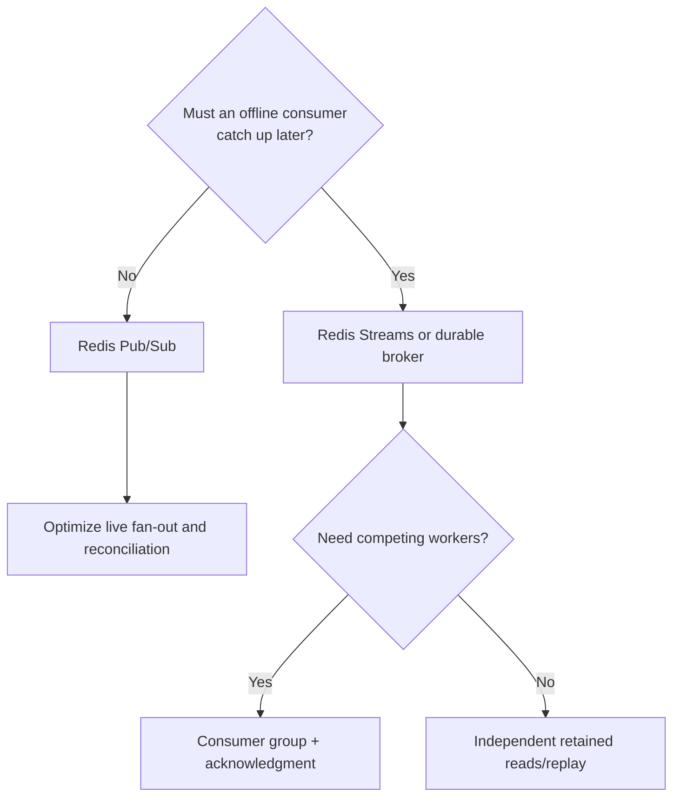

---

## 10. Reliable database changes: the dual-write problem

Suppose an application does this:

1. commit an order to PostgreSQL;
2. publish `order.created` to Redis.

It can crash between the two actions. The order exists but no event is published. Reversing the order creates the opposite failure: an event may describe an order that never commits.

### 10.1 Transactional outbox

Write the business row and an outbox row in one database transaction.

```sql
BEGIN;

INSERT INTO orders(order_id, customer_id, status)
VALUES (4815, 42, 'CREATED');

INSERT INTO outbox(event_id, topic, aggregate_id, payload, created_at)
VALUES (
    'evt-4815-created',
    'orders.created',
    '4815',
    '{"order_id":4815,"customer_id":42,"schema_version":1}',
    clock_timestamp()
);

COMMIT;
```

A relay polls or captures outbox changes and publishes them. The relay marks progress only after publication according to its protocol.

The outbox solves atomic creation of business state plus the intention to publish. It does **not** turn Redis Pub/Sub into durable subscriber delivery. If every consumer must process the event, relay into a durable stream/broker or let consumers read a durable change log.

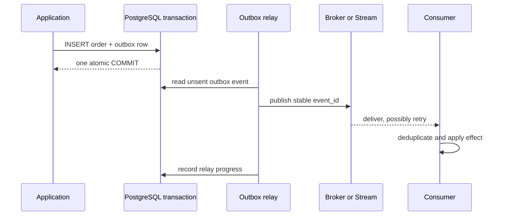

### 10.2 Idempotency remains necessary

The relay can publish twice if it crashes after publishing but before marking the row sent. Every event needs a stable `event_id`, and durable consumers should deduplicate effects.

---

## 11. Schema and contract design

### 11.1 Recommended envelope

```json
{
  "event_id": "globally-unique-stable-id",
  "type": "order.created",
  "schema_version": 1,
  "occurred_at": "2026-10-29T09:15:00Z",
  "producer": "order-service",
  "trace_id": "trace-...",
  "aggregate_id": "4815",
  "aggregate_version": 1,
  "data": {
    "customer_id": 42,
    "total": "19.95",
    "currency": "GEL"
  }
}
```

Why these fields matter:

- `event_id`: deduplication and investigation;
- `type`: dispatch;
- `schema_version`: controlled evolution;
- `occurred_at`: business time, not guaranteed delivery order;
- `producer`: ownership;
- `trace_id`: cross-service observability;
- aggregate ID/version: ordering and stale-event detection;
- `data`: typed event-specific payload.

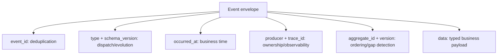

### 11.2 Evolution rules

Prefer additive compatible changes:

- consumers ignore unknown fields;
- producers do not silently change field meaning/type;
- required-field removal uses a migration/version plan;
- schemas and examples live in version control;
- personally identifiable information is minimized;
- large blobs live in object storage with authorized references, not channel payloads.

---

## 12. Backpressure and slow consumers

Redis pushes publications to subscribers. If a subscriber reads more slowly than messages arrive, its server-side output buffer grows. Redis has Pub/Sub output-buffer limits and closes a client that exceeds them to protect the server.

Therefore:

- callbacks should be quick;
- hand work to a **bounded** executor/queue;
- define what happens when the local queue is full;
- monitor disconnect/reconnect rates;
- do not use an unbounded in-memory queue;
- choose Streams/queues if consumers genuinely need backpressure and catch-up.

Dropping, sampling, coalescing, or reloading current state can be correct for live UI signals. It is not correct for payments or required jobs.

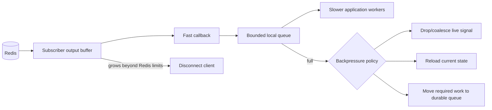

---

## 13. Redis Cluster and sharded Pub/Sub

Traditional Redis Cluster Pub/Sub propagates publications cluster-wide, which can create cluster-bus traffic. Redis 7 introduced **sharded Pub/Sub**:

- `SSUBSCRIBE shard-channel`
- `SPUBLISH shard-channel message`
- `SUNSUBSCRIBE`

The channel hashes to a Redis Cluster slot. Propagation is restricted to the owning shard and its replicas, improving horizontal scalability compared with sending every publication across the whole cluster.

Example:

```bash
redis-cli -c SSUBSCRIBE 'room:{128}:events'
redis-cli -c SPUBLISH 'room:{128}:events' '{"type":"typing","user_id":42}'
```

Hash tags inside `{...}` control the slot calculation. Sharded Pub/Sub changes routing scale; it does not add persistence, replay, or at-least-once delivery.

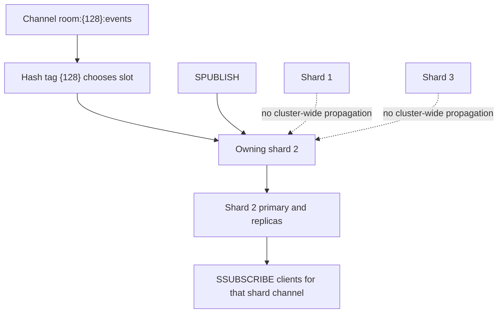

Cluster clients must follow redirections/topology and reconnect/resubscribe correctly after failover. Test the exact client and deployment mode.

---

## 14. Keyspace notifications

Redis can publish events when keys are changed, expired, or evicted. They are disabled by default because they cost CPU and must be configured.

Learning example:

```bash
redis-cli CONFIG SET notify-keyspace-events KEA
redis-cli PSUBSCRIBE '__keyevent@0__:*'
```

In another terminal:

```bash
redis-cli SET demo:key value EX 10
redis-cli DEL demo:key
```

Important limitations:

- notifications are fire-and-forget Pub/Sub messages;
- disconnected consumers miss them;
- expiry events occur when Redis actually removes an expired key, not necessarily at the exact TTL instant;
- in Redis Cluster, keyspace notifications are node-specific, so complete observation requires subscribing to every relevant node;
- broad notification settings can create significant traffic.

Use them for observation and cache-style reactions, not as an unquestioned audit log.

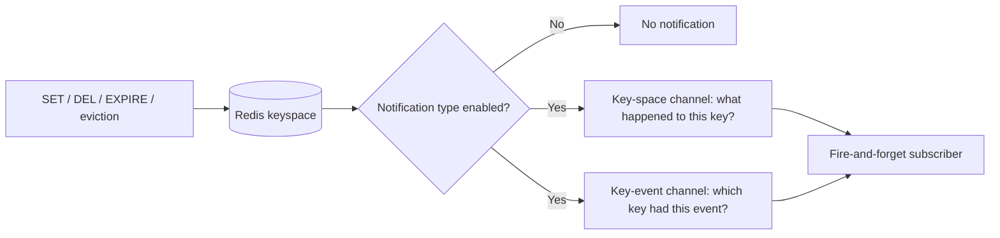

---

## 15. Failure scenarios and recovery designs

### Subscriber restarts

It misses publications during downtime. On startup, load a current snapshot/version and then subscribe. To close the race between snapshot and subscription, use a durable log or application-specific version check.

### Redis restarts or fails over

Connections break. Clients reconnect with exponential backoff plus jitter and resubscribe. Messages during the gap may be lost. Do not pretend reconnection recovers them.

### Publisher retries after timeout

The original publication may or may not have reached Redis. Retrying can duplicate a notification. Payloads should carry stable IDs when duplicates matter.

### Subscriber callback throws

Redis does not redeliver the message. Catch/report errors and decide whether live state can be reloaded or whether the workload belongs on a durable stream.

### Slow subscriber is disconnected

It reconnects but cannot replay missing Pub/Sub messages. Reduce traffic/work, coalesce updates, or switch to durable/backpressured messaging.

### Pattern matches more than expected

The subscriber receives sensitive or high-volume channels. Use narrow names/patterns, separate credentials/instances where necessary, and test pattern expansion.

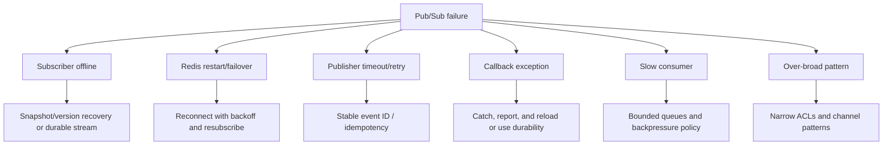

---

## 16. Observability and operations

Measure the whole path, not only `PUBLISH` latency.

Useful signals:

- publications per channel family;
- payload sizes;
- active subscription counts;
- subscriber reconnects and disconnect reasons;
- Redis Pub/Sub client output-buffer usage;
- messages accepted/dropped by each consumer's local queue;
- callback processing time and error count;
- time between `occurred_at` and processing;
- last processed aggregate version;
- periodic snapshot/reconciliation success;
- Redis memory, CPU, network, replication, and failover health.

Trace IDs connect publisher logs to subscriber logs, but at-most-once loss means absence must also be observable through reconciliation or durable state checks.

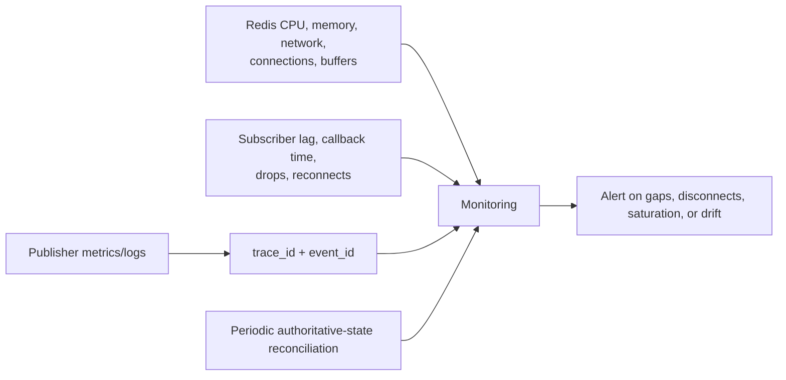

---

## 17. Security

- Use Redis ACLs to limit allowed commands and key/channel patterns where supported by the deployment.
- Restrict network reachability; do not expose Redis directly to the public Internet.
- Use TLS for untrusted networks and verify server identity.
- Keep credentials outside source code and rotate them.
- Treat messages as untrusted input: validate size, type, schema, and authorization context.
- Avoid secrets and unnecessary personal data in channel names/payloads.
- Remember that every matching subscriber receives the message; a broad pattern may cross intended boundaries.
- Rate-limit publishers so one producer cannot exhaust network or subscriber buffers.

Encryption and authentication do not add message persistence or processing guarantees; security and reliability are separate properties.

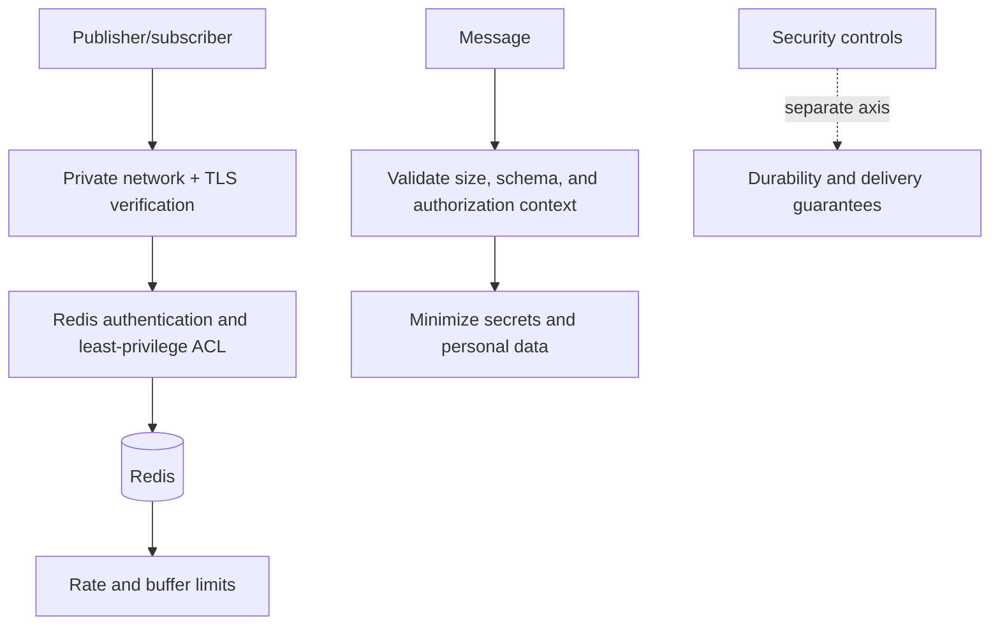

---

## 18. How Pub/Sub relates to the earlier lectures

### Big Data

Pub/sub handles **movement and fan-out**, not historical storage or large-scale analysis by itself. High event velocity may make a single broker/channel insufficient, leading to sharded topics or partitioned durable logs.

### CAP

During a network partition, an application separated from Redis cannot publish or receive through that Redis endpoint. Redis replication/cluster topology determines server-side failover behavior, while ordinary Pub/Sub still does not persist missed messages. An AP database label would not magically give Pub/Sub replay.

### Replication

Redis server replication copies Redis state/commands for availability. Pub/sub copies a live publication to interested clients. Same everyday word “copy”, different purposes and guarantees.

### Sharding

Redis sharded Pub/Sub hashes channels to slots to limit propagation. It improves scale but requires channel-key distribution and still offers ephemeral delivery.

### PostgreSQL logical replication

PostgreSQL calls its interface publication/subscription because the decoupling pattern is similar. But PostgreSQL logical replication uses retained WAL/replication slots and applies durable table changes. It is not equivalent to ephemeral Redis Pub/Sub.

```mermaid
flowchart TB
    BIG["Big Data"] --> MOVE["High-rate movement and fan-out"]
    CAP["CAP"] --> FAIL["Behavior when Redis or network is unreachable"]
    REP["Replication"] --> SERVER["Copies Redis/PostgreSQL server state"]
    SHARD["Sharding"] --> SCALE["Distributes channels or data across nodes"]
    REDIS["Redis Pub/Sub"] --> LIVE["Ephemeral live delivery"]
    PG["PostgreSQL logical replication"] --> WAL["Retained WAL-backed table changes"]
    MOVE --> REDIS
    FAIL --> REDIS
    SERVER --> PG
    SCALE --> REDIS
```

---

## 19. Classroom lab

### Part A — Fan-out

1. Start two exact subscribers to `lab:news:sports`.
2. Publish one message.
3. Confirm both receive it.
4. Stop one, publish again, reconnect it, and prove the missed message is not replayed.

### Part B — Patterns and duplicates

1. Subscribe exactly to `lab:news:sports`.
2. Also subscribe to `lab:news:*` from the same logical consumer/client arrangement.
3. Publish to `lab:news:sports`.
4. Observe that matching both routes can yield two deliveries; application handlers must not assume pattern routes are disjoint.

### Part C — Java

1. Run `OrderSubscriber`.
2. Run `OrderPublisher` twice.
3. Add a second subscriber process.
4. Stop one subscriber and repeat the loss experiment.
5. Modify the payload to include event and aggregate versions.

### Part D — Choose Pub/Sub or Streams

Classify each:

| Requirement | Better starting point |
| --- | --- |
| “User is typing” indicator | Pub/Sub |
| Required invoice generation | Stream/durable queue |
| Cache invalidation plus 30-second TTL | Pub/Sub may be sufficient |
| Audit every account change | Durable database/log, not Pub/Sub alone |
| Live sports score UI with periodic full refresh | Pub/Sub |
| Worker must finish every uploaded-video transcode | Durable queue/stream |

### Part E — Design a resilient dashboard

Design a dashboard that:

- loads a full snapshot over HTTP;
- subscribes to Redis for low-latency refresh hints;
- includes a monotonically increasing version;
- reloads when it detects a version gap;
- periodically refreshes even if no messages arrive.

Explain why the database remains authoritative while Pub/Sub improves freshness.

```mermaid
sequenceDiagram
    participant UI as Dashboard
    participant API as HTTP API
    participant DB as Authoritative database
    participant R as Redis Pub/Sub
    UI->>API: load snapshot
    API->>DB: read state + version 40
    DB-->>API: snapshot v40
    API-->>UI: snapshot v40
    UI->>R: subscribe to refresh hints
    R-->>UI: changed to v42
    Note over UI: v41 missing: detect version gap
    UI->>API: reload authoritative snapshot
    API-->>UI: snapshot v42
```

---

## 20. Review questions with answers

1. **If `PUBLISH` returns 3, did three applications finish processing?** No. It reports routing to active subscribers, not durable or successful application work.

2. **Can a subscriber replay yesterday's Redis Pub/Sub messages?** No. Use a retained Stream/log or another durable store.

3. **Does Redis database 1 have different Pub/Sub channels from database 0?** No. Pub/Sub is not scoped by Redis keyspace database number.

4. **Why does `subscribe()` usually need a dedicated Java connection?** It is a long-lived blocking/push conversation, unlike an ordinary request/response command connection.

5. **What happens if a subscriber is too slow?** Its output buffer grows; Redis can disconnect it at configured limits, and missed Pub/Sub messages cannot be replayed.

6. **Does the transactional outbox make Redis Pub/Sub durable for subscribers?** No. It durably records the publisher's intention; the destination must also be durable if consumers require recovery.

7. **What does sharded Pub/Sub add?** Slot-based propagation limited to a shard, improving cluster scalability; it does not add persistence.

8. **When is at-most-once acceptable?** When loss is tolerable or repaired by the next update/full-state refresh.

---

## 21. Summary

- Pub/sub broadcasts categorized messages without publishers naming individual subscribers.
- Redis Pub/Sub is fast, simple, ephemeral fan-out with at-most-once delivery.
- Offline or disconnected subscribers miss messages permanently.
- `PUBLISH` delivery counts do not confirm business processing.
- Use Redis Pub/Sub for transient live updates, presence, fan-out, and cache-refresh hints.
- Use Redis Streams or another durable broker/log when catch-up, replay, acknowledgment, or required processing matters.
- A dedicated subscriber connection, bounded processing, reconnection, and periodic state reconciliation are essential.
- Stable event IDs, aggregate versions, schema versions, and idempotent effects make event-driven systems diagnosable and safer.
- Sharded Pub/Sub improves cluster routing scale but keeps the same ephemeral reliability model.

## Further reading

- [Redis Pub/Sub commands and delivery semantics](https://redis.io/docs/latest/develop/pubsub/)
- [Redis Pub/Sub use cases](https://redis.io/docs/latest/develop/use-cases/pub-sub/)
- [Redis Pub/Sub with Java/Jedis](https://redis.io/docs/latest/develop/use-cases/pub-sub/java-jedis/)
- [Redis Streams](https://redis.io/docs/latest/develop/data-types/stream/)
- [Redis keyspace notifications](https://redis.io/docs/latest/develop/pubsub/keyspace-notifications/)
- [Redis client output-buffer behavior](https://redis.io/docs/latest/develop/reference/clients/)
- [Jedis releases](https://github.com/redis/jedis/releases)
- [PostgreSQL logical replication](https://www.postgresql.org/docs/current/logical-replication.html)
